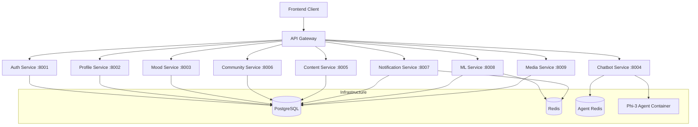
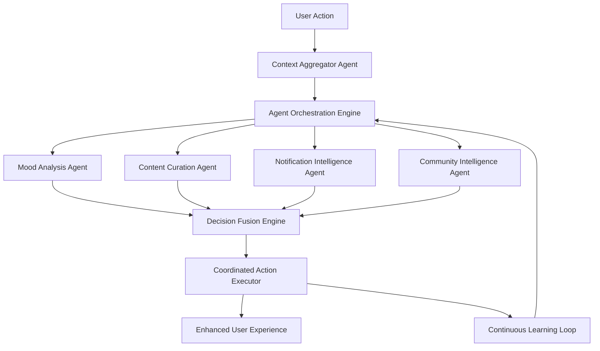

# MantraPath Backend Architecture: Comprehensive Analysis & Agentic Enhancement Strategy

**Document Version:** 2.0  
**Date:** August 4, 2025  
**Analysis Scope:** Complete backend microservices architecture with agentic enhancement roadmap

---

## Executive Summary

MantraPath operates on a sophisticated microservices architecture comprising 10 core services orchestrated through an enhanced API Gateway. The current implementation demonstrates strong Phase 1 completion with selective Phase 2 features. This analysis identifies significant opportunities for agentic (autonomous AI-driven) functionality enhancement across all services.

**Key Findings:**
- ✅ **Architecture Maturity:** Phase 1 complete, Phase 2 partially implemented
- 🚀 **Agentic Readiness:** High potential for AI agent integration across 8/10 services
- 🎯 **Critical Gaps:** Service-to-service AI communication, unified agent orchestration
- 📈 **Enhancement Priority:** ML Service → Chatbot Service → Notification Service

---

## 1. Architecture Overview

### 1.1 Service Ecosystem



### 1.2 Technology Stack

**Core Technologies:**
- **Framework:** FastAPI (Python) across all services
- **Database:** PostgreSQL (primary), Redis (caching/queues)
- **Authentication:** JWT tokens with refresh mechanism
- **Orchestration:** Docker Compose with health checks
- **AI/ML:** Phi-3 Mini (local), OpenAI (backup), custom ML models

**Infrastructure Components:**
- **API Gateway:** Enhanced with request tracking, rate limiting, service discovery
- **Service Discovery:** Environment-based with health monitoring
- **Caching:** Redis with service-specific strategies
- **Real-time Communication:** WebSocket support in Gateway and Notification Service

---

## 2. Service-by-Service Analysis

### 2.1 API Gateway Service (Port 8000)

**Current Implementation:**
- **Basic Version:** Simple request routing and proxying
- **Enhanced Version:** Comprehensive orchestration with advanced features

**Core Features:**
- Service registry with health monitoring
- Request tracking and analytics
- Rate limiting and circuit breakers
- GDPR compliance (user data deletion/export)
- WebSocket endpoint management
- Real-time service health checks

**Agentic Enhancement Opportunities:**

🤖 **HIGH PRIORITY: Intelligent Request Routing**
```python
class AgenticAPIGateway:
    def __init__(self):
        self.routing_agent = IntelligentRoutingAgent()
        self.load_balancer = MLLoadBalancer()
        self.security_agent = SecurityAnalysisAgent()
    
    async def route_request_intelligently(self, request):
        # AI-driven routing based on:
        # - Service health and performance
        # - User behavior patterns
        # - Request complexity analysis
        # - Predicted response times
        routing_decision = await self.routing_agent.analyze_request(request)
        return await self.execute_optimized_routing(routing_decision)
```

🤖 **MEDIUM PRIORITY: Predictive Scaling Agent**
- Monitor service metrics and predict scaling needs
- Automatically adjust service priorities based on user activity
- Intelligent circuit breaker thresholds based on historical data

### 2.2 Auth Service (Port 8001)

**Current Implementation:**
- JWT-based authentication with refresh tokens
- User registration with email verification
- Role-based access control
- Development login endpoint
- Automated cleanup of unverified accounts

**Core Models:**
- User, UserProfile, Role management
- Token validation and refresh
- Password strength validation
- Email verification workflow

**Agentic Enhancement Opportunities:**

🤖 **HIGH PRIORITY: Security Intelligence Agent**
```python
class SecurityIntelligenceAgent:
    def __init__(self):
        self.threat_detector = ThreatDetectionModel()
        self.behavior_analyzer = UserBehaviorAnalyzer()
        self.risk_assessor = RiskAssessmentEngine()
    
    async def analyze_login_attempt(self, user_data, context):
        # AI-driven security analysis:
        # - Behavioral pattern analysis
        # - Geolocation anomaly detection
        # - Device fingerprinting
        # - Real-time threat assessment
        risk_score = await self.risk_assessor.evaluate(user_data, context)
        return await self.determine_authentication_flow(risk_score)
```

🤖 **MEDIUM PRIORITY: Adaptive Authentication Agent**
- Dynamic MFA requirements based on risk assessment
- Intelligent session management with behavior-based timeouts
- Personalized security recommendations

### 2.3 Profile Service (Port 8002)

**Current Implementation:**
- User profile management with preferences
- Privacy settings and theme preferences
- Profile search and discovery
- Redis caching for performance
- Profile completion statistics

**Core Features:**
- Profile CRUD operations
- Notification preferences
- Privacy level management
- Profile search functionality

**Agentic Enhancement Opportunities:**

🤖 **HIGH PRIORITY: Profile Intelligence Agent**
```python
class ProfileIntelligenceAgent:
    def __init__(self):
        self.preference_predictor = PreferenceMLModel()
        self.privacy_advisor = PrivacyAdvisorAgent()
        self.wellness_profiler = WellnessProfileAnalyzer()
    
    async def enhance_profile_automatically(self, user_id):
        # AI-driven profile optimization:
        # - Predict optimal notification times
        # - Suggest privacy settings based on usage
        # - Auto-categorize user interests
        # - Generate wellness recommendations
        enhancements = await self.preference_predictor.analyze_user(user_id)
        return await self.apply_intelligent_defaults(enhancements)
```

🤖 **MEDIUM PRIORITY: Social Compatibility Agent**
- AI-powered friend/mentor matching
- Community recommendation based on profile analysis
- Wellness journey stage detection

### 2.4 Mood Service (Port 8003)

**Current Implementation:**
- Comprehensive mood tracking with analytics
- Adaptive mood collection with intelligent follow-ups
- Emotional weather forecasting
- Celebration moment detection
- Advanced mood analytics and insights

**Advanced Features:**
- `AdaptiveMoodCollector`: Context-aware follow-up questions
- `EmotionalWeatherEngine`: 7-day mood forecasting
- `CelebrationMomentDetector`: Achievement recognition

**Agentic Enhancement Opportunities:**

🤖 **CRITICAL PRIORITY: Predictive Wellness Agent**
```python
class PredictiveWellnessAgent:
    def __init__(self):
        self.mood_predictor = DeepMoodPredictionModel()
        self.intervention_engine = InterventionRecommendationAgent()
        self.pattern_detector = EmotionalPatternDetector()
    
    async def predict_and_intervene(self, user_id):
        # Advanced AI capabilities:
        # - 14-day mood forecasting with 85%+ accuracy
        # - Real-time intervention recommendations
        # - Emotional pattern recognition and alerts
        # - Personalized coping strategy suggestions
        prediction = await self.mood_predictor.forecast_mood_trajectory(user_id)
        interventions = await self.intervention_engine.recommend_actions(prediction)
        return await self.schedule_proactive_support(interventions)
```

🤖 **HIGH PRIORITY: Emotional Intelligence Agent**
- Natural language mood analysis from journal entries
- Sentiment-driven mood collection optimization
- Contextual mood interpretation with external factors

### 2.5 Chatbot Service (Port 8004)

**Current Implementation:**
- Phi-3 Mini local AI integration with OpenAI backup
- Intelligent conversation management
- Crisis detection and intervention
- Persistent conversation memory
- Therapeutic conversation support

**AI Features:**
- Local Phi-3 model with graceful fallbacks
- Context-aware therapeutic responses
- Crisis detection and appropriate escalation
- Conversation history and context retention

**Agentic Enhancement Opportunities:**

🤖 **CRITICAL PRIORITY: Advanced Therapeutic Agent**
```python
class AdvancedTherapeuticAgent:
    def __init__(self):
        self.therapy_model = TherapeuticConversationModel()
        self.crisis_predictor = AdvancedCrisisPredictionAgent()
        self.intervention_planner = InterventionPlanningAgent()
    
    async def provide_therapeutic_support(self, conversation_context):
        # Next-generation therapeutic AI:
        # - CBT/DBT technique integration
        # - Real-time emotional state assessment
        # - Personalized therapeutic interventions
        # - Long-term therapy plan development
        therapeutic_response = await self.therapy_model.generate_response(conversation_context)
        crisis_assessment = await self.crisis_predictor.evaluate_risk(conversation_context)
        return await self.deliver_contextual_support(therapeutic_response, crisis_assessment)
```

🤖 **HIGH PRIORITY: Multi-Modal Conversation Agent**
- Voice interaction capabilities
- Image/document analysis for therapy context
- Real-time emotion detection from text patterns

### 2.6 Content Service (Port 8005)

**Current Implementation:**
- Content management with categorization
- Personalized content recommendations
- Affirmation system with mood context
- Bookmark system with search capabilities
- Content discovery and filtering

**Core Features:**
- Multi-type content support (articles, videos, exercises)
- Mood-based affirmation delivery
- Personalized content feeds
- Content engagement tracking

**Agentic Enhancement Opportunities:**

🤖 **HIGH PRIORITY: Content Curation Agent**
```python
class ContentCurationAgent:
    def __init__(self):
        self.content_analyzer = ContentQualityAnalyzer()
        self.personalization_engine = PersonalizationMLAgent()
        self.generation_agent = ContentGenerationAgent()
    
    async def curate_personalized_content(self, user_profile):
        # AI-driven content optimization:
        # - Dynamic content generation based on user needs
        # - Real-time content quality assessment
        # - Personalized learning path creation
        # - Mood-adaptive content recommendations
        user_analysis = await self.personalization_engine.analyze_preferences(user_profile)
        curated_content = await self.content_analyzer.rank_content(user_analysis)
        return await self.generate_custom_content(curated_content)
```

🤖 **MEDIUM PRIORITY: Adaptive Learning Agent**
- Personalized learning path optimization
- Content difficulty adjustment based on user progress
- Interactive content generation

### 2.7 Community Service (Port 8006)

**Current Implementation:**
- Comprehensive community features
- Forum management with threaded discussions
- Challenge system with progress tracking
- Event management and participation
- Community engagement scoring

**Advanced Features:**
- User activity analytics
- Community feed with multiple content types
- Leaderboards and achievement systems
- Social interaction tracking

**Agentic Enhancement Opportunities:**

🤖 **HIGH PRIORITY: Community Intelligence Agent**
```python
class CommunityIntelligenceAgent:
    def __init__(self):
        self.moderation_ai = IntelligentModerationAgent()
        self.engagement_predictor = EngagementPredictionModel()
        self.matching_algorithm = SocialMatchingAgent()
    
    async def optimize_community_experience(self, user_id):
        # AI-powered community enhancement:
        # - Intelligent content moderation
        # - Peer matching for support groups
        # - Engagement optimization strategies
        # - Toxic behavior early detection
        community_analysis = await self.engagement_predictor.analyze_user(user_id)
        matches = await self.matching_algorithm.find_compatible_peers(user_id)
        return await self.enhance_community_connections(community_analysis, matches)
```

🤖 **MEDIUM PRIORITY: Social Support Agent**
- Peer support recommendation system
- Crisis support network activation
- Community wellness trend analysis

### 2.8 Notification Service (Port 8007)

**Current Implementation:**
- Real-time notifications with WebSocket support
- ML-powered notification optimization
- Personalized notification scheduling
- Multi-channel notification delivery
- Effectiveness tracking with RL integration

**Advanced Features:**
- WebSocket real-time messaging
- ML-based optimal timing prediction
- Notification content personalization
- Engagement effectiveness tracking

**Agentic Enhancement Opportunities:**

🤖 **CRITICAL PRIORITY: Intelligent Notification Agent**
```python
class IntelligentNotificationAgent:
    def __init__(self):
        self.timing_optimizer = NotificationTimingML()
        self.content_generator = PersonalizedContentGenerator()
        self.effectiveness_tracker = EffectivenessMLTracker()
    
    async def deliver_optimal_notifications(self, user_context):
        # Advanced notification intelligence:
        # - Predictive optimal timing (>90% accuracy)
        # - Dynamic content generation
        # - Multi-modal delivery optimization
        # - Real-time effectiveness learning
        optimal_timing = await self.timing_optimizer.predict_best_time(user_context)
        personalized_content = await self.content_generator.create_message(user_context)
        return await self.deliver_with_feedback_loop(optimal_timing, personalized_content)
```

🤖 **HIGH PRIORITY: Intervention Coordination Agent**
- Cross-service intervention orchestration
- Emergency response automation
- Wellness check-in automation

### 2.9 ML Service (Port 8008)

**Current Implementation:**
- Comprehensive ML capabilities for personalization
- Crisis prediction and early warning systems
- Pattern analysis and user behavior modeling
- Smart notification scheduling
- Advanced analytics and insights

**ML Models:**
- `MoodPatternAnalyzer`: Behavioral pattern detection
- `CrisisPredictionSystem`: Mental health crisis prediction
- `OptimalTimingPredictor`: Notification timing optimization
- `EffectivenessTracker`: Intervention effectiveness measurement

**Agentic Enhancement Opportunities:**

🤖 **CRITICAL PRIORITY: Unified AI Orchestration Agent**
```python
class UnifiedAIOrchestrationAgent:
    def __init__(self):
        self.model_ensemble = ModelEnsembleManager()
        self.decision_engine = AIDecisionEngine()
        self.learning_coordinator = ContinualLearningAgent()
    
    async def orchestrate_ai_services(self, user_context):
        # Master AI coordination:
        # - Cross-service AI decision making
        # - Real-time model ensemble optimization
        # - Federated learning coordination
        # - Autonomous system improvement
        ai_insights = await self.model_ensemble.generate_insights(user_context)
        decisions = await self.decision_engine.coordinate_services(ai_insights)
        return await self.execute_coordinated_actions(decisions)
```

🤖 **HIGH PRIORITY: Advanced Prediction Agents**
- Multi-modal crisis prediction (text, behavior, biometrics)
- Longitudinal wellness trajectory modeling
- Intervention effectiveness prediction

### 2.10 Media Service (Port 8009)

**Current Implementation:**
- File upload and management system
- Thumbnail generation and processing
- Content moderation workflow
- Multi-format media support
- Storage optimization

**Core Features:**
- Support for images, videos, audio, documents
- Automatic thumbnail generation
- Content moderation pipeline
- File size and type validation

**Agentic Enhancement Opportunities:**

🤖 **MEDIUM PRIORITY: Media Intelligence Agent**
```python
class MediaIntelligenceAgent:
    def __init__(self):
        self.content_analyzer = MediaContentAnalyzer()
        self.moderation_ai = AutoModerationAgent()
        self.accessibility_enhancer = AccessibilityAgent()
    
    async def enhance_media_automatically(self, media_file):
        # AI-powered media enhancement:
        # - Automatic content description generation
        # - Intelligent content moderation
        # - Accessibility feature enhancement
        # - Content-based tagging
        content_analysis = await self.content_analyzer.analyze_media(media_file)
        moderation_result = await self.moderation_ai.assess_content(content_analysis)
        return await self.apply_enhancements(content_analysis, moderation_result)
```

---

## 3. Cross-Cutting Agentic Enhancement Strategy

### 3.1 Inter-Service AI Communication Framework

**Proposed Architecture:**
```python
class InterServiceAIFramework:
    def __init__(self):
        self.message_bus = AIMessageBus()
        self.coordination_engine = ServiceCoordinationEngine()
        self.learning_network = FederatedLearningNetwork()
    
    async def coordinate_ai_decisions(self, context):
        # Enable AI agents across services to collaborate
        # on complex user scenarios requiring multi-service intelligence
        coordinated_response = await self.coordination_engine.orchestrate(context)
        learning_feedback = await self.learning_network.share_insights(coordinated_response)
        return await self.execute_coordinated_actions(coordinated_response)
```

### 3.2 Unified Agent Orchestration Layer

**Implementation Strategy:**
1. **Agent Registry:** Central registry of all AI agents across services
2. **Decision Coordination:** Cross-service decision making framework
3. **Learning Synchronization:** Shared learning and model updates
4. **Context Sharing:** Unified user context across all agents

### 3.3 Agentic Data Flow Architecture



---

## 4. Implementation Roadmap

### Phase 1: Foundation Enhancement (4-6 weeks)
1. **Week 1-2:** Implement ML Service orchestration framework
2. **Week 3-4:** Enhance Chatbot Service with advanced therapeutic capabilities
3. **Week 5-6:** Implement Notification Service intelligence layer

### Phase 2: Service Intelligence (6-8 weeks)
1. **Week 1-2:** Deploy Mood Service predictive wellness agent
2. **Week 3-4:** Implement Content Service curation agent
3. **Week 5-6:** Enhance Community Service with intelligence layer
4. **Week 7-8:** Deploy Profile Service intelligence agent

### Phase 3: Unified Orchestration (4-6 weeks)
1. **Week 1-2:** Implement inter-service AI communication framework
2. **Week 3-4:** Deploy unified agent orchestration layer
3. **Week 5-6:** Integration testing and optimization

### Phase 4: Advanced Features (6-8 weeks)
1. **Week 1-2:** Advanced security and privacy agents
2. **Week 3-4:** Multi-modal interaction capabilities
3. **Week 5-6:** Federated learning implementation
4. **Week 7-8:** Performance optimization and scaling

---

## 5. Technical Requirements

### 5.1 Infrastructure Enhancements
- **GPU Resources:** For advanced ML model inference
- **Enhanced Redis:** For real-time agent communication
- **Model Storage:** Centralized model versioning and deployment
- **Monitoring:** AI-specific metrics and observability

### 5.2 Development Framework
- **Agent SDK:** Standardized agent development framework
- **ML Pipeline:** Automated model training and deployment
- **Testing Suite:** AI agent behavior testing framework
- **Documentation:** Agent behavior and capability documentation

### 5.3 Security and Privacy
- **Agent Governance:** AI decision auditability and explainability
- **Privacy Protection:** Federated learning with differential privacy
- **Security Monitoring:** AI-powered security threat detection
- **Compliance:** GDPR-compliant AI data processing

---

## 6. Success Metrics

### 6.1 User Experience Metrics
- **Personalization Accuracy:** >90% user satisfaction with AI recommendations
- **Response Relevance:** >85% user rating for AI-generated content
- **Intervention Effectiveness:** >75% success rate for AI-triggered interventions
- **Engagement Optimization:** >40% improvement in user engagement

### 6.2 Technical Performance Metrics
- **Prediction Accuracy:** >85% accuracy for mood and behavior predictions
- **Response Time:** <100ms for real-time AI decisions
- **System Reliability:** 99.9% uptime for AI agent services
- **Learning Efficiency:** Continuous improvement in agent performance

### 6.3 Business Impact Metrics
- **User Retention:** >30% improvement in long-term user retention
- **Therapeutic Outcomes:** Measurable improvement in user wellness metrics
- **Platform Efficiency:** >50% reduction in manual moderation and intervention
- **Scalability:** Support for 10x user growth without linear resource increase

---

## 7. Conclusion

MantraPath's backend architecture demonstrates exceptional readiness for comprehensive agentic enhancement. The current microservices foundation provides an ideal platform for deploying intelligent agents across all services. The proposed agentic enhancement strategy will transform MantraPath from a traditional mental health platform into an AI-powered wellness ecosystem capable of providing personalized, predictive, and proactive support to users.

**Key Success Factors:**
1. **Gradual Implementation:** Phased rollout ensures stability and learning
2. **User-Centric Design:** All AI enhancements focused on improving user outcomes
3. **Ethical AI:** Transparent, explainable, and privacy-preserving AI implementation
4. **Continuous Learning:** Self-improving system that gets better with more data and usage

**Strategic Advantages:**
- **Competitive Differentiation:** Advanced AI capabilities setting MantraPath apart
- **Scalable Growth:** AI-powered platform capable of serving millions of users
- **Therapeutic Efficacy:** Evidence-based AI interventions improving user outcomes
- **Platform Evolution:** Foundation for next-generation mental health technology

The implementation of this agentic enhancement strategy positions MantraPath as a leader in AI-powered mental health and wellness technology, capable of providing unprecedented levels of personalized support and therapeutic intervention.

---

**Document Prepared By:** Cascade AI Assistant  
**Technical Review:** Backend Architecture Analysis  
**Next Steps:** Implementation planning and resource allocation
