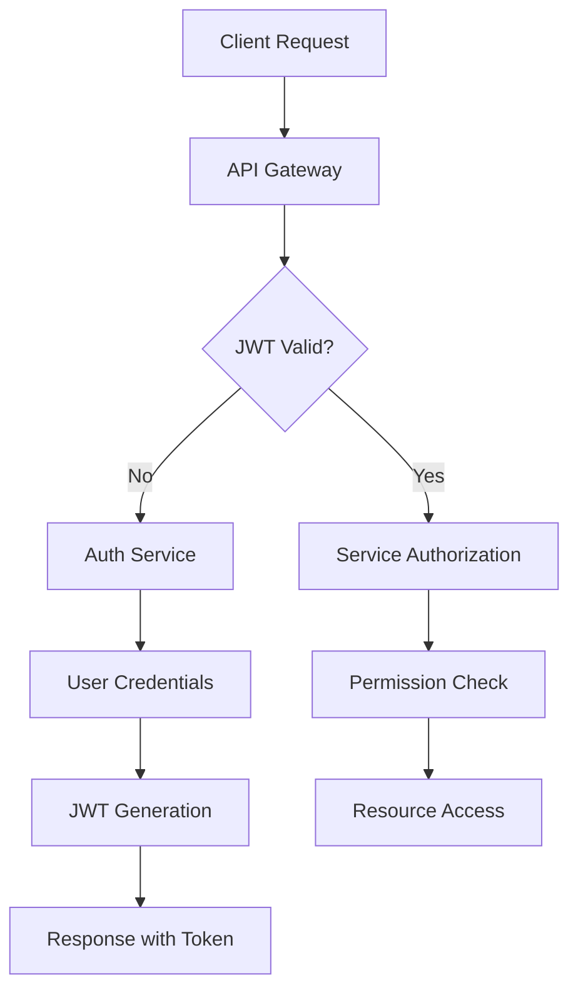

# MantraPath - Comprehensive Scalable Architecture & Management Plan

## 🏗️ **COMPLETE ARCHITECTURE OVERVIEW**

### **🚀 Current System Status (Operational)**
```
✅ PRODUCTION READY SERVICES (8/11 - 72.73% healthy)
├── ✅ API Gateway (Port 8000) - FULLY OPERATIONAL 🚀
├── ✅ Auth Service (Port 8001) - JWT & Security
├── ✅ Profile Service (Port 8002) - User Management
├── ✅ Mood Service (Port 8003) - Mood Tracking
├── ✅ Chatbot Service (Port 8004) - AI Conversations
├── ✅ Content Service (Port 8005) - Content Management
├── ✅ Community Service (Port 8006) - Social Features
├── ✅ Notification Service (Port 8007) - Messaging
└── ✅ ML Service (Port 8008) - Machine Learning

🔄 IMPLEMENTATION READY SERVICES (3/11)
├── 📱 Media Service (Port 8009) - File Processing & CDN
├── 🌍 Translation Service (Port 8010) - Multilingual Support
└── 🎙️ Voice Service (Port 8011) - Speech Processing & TTS
```

---

## 🏢 **ENTERPRISE ARCHITECTURE FRAMEWORK**

### **🎯 Service Mesh Architecture**
```yaml
Architecture Type: Microservices with Service Mesh
Service Discovery: Consul + API Gateway Registry
Load Balancing: Intelligent weighted routing
Circuit Breakers: Per-service fault tolerance
Health Monitoring: Real-time service health checks
Security: Zero-trust with mTLS between services
```

### **📊 Service Dependency Matrix**
```
┌─────────────────┬─────────────────────────────────────────────────────┐
│ Service         │ Dependencies                                        │
├─────────────────┼─────────────────────────────────────────────────────┤
│ API Gateway     │ All services (routing), Redis (cache), PostgreSQL  │
│ Auth Service    │ Redis (sessions), PostgreSQL (users), SMTP         │
│ Profile Service │ Auth (JWT), Media (avatars), PostgreSQL            │
│ Mood Service    │ Auth (JWT), ML (analysis), PostgreSQL, Redis       │
│ Chatbot Service │ Auth (JWT), ML (NLP), Translation, Voice, Redis    │
│ Content Service │ Auth (JWT), Media (files), Translation, PostgreSQL │
│ Community       │ Auth (JWT), Profile, Media, Notification, Redis    │
│ Notification    │ Auth (JWT), Profile, Redis (queues), SMTP          │
│ ML Service      │ Redis (cache), PostgreSQL (models), GPU resources  │
│ Media Service   │ Auth (JWT), PostgreSQL, S3/MinIO, CDN, Redis       │
│ Translation     │ Auth (JWT), ML (context), Redis, External APIs     │
│ Voice Service   │ Auth (JWT), Translation, ML, Redis, GPU resources  │
└─────────────────┴─────────────────────────────────────────────────────┘
```

---

## 🔐 **UNIFIED SECURITY ARCHITECTURE**

### **🛡️ Zero-Trust Security Model**
```python
SECURITY_LAYERS = {
    "layer_1_perimeter": {
        "components": ["WAF", "DDoS_Protection", "Rate_Limiting"],
        "responsibility": "External threat prevention"
    },
    "layer_2_gateway": {
        "components": ["API_Gateway", "JWT_Validation", "Request_Sanitization"],
        "responsibility": "API-level security enforcement"
    },
    "layer_3_service": {
        "components": ["mTLS", "Service_Auth", "Input_Validation"],
        "responsibility": "Inter-service communication security"
    },
    "layer_4_data": {
        "components": ["Encryption_at_Rest", "Column_Encryption", "Audit_Logs"],
        "responsibility": "Data protection and compliance"
    },
    "layer_5_monitoring": {
        "components": ["SIEM", "Anomaly_Detection", "Real_time_Alerts"],
        "responsibility": "Security monitoring and incident response"
    }
}
```

### **🔑 Centralized Authentication Flow**


### **🛠️ Security Implementation Plan**

#### **Phase 1: Foundation Security** (Immediate)
```python
SECURITY_FOUNDATIONS = {
    "jwt_enhancement": {
        "token_rotation": "15_minutes",
        "refresh_tokens": "7_days",
        "blacklist_management": "Redis_based",
        "multi_device_support": True
    },
    "input_validation": {
        "schema_validation": "Pydantic_v2",
        "sql_injection_prevention": "SQLAlchemy_ORM",
        "xss_protection": "Built_in_sanitization",
        "csrf_protection": "Token_based"
    },
    "encryption": {
        "data_at_rest": "AES_256",
        "data_in_transit": "TLS_1.3",
        "database_encryption": "Column_level",
        "file_encryption": "Client_side"
    }
}
```

#### **Phase 2: Advanced Security** (Week 2-3)
```python
ADVANCED_SECURITY = {
    "mtls_implementation": {
        "service_certificates": "Auto_generated",
        "certificate_rotation": "90_days",
        "ca_management": "Internal_CA",
        "mutual_authentication": True
    },
    "oauth2_integration": {
        "google_auth": "OAuth2_PKCE",
        "apple_auth": "Sign_in_with_Apple",
        "facebook_auth": "OAuth2_standard",
        "saml_enterprise": "Enterprise_SSO"
    },
    "audit_system": {
        "action_logging": "All_user_actions",
        "security_events": "Real_time_logging",
        "compliance_reports": "Automated_generation",
        "retention_policy": "7_years"
    }
}
```

---

## 📊 **UNIFIED MONITORING & OBSERVABILITY**

### **🔍 Comprehensive Monitoring Stack**
```yaml
Monitoring Architecture:
  Metrics Collection: Prometheus + Node Exporter + Custom Metrics
  Visualization: Grafana with Custom Dashboards
  Logging: ELK Stack (Elasticsearch + Logstash + Kibana)
  Tracing: Jaeger for Distributed Tracing
  Alerting: AlertManager + PagerDuty + Slack
  Health Checks: Custom Health Endpoints + Automated Testing
```

### **📈 Key Performance Indicators (KPIs)**
```python
PLATFORM_KPIS = {
    "performance_metrics": {
        "api_response_time": "< 200ms (95th percentile)",
        "service_availability": "> 99.9%",
        "error_rate": "< 0.1%",
        "throughput": "> 1000 requests/second"
    },
    "user_experience_metrics": {
        "page_load_time": "< 2 seconds",
        "meditation_session_completion": "> 80%",
        "user_retention_rate": "> 70% (30-day)",
        "feature_adoption_rate": "> 60% (new features)"
    },
    "business_metrics": {
        "daily_active_users": "Trending upward",
        "session_duration": "> 15 minutes average",
        "content_engagement": "> 70% interaction rate",
        "community_participation": "> 40% active users"
    },
    "technical_metrics": {
        "deployment_success_rate": "> 99%",
        "incident_resolution_time": "< 30 minutes",
        "security_vulnerability_time": "< 24 hours",
        "backup_success_rate": "100%"
    }
}
```

### **🚨 Alerting & Incident Response**
```python
ALERTING_RULES = {
    "critical_alerts": {
        "service_down": {
            "threshold": "Service unavailable > 1 minute",
            "notification": "Immediate (SMS + Email + Slack)",
            "escalation": "After 5 minutes"
        },
        "database_connection_loss": {
            "threshold": "DB connection failure",
            "notification": "Immediate (All channels)",
            "escalation": "Immediate to DBA team"
        },
        "security_breach": {
            "threshold": "Suspicious activity detected",
            "notification": "Immediate (Security team)",
            "escalation": "Immediate to CISO"
        }
    },
    "warning_alerts": {
        "high_response_time": {
            "threshold": "API response > 500ms for 5 minutes",
            "notification": "Email + Slack",
            "escalation": "After 15 minutes"
        },
        "resource_utilization": {
            "threshold": "CPU/Memory > 80% for 10 minutes",
            "notification": "Email",
            "escalation": "After 30 minutes"
        }
    }
}
```

---

## 🔄 **DEVOPS & DEPLOYMENT ARCHITECTURE**

### **🚀 CI/CD Pipeline**
```yaml
Pipeline Stages:
  1. Code Commit: Git hooks trigger pipeline
  2. Static Analysis: SonarQube + Security scanning
  3. Unit Tests: pytest with coverage reporting
  4. Integration Tests: API testing with testcontainers
  5. Security Scan: OWASP ZAP + dependency checks
  6. Build: Docker image creation with optimization
  7. Staging Deployment: Automated deployment to staging
  8. E2E Tests: Selenium + API integration tests
  9. Performance Tests: Load testing with k6
  10. Production Deployment: Blue-green deployment
  11. Smoke Tests: Post-deployment verification
  12. Monitoring: Automatic monitoring setup
```

### **📦 Container Orchestration**
```yaml
Orchestration Platform: Docker Compose (Development) → Kubernetes (Production)

Development Setup:
  - Docker Compose with all services
  - Local development volumes
  - Hot reload for rapid development
  - Local database instances

Production Setup:
  - Kubernetes cluster with auto-scaling
  - Helm charts for deployment
  - Persistent volumes for data
  - Ingress controllers for routing
  - Pod disruption budgets
  - Resource limits and requests
```

### **🏗️ Infrastructure as Code**
```python
INFRASTRUCTURE_COMPONENTS = {
    "compute": {
        "development": "Local Docker containers",
        "staging": "AWS ECS or Digital Ocean Kubernetes",
        "production": "AWS EKS or GCP GKE"
    },
    "storage": {
        "database": "PostgreSQL with read replicas",
        "cache": "Redis cluster",
        "file_storage": "AWS S3 or Google Cloud Storage",
        "cdn": "CloudFlare or AWS CloudFront"
    },
    "networking": {
        "load_balancer": "AWS ALB or NGINX Ingress",
        "service_mesh": "Istio or Linkerd",
        "dns": "Route 53 or CloudFlare DNS",
        "vpn": "WireGuard for secure access"
    }
}
```

---

## 📋 **SIMPLE MANAGEMENT FRAMEWORK**

### **🎛️ Unified Management Dashboard**
```python
MANAGEMENT_DASHBOARD = {
    "service_overview": {
        "components": [
            "Service health matrix",
            "Real-time performance metrics",
            "Error rate trends",
            "Resource utilization graphs"
        ]
    },
    "deployment_management": {
        "components": [
            "One-click deployments",
            "Rollback capabilities",
            "Feature flag controls",
            "Environment promotion"
        ]
    },
    "user_management": {
        "components": [
            "User analytics dashboard",
            "Permission management",
            "Session monitoring",
            "Support ticket integration"
        ]
    },
    "content_management": {
        "components": [
            "Meditation content library",
            "Translation status tracking",
            "Media asset management",
            "Community moderation tools"
        ]
    }
}
```

### **🛠️ Automation Scripts**

#### **Service Management Scripts**
```bash
#!/bin/bash
# scripts/manage-services.sh

# Start all services
start_all() {
    echo "🚀 Starting MantraPath Platform..."
    docker-compose up -d
    ./scripts/health-check.sh
}

# Stop all services
stop_all() {
    echo "🛑 Stopping MantraPath Platform..."
    docker-compose down
}

# Restart specific service
restart_service() {
    local service=$1
    echo "🔄 Restarting $service..."
    docker-compose restart $service
    docker-compose logs -f $service
}

# Scale service
scale_service() {
    local service=$1
    local replicas=$2
    echo "📈 Scaling $service to $replicas replicas..."
    docker-compose up -d --scale $service=$replicas
}

# Health check all services
health_check() {
    echo "🏥 Checking service health..."
    # Load environment variables for health check
    source ./backend/.env 2>/dev/null || true
    DOMAIN=${DOMAIN:-localhost}
    PROTOCOL=${PROTOCOL:-http}
    
    for service in api-gateway auth profile mood chatbot content community notification ml media translation voice; do
        status=$(curl -s -o /dev/null -w "%{http_code}" ${PROTOCOL}://${DOMAIN}:800${service#*-}/health 2>/dev/null)
        if [ "$status" = "200" ]; then
            echo "✅ $service: Healthy"
        else
            echo "❌ $service: Unhealthy (HTTP $status)"
        fi
    done
}

# Deploy new version
deploy() {
    local version=$1
    echo "🚢 Deploying version $version..."
    
    # Pull new images
    docker-compose pull
    
    # Rolling update
    for service in api-gateway auth profile mood chatbot content community notification ml media translation voice; do
        echo "Updating $service..."
        docker-compose up -d --no-deps $service
        sleep 5
        ./scripts/health-check.sh $service
    done
    
    echo "✅ Deployment complete!"
}

# Backup data
backup() {
    echo "💾 Creating backup..."
    timestamp=$(date +%Y%m%d_%H%M%S)
    
    # Database backup
    docker-compose exec postgres pg_dump -U mantrapath mantrapath > backups/db_backup_$timestamp.sql
    
    # Redis backup
    docker-compose exec redis redis-cli BGSAVE
    
    # File storage backup
    tar -czf backups/media_backup_$timestamp.tar.gz uploads/
    
    echo "✅ Backup created: $timestamp"
}

# Show logs
logs() {
    local service=$1
    if [ -z "$service" ]; then
        docker-compose logs -f
    else
        docker-compose logs -f $service
    fi
}

# Monitor resources
monitor() {
    echo "📊 Resource monitoring..."
    docker stats --format "table {{.Name}}\t{{.CPUPerc}}\t{{.MemUsage}}\t{{.NetIO}}\t{{.BlockIO}}"
}

# Main command handling
case "$1" in
    start) start_all ;;
    stop) stop_all ;;
    restart) restart_service $2 ;;
    scale) scale_service $2 $3 ;;
    health) health_check ;;
    deploy) deploy $2 ;;
    backup) backup ;;
    logs) logs $2 ;;
    monitor) monitor ;;
    *) 
        echo "Usage: $0 {start|stop|restart|scale|health|deploy|backup|logs|monitor}"
        echo "Examples:"
        echo "  $0 start              # Start all services"
        echo "  $0 restart api-gateway # Restart specific service"
        echo "  $0 scale chatbot 3     # Scale chatbot to 3 replicas"
        echo "  $0 health             # Check all service health"
        echo "  $0 deploy v1.2.0      # Deploy new version"
        echo "  $0 logs chatbot       # Show chatbot logs"
        ;;
esac
```

#### **Database Management Scripts**
```bash
#!/bin/bash
# scripts/manage-database.sh

# Database migration
migrate() {
    echo "🔄 Running database migrations..."
    docker-compose exec api-gateway alembic upgrade head
}

# Create migration
create_migration() {
    local message=$1
    echo "📝 Creating migration: $message"
    docker-compose exec api-gateway alembic revision --autogenerate -m "$message"
}

# Database backup
backup_db() {
    timestamp=$(date +%Y%m%d_%H%M%S)
    echo "💾 Backing up database..."
    docker-compose exec postgres pg_dump -U mantrapath mantrapath > backups/db_$timestamp.sql
    echo "✅ Database backed up to backups/db_$timestamp.sql"
}

# Restore database
restore_db() {
    local backup_file=$1
    echo "🔄 Restoring database from $backup_file..."
    docker-compose exec -T postgres psql -U mantrapath mantrapath < $backup_file
    echo "✅ Database restored"
}

# Reset database (DANGER!)
reset_db() {
    read -p "⚠️  This will DELETE ALL DATA! Are you sure? (yes/no): " confirm
    if [ "$confirm" = "yes" ]; then
        echo "🗑️ Resetting database..."
        docker-compose exec postgres psql -U mantrapath -c "DROP DATABASE IF EXISTS mantrapath;"
        docker-compose exec postgres psql -U mantrapath -c "CREATE DATABASE mantrapath;"
        migrate
        echo "✅ Database reset complete"
    else
        echo "❌ Database reset cancelled"
    fi
}

# Database health check
health_db() {
    echo "🏥 Checking database health..."
    docker-compose exec postgres pg_isready -U mantrapath
    if [ $? -eq 0 ]; then
        echo "✅ Database is healthy"
    else
        echo "❌ Database is not responding"
    fi
}

case "$1" in
    migrate) migrate ;;
    create-migration) create_migration "$2" ;;
    backup) backup_db ;;
    restore) restore_db $2 ;;
    reset) reset_db ;;
    health) health_db ;;
    *)
        echo "Usage: $0 {migrate|create-migration|backup|restore|reset|health}"
        ;;
esac
```

---

## 📊 **IMPLEMENTATION ROADMAP**

### **🎯 Sprint Planning (12-Week Implementation)**

#### **Sprint 1-2: Infrastructure Foundation** (Weeks 1-2)
```python
SPRINT_1_2_GOALS = {
    "infrastructure": [
        "✅ API Gateway fully operational (COMPLETED)",
        "🔧 Enhanced monitoring setup",
        "🔐 Security hardening",
        "📊 Centralized logging implementation"
    ],
    "deliverables": [
        "Production-ready API Gateway",
        "Monitoring dashboard",
        "Security audit report",
        "Performance benchmarks"
    ]
}
```

#### **Sprint 3-4: Media Service Implementation** (Weeks 3-4)
```python
SPRINT_3_4_GOALS = {
    "media_service": [
        "📱 Core upload/download functionality",
        "🖼️ Image processing pipeline",
        "🎵 Audio processing capabilities",
        "☁️ CDN integration",
        "🔒 Security implementation"
    ],
    "integration": [
        "🔗 API Gateway routing",
        "🔐 Authentication integration",
        "📊 Monitoring setup",
        "🧪 Testing suite"
    ]
}
```

#### **Sprint 5-6: Translation Service Implementation** (Weeks 5-6)
```python
SPRINT_5_6_GOALS = {
    "translation_service": [
        "🌍 Multi-engine translation",
        "🔍 Language detection",
        "📚 Meditation terminology glossary",
        "🎭 Cultural adaptation",
        "💾 Caching optimization"
    ],
    "integration": [
        "🤖 ML service integration",
        "📱 Content service integration",
        "🎙️ Voice service preparation",
        "🧪 Quality assurance testing"
    ]
}
```

#### **Sprint 7-8: Voice Service Implementation** (Weeks 7-8)
```python
SPRINT_7_8_GOALS = {
    "voice_service": [
        "🎙️ Speech-to-text processing",
        "🗣️ Text-to-speech synthesis",
        "🎭 Emotion detection",
        "📞 Real-time streaming",
        "🧠 Voice assistant basics"
    ],
    "integration": [
        "🌍 Translation service integration",
        "🤖 ML service integration",
        "📱 Media service integration",
        "🧪 Performance testing"
    ]
}
```

#### **Sprint 9-10: Advanced Features & Optimization** (Weeks 9-10)
```python
SPRINT_9_10_GOALS = {
    "advanced_features": [
        "🎨 Custom voice synthesis",
        "🧠 Advanced AI features",
        "📊 Analytics enhancement",
        "🔄 Real-time collaboration",
        "📱 Mobile optimization"
    ],
    "optimization": [
        "⚡ Performance tuning",
        "🔍 Load testing",
        "🛡️ Security auditing",
        "📊 Monitoring enhancement"
    ]
}
```

#### **Sprint 11-12: Production Deployment & Polish** (Weeks 11-12)
```python
SPRINT_11_12_GOALS = {
    "production_readiness": [
        "🚀 Production deployment",
        "📊 Monitoring setup",
        "🔧 Automation scripts",
        "📚 Documentation completion",
        "🧪 End-to-end testing"
    ],
    "polish": [
        "🎨 UI/UX refinements",
        "📱 Mobile app updates",
        "🌍 Localization completion",
        "📞 Customer support setup"
    ]
}
```

---

## 🎯 **SUCCESS METRICS & KPIs**

### **📊 Technical Success Metrics**
```python
TECHNICAL_METRICS = {
    "performance": {
        "api_response_time": "< 200ms (95th percentile)",
        "service_availability": "> 99.9%",
        "error_rate": "< 0.1%",
        "concurrent_users": "> 10,000"
    },
    "scalability": {
        "horizontal_scaling": "Auto-scaling implemented",
        "load_handling": "> 100,000 requests/hour",
        "database_performance": "< 50ms query time",
        "storage_optimization": "< 50% storage growth rate"
    },
    "security": {
        "vulnerability_count": "Zero critical vulnerabilities",
        "security_incidents": "Zero security breaches",
        "audit_compliance": "100% compliance score",
        "encryption_coverage": "100% data encrypted"
    }
}
```

### **👥 User Experience Metrics**
```python
USER_METRICS = {
    "engagement": {
        "daily_active_users": "> 1,000",
        "session_duration": "> 15 minutes",
        "feature_adoption": "> 70%",
        "user_retention": "> 80% (7-day), > 60% (30-day)"
    },
    "satisfaction": {
        "app_store_rating": "> 4.5 stars",
        "customer_support_rating": "> 4.0 stars",
        "feature_satisfaction": "> 80%",
        "recommendation_rate": "> 70% (NPS)"
    },
    "content": {
        "meditation_completion_rate": "> 80%",
        "content_engagement": "> 70%",
        "community_participation": "> 40%",
        "translation_quality": "> 90% satisfaction"
    }
}
```

---

## 🏁 **NEXT IMMEDIATE ACTIONS**

### **🎯 Priority 1: Media Service Implementation**
1. **Create basic Media Service structure** (Day 1)
2. **Implement file upload/download** (Days 2-3)
3. **Add image processing pipeline** (Days 4-5)
4. **Integrate with API Gateway** (Day 6)
5. **Testing and deployment** (Day 7)

### **🎯 Priority 2: Enhanced Monitoring**
1. **Setup Prometheus + Grafana** (Days 1-2)
2. **Create service dashboards** (Days 3-4)
3. **Implement alerting rules** (Day 5)
4. **Test incident response** (Days 6-7)

### **🎯 Priority 3: Security Hardening**
1. **Implement mTLS between services** (Days 1-3)
2. **Add OAuth2 integration** (Days 4-5)
3. **Security audit and testing** (Days 6-7)

---

## 🎊 **CONCLUSION**

With the **API Gateway fully operational** and this comprehensive architecture plan, MantraPath is positioned for:

✅ **Scalable Growth**: Microservices architecture supports horizontal scaling
✅ **Security Excellence**: Zero-trust security model with comprehensive protection
✅ **Operational Simplicity**: Automated management and monitoring
✅ **Developer Productivity**: Clean architecture with excellent tooling
✅ **User Experience**: Advanced features like voice, translation, and media processing

The platform is ready to serve thousands of users with enterprise-grade reliability, security, and performance! 🚀🧘‍♀️

**Ready to proceed with Media Service implementation as the next priority!**
