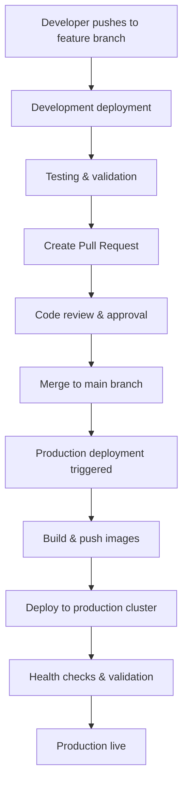

# MantraPath Production Deployment Strategy

## 🎯 Overview

MantraPath uses a **separate cluster strategy** for production deployments, ensuring complete isolation between development and production environments. Production deployments are automatically triggered by merges to the `main` branch.

## 🏗️ Architecture

### Development Environment
- **Cluster**: `mantrapath-dev` (Kind/local)
- **Namespace**: `mantrapath-dev`
- **Domain**: `mantrapath-dev.local`
- **Trigger**: Feature branch pushes, manual deployments
- **Purpose**: Development, testing, feature validation

### Production Environment
- **Cluster**: `mantrapath-prod` (separate production cluster)
- **Namespace**: `mantrapath-prod`
- **Domain**: `mantrapath.com`, `api.mantrapath.com`
- **Trigger**: Main branch merges (automatic)
- **Purpose**: Live production serving real users

## 🔄 Deployment Flow



## 🚀 Production Deployment Process

### 1. Automatic Trigger
- **Event**: Merge to `main` branch
- **Workflow**: `.github/workflows/production-deploy.yml`
- **Conditions**: Changes in `backend/`, `frontend/`, or `deployment/`

### 2. Build Phase
- Build all 19+ service Docker images
- Tag with commit SHA and `latest`
- Push to GitHub Container Registry
- Parallel builds for faster deployment

### 3. Deploy Phase
- Connect to **separate production cluster**
- Deploy to `mantrapath-prod` namespace
- Use production-specific configurations
- Apply production resource limits
- Enable autoscaling and PDBs

### 4. Validation Phase
- Wait for all pods to be ready
- Run health checks on critical services
- Test external connectivity
- Validate service-to-service communication

## 🔧 Production Configuration

### Centralized Port Management
All service ports are defined in one place (`values-prod.yaml`):

```yaml
global:
  ports:
    # Core API Services (80xx range)
    apiGateway: 8000
    modelsService: 8001
    translationService: 8002
    
    # Authentication & User Services (81xx range)
    authService: 8100
    profileService: 8101
    moodService: 8102
    
    # AI & ML Services (82xx range)
    chatbotService: 8200
    mlService: 8201
    aiContextStore: 8202
    # ... and so on
```

### Resource Allocation
- **High-Performance Services**: 1-4 CPU cores, 2-8GB RAM
- **Standard Services**: 200m-1 CPU core, 256MB-1GB RAM
- **AI/ML Services**: 300m-2 CPU cores, 512MB-4GB RAM

### Autoscaling Configuration
- **API Gateway**: 3-15 replicas
- **Chatbot Service**: 3-12 replicas
- **Models Service**: 2-10 replicas
- **Translation Service**: 2-8 replicas

## 🔒 Security & Isolation

### Cluster Separation
- **Development**: Local Kind cluster or shared dev cluster
- **Production**: Dedicated production cluster (GKE/EKS/AKS)
- **Network**: Completely isolated networks
- **Access**: Different authentication and RBAC

### Secrets Management
- **Development**: Basic secrets for testing
- **Production**: Secure secrets via GitHub Actions secrets
- **Rotation**: Regular secret rotation in production
- **External**: Integration with external secret managers

### GitHub Actions Secrets Required
```
# Kubernetes Access
PROD_K8S_SERVER          # Production cluster API server
PROD_K8S_CA_CERT         # Cluster CA certificate (base64)
PROD_K8S_TOKEN           # Service account token

# Application Secrets
PROD_POSTGRES_PASSWORD   # Secure PostgreSQL password
PROD_POSTGRES_USER       # PostgreSQL username
PROD_POSTGRES_DATABASE   # PostgreSQL database name
PROD_JWT_SECRET_KEY      # 256-bit JWT signing key
PROD_REDIS_PASSWORD      # Redis authentication password
PROD_SERVICE_AUTH_TOKEN  # Service-to-service auth token

# External Services
OPENAI_API_KEY          # OpenAI API key
SMTP_USERNAME           # Email service username
SMTP_PASSWORD           # Email service password
SMTP_SERVER             # SMTP server address
```

## 🌐 Production Access

### External URLs
- **Frontend**: https://mantrapath.com
- **API Gateway**: https://api.mantrapath.com
- **Admin Panel**: https://admin.mantrapath.com

### Internal Service Communication
- **API Gateway** → **Auth Service**: `http://mantrapath-prod-auth-service:8100`
- **API Gateway** → **Chatbot**: `http://mantrapath-prod-chatbot-service:8200`
- **Models Service** → **Translation**: `http://mantrapath-prod-translation-service:8002`

### Health Check Endpoints
```bash
# API Gateway Health
curl https://api.mantrapath.com/health

# Individual Service Health (via kubectl port-forward)
kubectl port-forward svc/mantrapath-prod-chatbot-service 8200:8200 -n mantrapath-prod
curl http://localhost:8200/health
```

## 📊 Monitoring & Observability

### Health Checks
- **Kubernetes**: Liveness and readiness probes
- **Application**: Custom health endpoints
- **External**: Uptime monitoring services
- **Alerts**: Slack/Discord notifications on failures

### Metrics Collection
- **Prometheus**: Metrics collection
- **Grafana**: Visualization dashboards
- **Alerts**: Automated alerting rules
- **Logs**: Centralized log aggregation

## 🛠️ Operational Commands

### Production Deployment
```bash
# Automatic (recommended)
git checkout main
git merge feature/my-feature
git push origin main  # Triggers production deployment

# Manual (emergency only)
./deployment/helm-deploy.sh --environment prod
```

### Production Management
```bash
# Switch to production cluster
kubectl config use-context production

# Check deployment status
kubectl get pods -n mantrapath-prod
kubectl get services -n mantrapath-prod

# Scale services
kubectl scale deployment mantrapath-prod-chatbot-service --replicas=5 -n mantrapath-prod

# View logs
kubectl logs -f deployment/mantrapath-prod-api-gateway -n mantrapath-prod

# Port forward for debugging
kubectl port-forward svc/mantrapath-prod-api-gateway 8000:8000 -n mantrapath-prod
```

### Rollback Procedures
```bash
# Helm rollback
helm rollback mantrapath-prod -n mantrapath-prod

# Scale down problematic service
kubectl scale deployment mantrapath-prod-problematic-service --replicas=0 -n mantrapath-prod

# Emergency maintenance mode
kubectl patch ingress mantrapath-prod-ingress -n mantrapath-prod -p '{"spec":{"rules":[]}}'
```

## 🔄 CI/CD Pipeline

### GitHub Actions Workflow
1. **Validate**: Check changes, lint code, run tests
2. **Build**: Build Docker images for changed services
3. **Deploy**: Deploy to production cluster
4. **Health Check**: Validate deployment success
5. **Notify**: Send deployment notifications

### Deployment Stages
```yaml
jobs:
  validate:        # Change detection, linting
  build-images:    # Docker image builds (parallel)
  deploy-production: # Helm deployment to prod cluster
  notify:          # Success/failure notifications
```

## 🚨 Troubleshooting

### Common Issues

1. **Deployment Timeout**
   - Check resource limits
   - Verify image availability
   - Check cluster capacity

2. **Pod CrashLoopBackOff**
   - Check application logs
   - Verify environment variables
   - Check resource constraints

3. **Service Unreachable**
   - Verify service endpoints
   - Check ingress configuration
   - Test DNS resolution

### Debug Commands
```bash
# Check pod status
kubectl describe pod <pod-name> -n mantrapath-prod

# View recent events
kubectl get events -n mantrapath-prod --sort-by='.lastTimestamp'

# Check resource usage
kubectl top pods -n mantrapath-prod
kubectl top nodes

# Test connectivity
kubectl exec -it <pod-name> -n mantrapath-prod -- curl http://service:port/health
```

## 📋 Setup Checklist

### Initial Setup
- [ ] Create separate production cluster
- [ ] Configure GitHub Actions secrets
- [ ] Set up DNS records
- [ ] Configure SSL certificates
- [ ] Test deployment pipeline

### Pre-Production
- [ ] Run security scans
- [ ] Performance testing
- [ ] Backup procedures
- [ ] Monitoring setup
- [ ] Alert configuration

### Go-Live
- [ ] Final deployment test
- [ ] Health check validation
- [ ] Performance monitoring
- [ ] User acceptance testing
- [ ] Documentation updates

## 🎯 Best Practices

1. **Always use separate clusters** for dev/prod
2. **Test in staging** before production deployment
3. **Monitor resource usage** and set appropriate limits
4. **Implement proper health checks** for all services
5. **Use semantic versioning** for releases
6. **Maintain rollback procedures** for quick recovery
7. **Regular security updates** and patches
8. **Automated testing** in CI/CD pipeline

---

## 📞 Support

For production deployment issues:
1. Check deployment logs in GitHub Actions
2. Review cluster status with `kubectl`
3. Check service health endpoints
4. Review monitoring dashboards
5. Escalate to DevOps team if needed

**Remember**: Production deployments affect real users. Always test thoroughly in development first!


