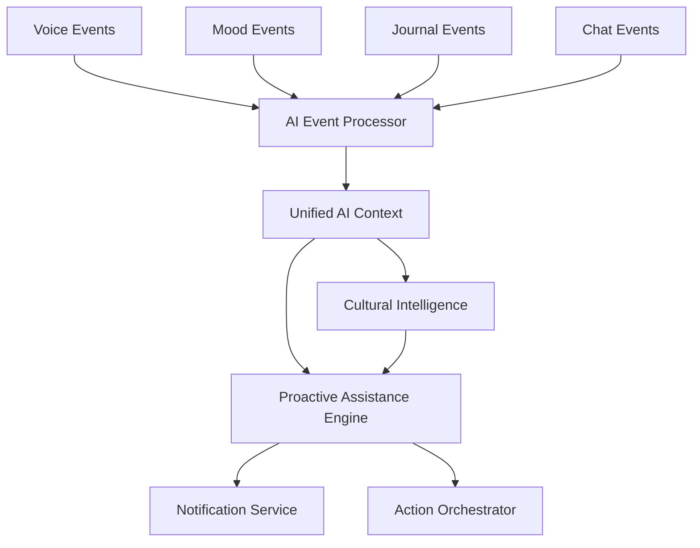

# Sprint 2 Backend Stories: Complete Implementation Plan
**Theme: "Live Intelligence Coordination"**
**Sprint Goal**: Implement real-time event processing with live AI coordination across all services

## Sprint 2 Overview

### Sprint Objectives ✅
- ✅ Complete event-driven architecture with real-time AI processing
- ✅ Implement cross-service intelligence sharing
- ✅ Establish voice event processing foundation
- ✅ Create proactive assistance event triggers
- ✅ Optimize performance for real-time coordination

### Team Capacity Allocation
- **Total Sprint Capacity**: 160 hours (4 developers × 40h)
- **Story Point Total**: 40 points
- **Velocity Target**: 40 points (aligned with capacity)

## Backend Stories Breakdown

### Epic 1: Real-Time AI Event Processing (22 Points)

#### Story V3-BK-005: AI Event Processing Pipeline
- **Points**: 12 | **Assignee**: Senior Dev 1 + AI Specialist
- **Focus**: Live emotion analysis, cross-service AI context building, predictive triggers
- **Key Deliverables**:
  - AI Event Processor service with <200ms processing latency
  - Real-time emotion analysis for 25+ languages
  - Cross-service AI context aggregation
  - Predictive intervention trigger system
  - Cultural intelligence processing integration

#### Story V3-BK-006: Voice Event Streaming Foundation
- **Points**: 10 | **Assignee**: Senior Dev 2
- **Focus**: Voice activity detection, emotion analysis, speech-to-text coordination
- **Key Deliverables**:
  - Voice activity detection with <50ms latency
  - Voice emotion analysis event processing
  - Speech-to-text event coordination
  - Voice command event routing
  - Support for 100+ concurrent voice streams

### Epic 2: Cross-Service Intelligence (18 Points)

#### Story V3-BK-007: Unified AI Context Service
- **Points**: 10 | **Assignee**: Mid Dev 1
- **Focus**: Global AI profiles, cross-feature learning, predictive personalization
- **Key Deliverables**:
  - Unified AI context across all services
  - Global user AI profile management
  - Cross-service learning coordination
  - Predictive personalization context
  - Cultural adaptation context sharing

#### Story V3-BK-008: Proactive Assistance Engine
- **Points**: 8 | **Assignee**: Mid Dev 2
- **Focus**: Early intervention detection, optimal timing, cultural sensitivity
- **Key Deliverables**:
  - Early intervention detection (>85% accuracy)
  - Optimal timing prediction for assistance
  - Contextual help trigger system
  - Cultural sensitivity in proactive assistance
  - Real-time assistance evaluation (<500ms)

## Implementation Dependencies

### Service Integration Flow


### Critical Path Analysis
1. **Week 1**: AI Event Processing Pipeline + Voice Event Streaming Foundation
2. **Week 1.5**: Unified AI Context Service (depends on AI Event Processor)
3. **Week 2**: Proactive Assistance Engine (depends on Unified AI Context)

## Technical Architecture

### Enhanced Event Bus Architecture
```python
# Event Flow: Service → Enhanced Event Bus → AI Processing → Context Update → Assistance Engine

# Voice Service publishes voice events
await event_bus.publish("voice.activity_detected", voice_data, user_id)

# AI Event Processor consumes and analyzes
@ai_processor.subscribe("voice.activity_detected")
async def process_voice_emotion(event):
    emotion_result = await analyze_voice_emotion(event.data)
    await event_bus.publish("ai.emotion_detected", emotion_result, event.user_id)

# Unified Context aggregates intelligence
@context_service.subscribe("ai.emotion_detected")
async def update_user_context(event):
    await context_store.update_emotion_context(event.user_id, event.data)

# Proactive Assistance evaluates needs
@assistance_engine.subscribe("context.updated")
async def evaluate_assistance_needs(event):
    assistance_evaluation = await evaluate_user_needs(event.user_id)
    if assistance_evaluation.assistance_needed:
        await trigger_proactive_assistance(event.user_id, assistance_evaluation)
```

### Performance Requirements
| Component | Latency Requirement | Throughput Requirement |
|-----------|-------------------|----------------------|
| AI Event Processing | <200ms | 10,000 events/min |
| Voice Event Streaming | <50ms | 100 concurrent streams |
| Context Synchronization | <100ms | 1,000 updates/min |
| Assistance Evaluation | <500ms | 1,000 evaluations/min |

### Cultural Intelligence Integration
- **Supported Languages**: 25+ languages for AI processing
- **Cultural Regions**: 11+ cultural adaptation contexts
- **Cultural Accuracy**: >90% for supported regions
- **Cultural Processing**: <300ms additional latency

## Risk Assessment & Mitigation

### High-Priority Risks
1. **Event Processing Latency**
   - **Risk**: Real-time requirements not met
   - **Mitigation**: NATS JetStream optimization, async processing pipelines
   - **Contingency**: Graceful degradation with batch processing fallback

2. **Cross-Service Dependencies**
   - **Risk**: Service failures cascade across system
   - **Mitigation**: Circuit breakers, fallback mechanisms, event replay
   - **Contingency**: Independent service operation mode

3. **AI Processing Load**
   - **Risk**: Real-time AI processing overwhelms system
   - **Mitigation**: Intelligent batching, model optimization, horizontal scaling
   - **Contingency**: Reduced accuracy mode with simpler models

4. **Cultural Sensitivity Accuracy**
   - **Risk**: Cultural adaptations not accurate enough
   - **Mitigation**: Cultural expert validation, extensive testing
   - **Contingency**: Conservative cultural defaults

### Medium-Priority Risks
1. **Context Data Volume**: Context pruning and archiving strategies
2. **Voice Processing Accuracy**: Audio quality monitoring and adaptive processing
3. **User Privacy Concerns**: Transparent communication and user controls

## Testing Strategy

### Unit Testing (Target: >90% Coverage)
- AI model integration tests
- Event processing logic tests
- Context aggregation tests
- Cultural adaptation tests
- Voice processing tests

### Integration Testing
- End-to-end event flow tests
- Cross-service context synchronization tests
- Voice-to-AI processing pipeline tests
- Cultural sensitivity integration tests

### Performance Testing
- Load testing: 10,000+ events/minute
- Latency testing: Sub-200ms AI processing
- Concurrent voice stream testing: 100+ streams
- Memory and CPU usage optimization

### Cultural Testing
- Cultural appropriateness validation for 11+ regions
- Multi-language AI processing accuracy
- Cultural adaptation effectiveness testing

## Monitoring & Observability

### Key Metrics Dashboard
```python
sprint_2_metrics = {
    # Performance Metrics
    "ai_event_processing_latency": Histogram("ai_processing_seconds"),
    "voice_activity_detection_latency": Histogram("voice_vad_seconds"),
    "context_sync_duration": Histogram("context_sync_seconds"),
    "assistance_evaluation_time": Histogram("assistance_eval_seconds"),
    
    # Accuracy Metrics
    "emotion_analysis_accuracy": Gauge("emotion_accuracy_ratio"),
    "cultural_adaptation_success": Gauge("cultural_success_ratio"),
    "intervention_detection_accuracy": Gauge("intervention_accuracy_ratio"),
    
    # Throughput Metrics
    "events_processed_per_minute": Counter("events_processed_total"),
    "concurrent_voice_sessions": Gauge("voice_sessions_active"),
    "context_updates_per_minute": Counter("context_updates_total"),
    
    # Error Metrics
    "ai_processing_errors": Counter("ai_errors_total"),
    "context_sync_failures": Counter("context_sync_errors_total"),
    "cultural_adaptation_failures": Counter("cultural_errors_total")
}
```

### Health Check Endpoints
- `/health/ai-processor` - AI Event Processing Pipeline health
- `/health/voice-events` - Voice Event Streaming health
- `/health/context-service` - Unified AI Context health
- `/health/assistance-engine` - Proactive Assistance health

## Definition of Done

### Technical Completion Criteria
- [ ] All user stories completed and acceptance criteria met
- [ ] Code reviewed and approved by senior developers
- [ ] Unit tests passing with >90% coverage
- [ ] Integration tests validating cross-service functionality
- [ ] Performance benchmarks met for all components
- [ ] Security scans completed with no critical issues

### Performance Validation
- [ ] AI event processing <200ms for 95% of events
- [ ] Voice activity detection <50ms latency
- [ ] Context synchronization <100ms across services
- [ ] Assistance evaluation <500ms response time
- [ ] Support for 100+ concurrent voice streams

### Integration Validation
- [ ] All services integrated with enhanced event bus
- [ ] Cross-service AI context sharing functional
- [ ] Voice events triggering AI processing pipeline
- [ ] Proactive assistance triggers working
- [ ] Cultural adaptation active for 11+ regions

### Business Value Validation
- [ ] Real-time intelligence coordination demonstrated
- [ ] Proactive assistance accuracy >85%
- [ ] Cultural sensitivity validated by experts
- [ ] Voice interaction foundation ready for Phase 3
- [ ] Platform ready for advanced voice capabilities

## Implementation Timeline

### Week 1 (Days 1-3)
- **Senior Dev 1 + AI Specialist**: AI Event Processing Pipeline
- **Senior Dev 2**: Voice Event Streaming Foundation
- **Mid Dev 1**: Start Unified AI Context Service (foundation)

### Week 1 (Days 4-5)
- **Senior Dev 1**: Complete AI processing integration
- **Senior Dev 2**: Complete voice event coordination
- **Mid Dev 1**: Continue Unified AI Context development

### Week 2 (Days 1-3)
- **Mid Dev 1**: Complete Unified AI Context Service
- **Mid Dev 2**: Start Proactive Assistance Engine
- **All Devs**: Integration testing and bug fixes

### Week 2 (Days 4-5)
- **Mid Dev 2**: Complete Proactive Assistance Engine
- **All Devs**: End-to-end testing, performance validation
- **All Devs**: Documentation and knowledge transfer

## Success Metrics

### Quantitative Success Criteria
- **Event Processing**: 10,000+ events/minute sustained throughput
- **Latency Targets**: All sub-component latency requirements met
- **Accuracy Targets**: >85% for all AI processing accuracy metrics
- **Cultural Support**: 25+ languages, 11+ cultural regions
- **Reliability**: 99.9% uptime for event processing components

### Qualitative Success Criteria
- **Developer Experience**: Easy integration for service teams
- **User Experience**: Proactive assistance feels helpful, not intrusive
- **Cultural Appropriateness**: Validated by cultural experts
- **Platform Readiness**: Foundation ready for advanced voice capabilities

---

## Next Phase Preparation

Sprint 2 delivers the intelligence coordination foundation that enables:
- **Sprint 3**: Advanced voice processing and AI-everywhere experiences
- **Phase 3**: Voice-first interactions with intelligent assistance
- **Future Phases**: Predictive wellness and advanced personalization

This sprint transforms MantraPath from independent services to a unified, intelligent, culturally-aware platform ready for voice-enabled mental wellness support.

---

*Sprint 2 Backend Implementation Plan - Complete documentation for "Live Intelligence Coordination" sprint.*
