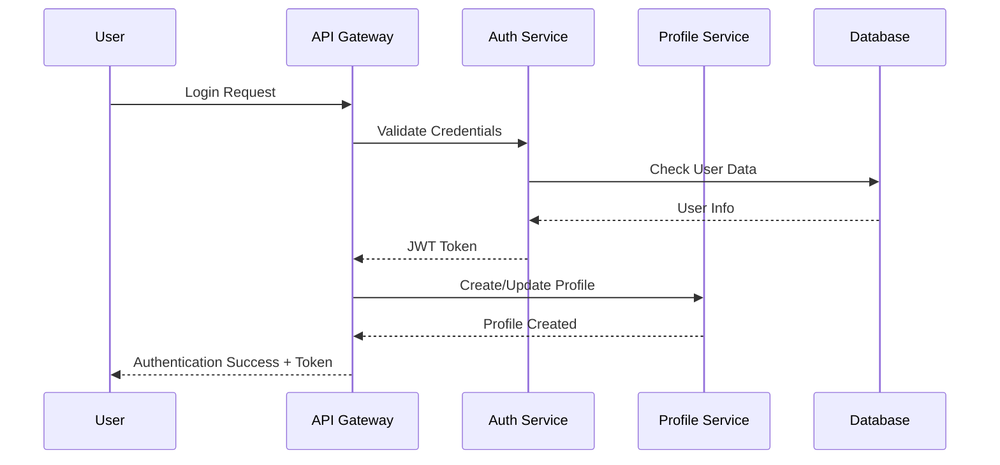
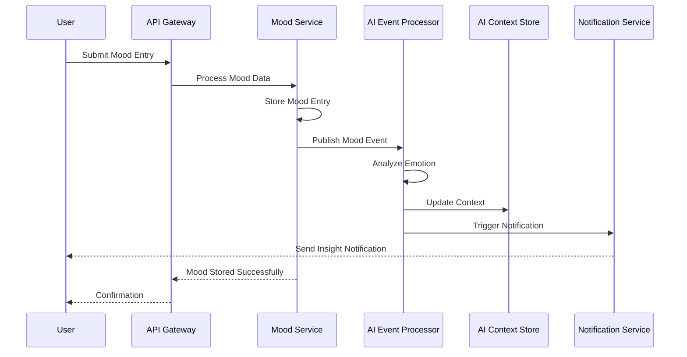
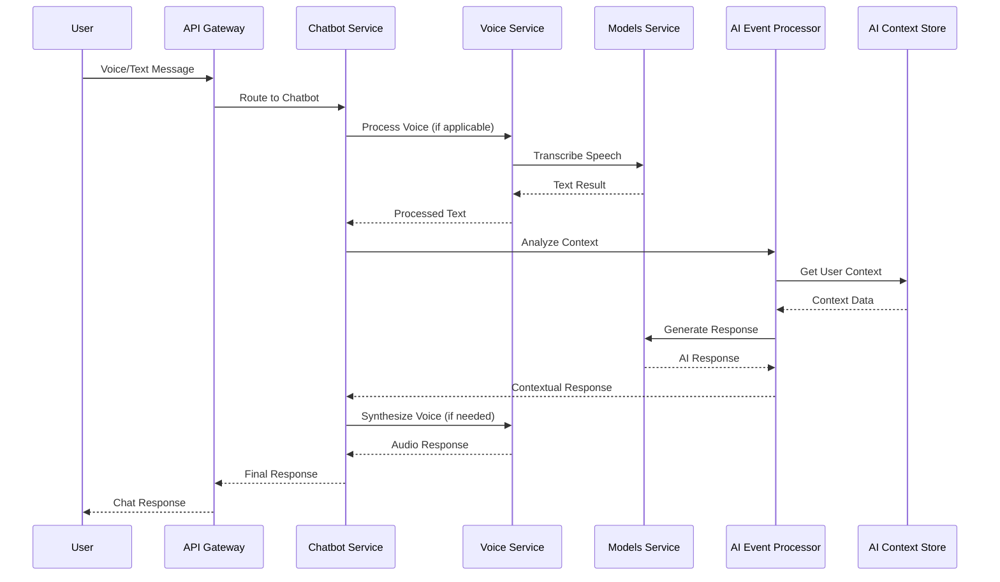

# MantraPath High-Level Design

## 🎯 System Overview

MantraPath is a comprehensive mental health platform designed to provide personalized, AI-powered support through a microservices architecture. The system integrates multiple specialized services to deliver culturally-aware, multilingual mental health assistance.

## 🏗️ High-Level Architecture

### **System Components**

```
┌─────────────────────────────────────────────────────────────────┐
│                        CLIENT LAYER                            │
├─────────────────────────────────────────────────────────────────┤
│  Web App (React)  │  Mobile App  │  Voice Interface  │  API    │
└─────────────────────────────────────────────────────────────────┘
                                │
                                ▼
┌─────────────────────────────────────────────────────────────────┐
│                      API GATEWAY LAYER                         │
├─────────────────────────────────────────────────────────────────┤
│  • Authentication  • Rate Limiting  • Routing  • CORS         │
│  • Voice Routing   • AI Context     • Cultural Context        │
└─────────────────────────────────────────────────────────────────┘
                                │
                                ▼
┌─────────────────────────────────────────────────────────────────┐
│                    CORE SERVICES LAYER                         │
├─────────────────────────────────────────────────────────────────┤
│  Auth Service  │  Profile Service  │  Mood Service  │  Memory  │
│  Community     │  Content Service  │  Notification  │  Media   │
└─────────────────────────────────────────────────────────────────┘
                                │
                                ▼
┌─────────────────────────────────────────────────────────────────┐
│                    AI SERVICES LAYER                           │
├─────────────────────────────────────────────────────────────────┤
│  AI Event Processor  │  AI Context Store  │  Models Service    │
│  ML Service         │  Chatbot Service   │  Voice Service     │
│  Translation Service │  Proactive Engine  │  Phi3 Agent       │
└─────────────────────────────────────────────────────────────────┘
                                │
                                ▼
┌─────────────────────────────────────────────────────────────────┐
│                   ORCHESTRATION LAYER                          │
├─────────────────────────────────────────────────────────────────┤
│  Action Orchestrator  │  Deployment API  │  Event Bus (NATS)  │
└─────────────────────────────────────────────────────────────────┘
                                │
                                ▼
┌─────────────────────────────────────────────────────────────────┐
│                      DATA LAYER                                │
├─────────────────────────────────────────────────────────────────┤
│  PostgreSQL  │  Redis  │  File Storage  │  Model Storage      │
└─────────────────────────────────────────────────────────────────┘
```

## 🔄 Data Flow Patterns

### **1. User Authentication Flow**



### **2. Mood Tracking Flow**



### **3. AI-Powered Chat Flow**



## 🎨 Design Patterns

### **1. Microservices Pattern**
- **Single Responsibility**: Each service handles one domain
- **Independent Deployment**: Services can be deployed separately
- **Technology Diversity**: Services can use different technologies
- **Fault Isolation**: Failure in one service doesn't affect others

### **2. API Gateway Pattern**
- **Single Entry Point**: All client requests go through gateway
- **Cross-Cutting Concerns**: Authentication, rate limiting, logging
- **Service Discovery**: Dynamic routing to appropriate services
- **Protocol Translation**: HTTP to internal service protocols

### **3. Event-Driven Architecture**
- **Asynchronous Communication**: Services communicate via events
- **Loose Coupling**: Services don't need direct knowledge of each other
- **Scalability**: Easy to add new event consumers
- **Resilience**: Event queuing provides fault tolerance

### **4. CQRS (Command Query Responsibility Segregation)**
- **Separate Read/Write Models**: Different models for commands and queries
- **Optimized Performance**: Read models optimized for queries
- **Scalability**: Independent scaling of read and write operations

### **5. Saga Pattern**
- **Distributed Transactions**: Managing transactions across services
- **Compensation**: Rollback mechanisms for failed operations
- **Eventual Consistency**: Data consistency across services

## 🔐 Security Design

### **1. Authentication & Authorization**
```
┌─────────────────┐    ┌─────────────────┐    ┌─────────────────┐
│   Client App    │───▶│  API Gateway    │───▶│  Auth Service   │
│                 │    │  (JWT Validate) │    │  (Token Gen)    │
└─────────────────┘    └─────────────────┘    └─────────────────┘
                                │
                                ▼
                       ┌─────────────────┐
                       │  Target Service │
                       │  (Authorized)   │
                       └─────────────────┘
```

### **2. Data Security**
- **Encryption at Rest**: Database encryption
- **Encryption in Transit**: TLS/SSL for all communications
- **Token-based Auth**: JWT tokens for stateless authentication
- **Role-based Access**: Granular permissions system

### **3. Privacy by Design**
- **Data Minimization**: Only collect necessary data
- **User Consent**: Explicit consent for data processing
- **Right to Deletion**: Complete data removal capability
- **Anonymization**: Personal data anonymization options

## 📊 Scalability Design

### **1. Horizontal Scaling**
```
┌─────────────────┐    ┌─────────────────┐    ┌─────────────────┐
│   Load Balancer │───▶│  Service A      │    │  Service A      │
│                 │    │  (Instance 1)   │    │  (Instance 2)   │
└─────────────────┘    └─────────────────┘    └─────────────────┘
                                │
                                ▼
                       ┌─────────────────┐
                       │  Shared Database│
                       │  (PostgreSQL)   │
                       └─────────────────┘
```

### **2. Caching Strategy**
- **Redis Cache**: Session data and frequently accessed data
- **CDN**: Static content delivery
- **Application Cache**: In-memory caching for performance
- **Database Cache**: Query result caching

### **3. Database Scaling**
- **Read Replicas**: Separate read and write databases
- **Sharding**: Horizontal database partitioning
- **Connection Pooling**: Efficient database connections
- **Query Optimization**: Indexed queries and optimized schemas

## 🔄 Event-Driven Design

### **Event Types and Flows**

#### **User Events**
- `user.registered` - New user registration
- `user.profile.updated` - Profile changes
- `user.preferences.changed` - Preference updates

#### **Mental Health Events**
- `mood.entry.created` - New mood entry
- `journal.entry.created` - Journal entry
- `mood.pattern.detected` - Pattern analysis
- `crisis.alert.triggered` - Crisis intervention

#### **AI Events**
- `ai.insight.generated` - New AI insight
- `ai.context.updated` - Context changes
- `ai.prediction.made` - Predictive analysis
- `ai.intervention.suggested` - Intervention recommendation

#### **Community Events**
- `community.post.created` - New community post
- `community.challenge.joined` - Challenge participation
- `community.support.offered` - Support interactions

#### **Notification Events**
- `notification.sent` - Notification delivery
- `notification.read` - Notification engagement
- `notification.preferences.updated` - Preference changes

## 🌐 Multi-Language and Cultural Design

### **1. Language Support Architecture**
```
┌─────────────────┐    ┌─────────────────┐    ┌─────────────────┐
│   User Input    │───▶│  Language       │───▶│  Translation    │
│   (Any Language)│    │  Detection      │    │  Service        │
└─────────────────┘    └─────────────────┘    └─────────────────┘
                                │
                                ▼
                       ┌─────────────────┐
                       │  Cultural       │
                       │  Intelligence   │
                       └─────────────────┘
```

### **2. Cultural Adaptation**
- **Cultural Context**: Understanding cultural nuances
- **Regional Preferences**: Adapting to local customs
- **Language Variants**: Supporting regional language variants
- **Cultural Sensitivity**: Respecting cultural differences

## 🤖 AI Integration Design

### **1. AI Service Hierarchy**
```
┌─────────────────────────────────────────────────────────────────┐
│                    AI ORCHESTRATION LAYER                      │
├─────────────────────────────────────────────────────────────────┤
│  AI Event Processor  │  AI Context Store  │  Proactive Engine  │
└─────────────────────────────────────────────────────────────────┘
                                │
                                ▼
┌─────────────────────────────────────────────────────────────────┐
│                    AI EXECUTION LAYER                          │
├─────────────────────────────────────────────────────────────────┤
│  Models Service  │  Chatbot Service  │  Voice Service         │
│  Translation     │  ML Service      │  Phi3 Agent            │
└─────────────────────────────────────────────────────────────────┘
```

### **2. AI Processing Pipeline**
1. **Input Processing**: Voice/text input handling
2. **Context Gathering**: User context and history
3. **AI Analysis**: Emotion, sentiment, cultural analysis
4. **Insight Generation**: Personalized insights and recommendations
5. **Response Generation**: Contextual and culturally appropriate responses
6. **Learning Integration**: Feedback loop for continuous improvement

## 📱 Client Integration Design

### **1. Web Application**
- **React Frontend**: Modern, responsive web interface
- **Real-time Updates**: WebSocket connections for live data
- **Progressive Web App**: Offline capability and mobile experience
- **Accessibility**: WCAG compliant design

### **2. Mobile Application**
- **Cross-platform**: React Native for iOS and Android
- **Native Features**: Camera, microphone, push notifications
- **Offline Support**: Local data storage and sync
- **Voice Integration**: Native voice processing

### **3. API Integration**
- **RESTful APIs**: Standard HTTP-based APIs
- **GraphQL**: Flexible data querying
- **WebSocket**: Real-time communication
- **Webhook Support**: External system integration

## 🔧 Technology Stack Integration

### **1. Backend Technologies**
- **Python 3.11+**: Primary development language
- **FastAPI**: High-performance web framework
- **SQLAlchemy**: Database ORM and migrations
- **Pydantic**: Data validation and serialization
- **Celery**: Background task processing

### **2. AI/ML Technologies**
- **PyTorch**: Deep learning framework
- **Transformers**: Pre-trained language models
- **scikit-learn**: Machine learning algorithms
- **NLTK/spaCy**: Natural language processing
- **OpenAI API**: Advanced language models

### **3. Infrastructure Technologies**
- **Docker**: Containerization
- **Kubernetes**: Container orchestration
- **Nginx**: Load balancing and reverse proxy
- **Prometheus**: Monitoring and metrics
- **Grafana**: Visualization and dashboards

## 🚀 Deployment and DevOps Design

### **1. CI/CD Pipeline**
```
┌─────────────┐    ┌─────────────┐    ┌─────────────┐    ┌─────────────┐
│   Code      │───▶│   Build     │───▶│   Test      │───▶│   Deploy    │
│   Commit    │    │   Docker    │    │   Pipeline  │    │   K8s       │
└─────────────┘    └─────────────┘    └─────────────┘    └─────────────┘
```

### **2. Environment Strategy**
- **Development**: Local development environment
- **Staging**: Production-like testing environment
- **Production**: Live production environment
- **Feature Flags**: Gradual feature rollouts

### **3. Monitoring and Observability**
- **Application Metrics**: Performance and business metrics
- **Infrastructure Metrics**: System resource monitoring
- **Log Aggregation**: Centralized logging system
- **Distributed Tracing**: Request flow tracking
- **Alerting**: Proactive issue detection

This high-level design provides a comprehensive foundation for building a scalable, maintainable, and culturally-aware mental health platform that can serve users globally while maintaining the highest standards of security and privacy.
