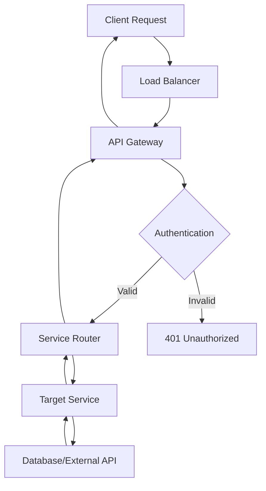
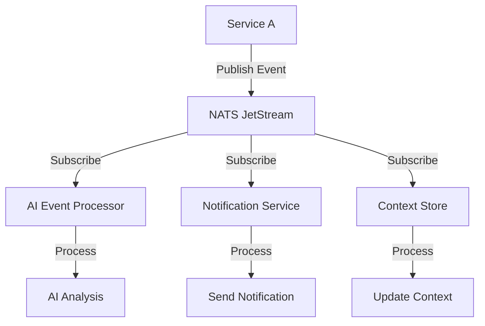
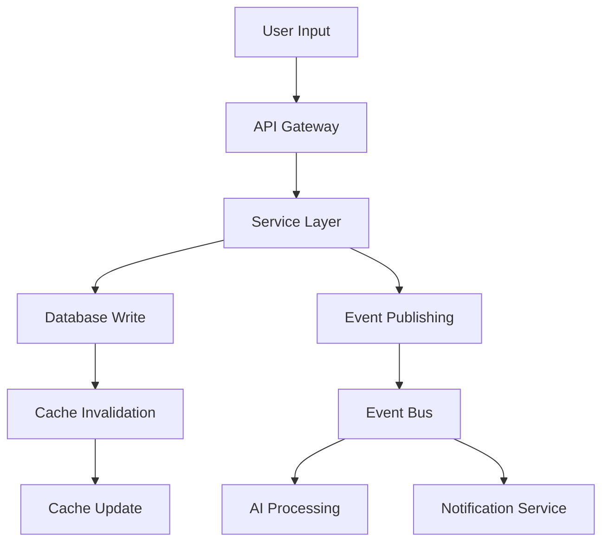
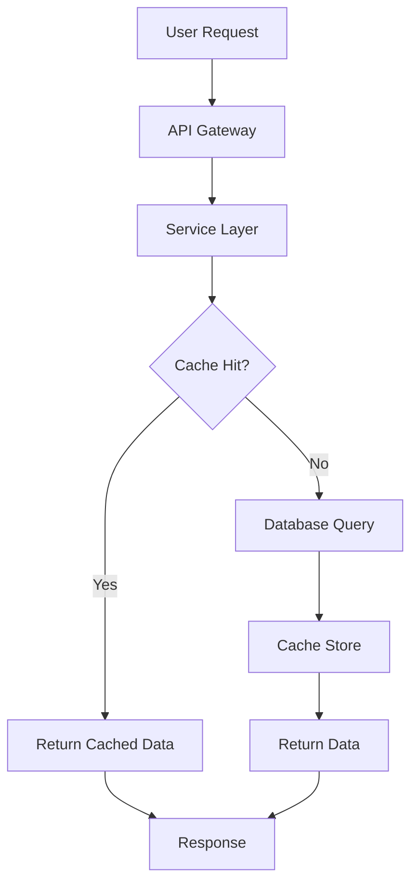
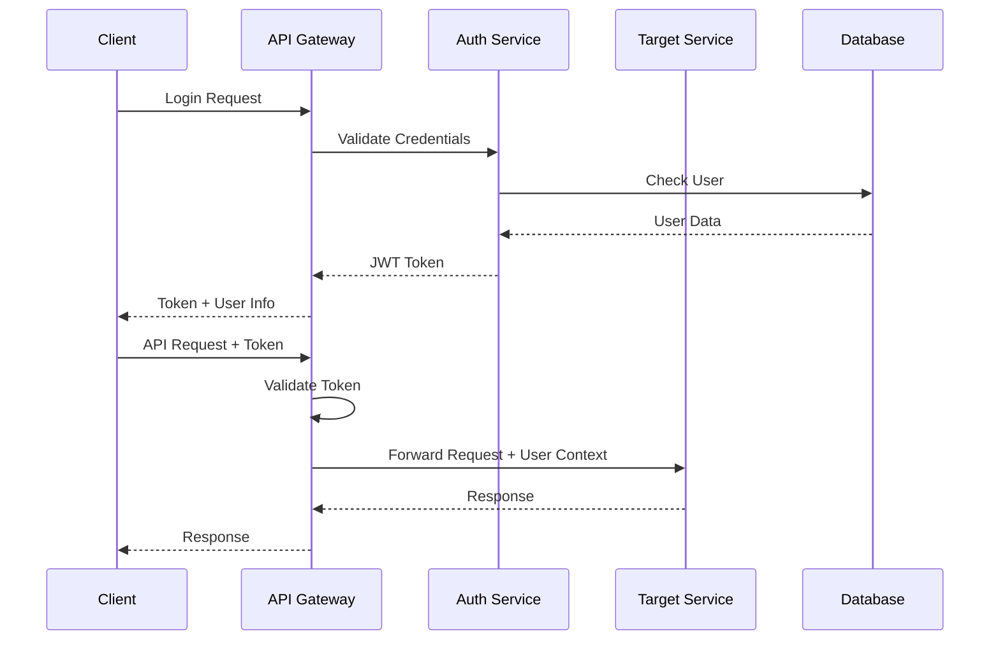

# MantraPath System Design

## 🎯 System Overview

MantraPath is a comprehensive mental health platform designed to scale globally while maintaining high availability, security, and performance. The system is built using microservices architecture with event-driven communication patterns.

## 🏗️ System Architecture

### **High-Level System Components**

```
┌─────────────────────────────────────────────────────────────────┐
│                        EXTERNAL LAYER                          │
├─────────────────────────────────────────────────────────────────┤
│  CDN (CloudFlare)  │  Load Balancer  │  API Gateway  │  WAF    │
└─────────────────────────────────────────────────────────────────┘
                                │
                                ▼
┌─────────────────────────────────────────────────────────────────┐
│                      APPLICATION LAYER                         │
├─────────────────────────────────────────────────────────────────┤
│  Core Services  │  AI Services  │  Communication  │  Content  │
│  (20+ Services) │  (8 Services) │  (4 Services)   │  (3 Services)│
└─────────────────────────────────────────────────────────────────┘
                                │
                                ▼
┌─────────────────────────────────────────────────────────────────┐
│                        DATA LAYER                              │
├─────────────────────────────────────────────────────────────────┤
│  PostgreSQL  │  Redis  │  File Storage  │  Message Queue  │  ML  │
│  (Primary)   │ (Cache) │   (S3/MinIO)   │   (NATS)       │ Models│
└─────────────────────────────────────────────────────────────────┘
```

## 🔄 System Communication Patterns

### **1. Synchronous Communication**

#### **API Gateway Routing**


#### **Service-to-Service Communication**
```python
# Example: Mood Service calling AI Event Processor
class MoodService:
    def __init__(self):
        self.ai_processor_url = os.getenv("AI_EVENT_PROCESSOR_URL")
        self.http_client = httpx.AsyncClient()
    
    async def process_mood_entry(self, mood_data: dict):
        # 1. Store mood entry locally
        mood_entry = await self.store_mood_entry(mood_data)
        
        # 2. Send to AI processor for analysis
        ai_request = {
            "event_type": "mood_entry_created",
            "user_id": mood_data["user_id"],
            "data": mood_data,
            "timestamp": datetime.utcnow().isoformat()
        }
        
        try:
            response = await self.http_client.post(
                f"{self.ai_processor_url}/api/v1/process",
                json=ai_request,
                timeout=30.0
            )
            if response.status_code == 200:
                ai_result = response.json()
                await self.update_mood_insights(mood_entry.id, ai_result)
        except Exception as e:
            logger.error(f"AI processing failed: {e}")
            # Continue without AI processing
        
        return mood_entry
```

### **2. Asynchronous Communication**

#### **Event-Driven Architecture**


#### **Event Types and Handlers**
```python
# Event definitions
class EventTypes:
    # User events
    USER_REGISTERED = "user.registered"
    USER_PROFILE_UPDATED = "user.profile.updated"
    USER_PREFERENCES_CHANGED = "user.preferences.changed"
    
    # Mental health events
    MOOD_ENTRY_CREATED = "mood.entry.created"
    JOURNAL_ENTRY_CREATED = "journal.entry.created"
    MOOD_PATTERN_DETECTED = "mood.pattern.detected"
    CRISIS_ALERT_TRIGGERED = "crisis.alert.triggered"
    
    # AI events
    AI_INSIGHT_GENERATED = "ai.insight.generated"
    AI_CONTEXT_UPDATED = "ai.context.updated"
    AI_PREDICTION_MADE = "ai.prediction.made"
    AI_INTERVENTION_SUGGESTED = "ai.intervention.suggested"
    
    # Community events
    COMMUNITY_POST_CREATED = "community.post.created"
    COMMUNITY_CHALLENGE_JOINED = "community.challenge.joined"
    COMMUNITY_SUPPORT_OFFERED = "community.support.offered"
    
    # Notification events
    NOTIFICATION_SENT = "notification.sent"
    NOTIFICATION_READ = "notification.read"
    NOTIFICATION_PREFERENCES_UPDATED = "notification.preferences.updated"

# Event handler example
class AIEventProcessor:
    async def handle_mood_entry_created(self, event: dict):
        user_id = event["user_id"]
        mood_data = event["data"]
        
        # 1. Analyze emotion
        emotion_result = await self.emotion_analyzer.analyze(
            text=mood_data.get("notes", ""),
            language=mood_data.get("language", "en"),
            user_id=user_id
        )
        
        # 2. Update context
        await self.context_store.update_user_context(
            user_id=user_id,
            context_type="mood",
            data={
                "mood_score": mood_data["mood_score"],
                "emotion": emotion_result.emotion,
                "confidence": emotion_result.confidence,
                "timestamp": event["timestamp"]
            }
        )
        
        # 3. Check for patterns
        patterns = await self.detect_mood_patterns(user_id)
        if patterns.get("risk_level") == "high":
            await self.trigger_intervention(user_id, patterns)
        
        # 4. Generate insights
        insights = await self.generate_insights(user_id, mood_data, emotion_result)
        if insights:
            await self.publish_event(EventTypes.AI_INSIGHT_GENERATED, {
                "user_id": user_id,
                "insights": insights,
                "source": "mood_analysis"
            })
```

## 🗄️ Data Architecture

### **1. Database Design**

#### **Primary Database (PostgreSQL)**
```sql
-- Core tables with relationships
CREATE TABLE users (
    id UUID PRIMARY KEY DEFAULT gen_random_uuid(),
    email VARCHAR(255) UNIQUE NOT NULL,
    username VARCHAR(100) UNIQUE NOT NULL,
    password_hash VARCHAR(255) NOT NULL,
    first_name VARCHAR(100),
    last_name VARCHAR(100),
    is_active BOOLEAN DEFAULT TRUE,
    is_verified BOOLEAN DEFAULT FALSE,
    role VARCHAR(50) DEFAULT 'user',
    created_at TIMESTAMP DEFAULT CURRENT_TIMESTAMP,
    last_login TIMESTAMP
);

CREATE TABLE user_profiles (
    id UUID PRIMARY KEY DEFAULT gen_random_uuid(),
    user_id UUID REFERENCES users(id) ON DELETE CASCADE,
    bio TEXT,
    avatar_url VARCHAR(500),
    timezone VARCHAR(50) DEFAULT 'UTC',
    theme VARCHAR(20) DEFAULT 'light',
    privacy_level VARCHAR(20) DEFAULT 'private',
    notifications_enabled BOOLEAN DEFAULT TRUE,
    created_at TIMESTAMP DEFAULT CURRENT_TIMESTAMP,
    updated_at TIMESTAMP DEFAULT CURRENT_TIMESTAMP
);

CREATE TABLE mood_entries (
    id UUID PRIMARY KEY DEFAULT gen_random_uuid(),
    user_id UUID REFERENCES users(id) ON DELETE CASCADE,
    mood_score INTEGER NOT NULL CHECK (mood_score >= 1 AND mood_score <= 10),
    energy_level INTEGER CHECK (energy_level >= 1 AND energy_level <= 10),
    stress_level INTEGER CHECK (stress_level >= 1 AND stress_level <= 10),
    activities JSONB,
    notes TEXT,
    emotions JSONB,
    created_at TIMESTAMP DEFAULT CURRENT_TIMESTAMP
);

-- Indexes for performance
CREATE INDEX idx_mood_entries_user_created ON mood_entries(user_id, created_at);
CREATE INDEX idx_mood_entries_created_at ON mood_entries(created_at);
CREATE INDEX idx_users_email ON users(email);
CREATE INDEX idx_users_username ON users(username);
```

#### **Caching Layer (Redis)**
```python
# Cache key patterns and TTL
CACHE_CONFIG = {
    "user_profile": {"ttl": 3600, "pattern": "profile:{user_id}"},
    "mood_analytics": {"ttl": 1800, "pattern": "mood_analytics:{user_id}:{days}"},
    "ai_context": {"ttl": 900, "pattern": "ai_context:{user_id}"},
    "content_feed": {"ttl": 600, "pattern": "content_feed:{user_id}:{page}"},
    "notification_preferences": {"ttl": 3600, "pattern": "notif_prefs:{user_id}"},
    "emotion_analysis": {"ttl": 7200, "pattern": "emotion:{text_hash}:{language}"}
}

class CacheManager:
    def __init__(self, redis_url: str):
        self.redis = redis.from_url(redis_url)
        self.config = CACHE_CONFIG
    
    async def get_user_profile(self, user_id: str) -> Optional[dict]:
        key = f"profile:{user_id}"
        return await self.get(key)
    
    async def set_user_profile(self, user_id: str, profile: dict):
        key = f"profile:{user_id}"
        await self.set(key, profile, ttl=3600)
```

### **2. Data Flow Patterns**

#### **Write-Heavy Operations**


#### **Read-Heavy Operations**


## 🔐 Security Architecture

### **1. Authentication & Authorization**

#### **JWT Token Flow**


#### **Role-Based Access Control**
```python
# Permission definitions
PERMISSIONS = {
    "user": [
        "mood:read", "mood:write",
        "journal:read", "journal:write",
        "profile:read", "profile:write",
        "community:read", "community:write"
    ],
    "moderator": [
        "community:moderate",
        "content:moderate",
        "user:view_limited"
    ],
    "admin": [
        "user:manage",
        "system:configure",
        "analytics:view",
        "content:manage"
    ]
}

class AuthorizationService:
    def __init__(self):
        self.permissions = PERMISSIONS
    
    def has_permission(self, user_role: str, required_permission: str) -> bool:
        user_permissions = self.permissions.get(user_role, [])
        return required_permission in user_permissions
    
    def check_resource_access(self, user_id: str, resource_user_id: str, permission: str) -> bool:
        # Users can only access their own resources
        if user_id == resource_user_id:
            return True
        
        # Admins can access all resources
        if self.has_permission("admin", permission):
            return True
        
        return False
```

### **2. Data Security**

#### **Encryption at Rest**
```python
# Database encryption configuration
DATABASE_CONFIG = {
    "encryption": {
        "enabled": True,
        "algorithm": "AES-256-GCM",
        "key_rotation_days": 90
    },
    "sensitive_fields": [
        "password_hash",
        "notes",
        "personal_data"
    ]
}

class EncryptionService:
    def __init__(self, encryption_key: str):
        self.key = encryption_key.encode()
        self.cipher = Fernet(encryption_key)
    
    def encrypt_field(self, data: str) -> str:
        return self.cipher.encrypt(data.encode()).decode()
    
    def decrypt_field(self, encrypted_data: str) -> str:
        return self.cipher.decrypt(encrypted_data.encode()).decode()
```

#### **API Security**
```python
# Rate limiting configuration
RATE_LIMITS = {
    "login": {"requests": 5, "window": 300},  # 5 requests per 5 minutes
    "api": {"requests": 100, "window": 60},   # 100 requests per minute
    "ai_processing": {"requests": 20, "window": 60}  # 20 AI requests per minute
}

class RateLimiter:
    def __init__(self, redis_client):
        self.redis = redis_client
    
    async def check_rate_limit(self, key: str, limit: int, window: int) -> bool:
        current = await self.redis.incr(key)
        if current == 1:
            await self.redis.expire(key, window)
        return current <= limit
```

## 📊 Scalability Design

### **1. Horizontal Scaling**

#### **Service Scaling Strategy**
```yaml
# Kubernetes deployment configuration
apiVersion: apps/v1
kind: Deployment
metadata:
  name: mood-service
spec:
  replicas: 3
  selector:
    matchLabels:
      app: mood-service
  template:
    metadata:
      labels:
        app: mood-service
    spec:
      containers:
      - name: mood-service
        image: mantrapath/mood-service:latest
        ports:
        - containerPort: 8003
        resources:
          requests:
            memory: "256Mi"
            cpu: "250m"
          limits:
            memory: "512Mi"
            cpu: "500m"
        env:
        - name: DATABASE_URL
          valueFrom:
            secretKeyRef:
              name: database-secret
              key: url
        - name: REDIS_URL
          valueFrom:
            secretKeyRef:
              name: redis-secret
              key: url
```

#### **Database Scaling**
```python
# Database connection pooling
class DatabaseManager:
    def __init__(self, database_url: str):
        self.engine = create_async_engine(
            database_url,
            pool_size=20,
            max_overflow=30,
            pool_pre_ping=True,
            pool_recycle=3600
        )
        self.session_factory = sessionmaker(
            bind=self.engine,
            class_=AsyncSession,
            expire_on_commit=False
        )
    
    async def get_session(self) -> AsyncSession:
        async with self.session_factory() as session:
            try:
                yield session
            finally:
                await session.close()
```

### **2. Caching Strategy**

#### **Multi-Level Caching**
```python
class CacheStrategy:
    def __init__(self):
        self.redis = redis.Redis(host='redis-cluster')
        self.local_cache = {}  # In-memory cache
        self.cache_ttl = {
            "user_profile": 3600,
            "mood_analytics": 1800,
            "ai_context": 900,
            "content_feed": 600
        }
    
    async def get(self, key: str) -> Optional[Any]:
        # 1. Check local cache first
        if key in self.local_cache:
            return self.local_cache[key]
        
        # 2. Check Redis cache
        value = await self.redis.get(key)
        if value:
            data = json.loads(value)
            self.local_cache[key] = data  # Store in local cache
            return data
        
        return None
    
    async def set(self, key: str, value: Any, ttl: int = None):
        # Store in both local and Redis cache
        self.local_cache[key] = value
        ttl = ttl or self.cache_ttl.get(key.split(':')[0], 3600)
        await self.redis.setex(key, ttl, json.dumps(value))
```

### **3. Load Balancing**

#### **Service Discovery and Load Balancing**
```python
class ServiceRegistry:
    def __init__(self):
        self.services = {}
        self.health_checker = HealthChecker()
    
    async def register_service(self, service_name: str, instance: ServiceInstance):
        if service_name not in self.services:
            self.services[service_name] = []
        
        self.services[service_name].append(instance)
        await self.health_checker.start_monitoring(instance)
    
    def get_healthy_instances(self, service_name: str) -> List[ServiceInstance]:
        if service_name not in self.services:
            return []
        
        return [instance for instance in self.services[service_name] 
                if instance.is_healthy]
    
    def select_instance(self, service_name: str, strategy: str = "round_robin") -> ServiceInstance:
        instances = self.get_healthy_instances(service_name)
        if not instances:
            raise ServiceUnavailableError(f"No healthy instances for {service_name}")
        
        if strategy == "round_robin":
            return self._round_robin_selection(instances)
        elif strategy == "least_connections":
            return self._least_connections_selection(instances)
        else:
            return instances[0]
```

## 🔄 Event Processing System

### **1. Event Bus Architecture**

#### **NATS JetStream Configuration**
```yaml
# NATS JetStream configuration
jetstream:
  store_dir: /data/jetstream
  max_memory: 1GB
  max_file: 10GB
  streams:
    - name: mantrapath_events
      subjects: ["mantrapath.*"]
      retention: 24h
      max_age: 24h
      storage: file
      replicas: 3
    - name: ai_events
      subjects: ["ai.*"]
      retention: 1h
      max_age: 1h
      storage: memory
      replicas: 3
```

#### **Event Processing Pipeline**
```python
class EventProcessor:
    def __init__(self, js: JetStreamContext):
        self.js = js
        self.handlers = {}
        self.setup_handlers()
    
    def setup_handlers(self):
        self.handlers = {
            "mood.entry.created": self.handle_mood_entry,
            "journal.entry.created": self.handle_journal_entry,
            "ai.insight.generated": self.handle_ai_insight,
            "notification.sent": self.handle_notification_sent
        }
    
    async def start_processing(self):
        for subject, handler in self.handlers.items():
            await self.js.subscribe(
                subject=subject,
                callback=handler,
                durable_name=f"{subject}_processor"
            )
    
    async def handle_mood_entry(self, msg):
        try:
            event = json.loads(msg.data.decode())
            user_id = event["user_id"]
            mood_data = event["data"]
            
            # Process mood entry
            await self.process_mood_analysis(user_id, mood_data)
            
            # Acknowledge message
            msg.ack()
        except Exception as e:
            logger.error(f"Error processing mood entry: {e}")
            # Implement retry logic or dead letter queue
```

### **2. Message Queuing**

#### **Dead Letter Queue Pattern**
```python
class DeadLetterQueue:
    def __init__(self, js: JetStreamContext):
        self.js = js
        self.dlq_subject = "mantrapath.dlq"
    
    async def setup_dlq(self):
        # Create dead letter queue stream
        await self.js.add_stream(
            name="dlq",
            subjects=[self.dlq_subject],
            retention="7d",
            max_age="7d",
            storage="file"
        )
    
    async def send_to_dlq(self, original_subject: str, message: dict, error: str):
        dlq_message = {
            "original_subject": original_subject,
            "original_message": message,
            "error": error,
            "timestamp": datetime.utcnow().isoformat(),
            "retry_count": message.get("retry_count", 0)
        }
        
        await self.js.publish(
            self.dlq_subject,
            json.dumps(dlq_message).encode()
        )
```

## 📈 Monitoring and Observability

### **1. Metrics Collection**

#### **Application Metrics**
```python
from prometheus_client import Counter, Histogram, Gauge

# Define metrics
REQUEST_COUNT = Counter('http_requests_total', 'Total HTTP requests', ['method', 'endpoint', 'status'])
REQUEST_DURATION = Histogram('http_request_duration_seconds', 'HTTP request duration', ['method', 'endpoint'])
ACTIVE_CONNECTIONS = Gauge('active_connections', 'Number of active connections')
AI_PROCESSING_TIME = Histogram('ai_processing_duration_seconds', 'AI processing duration', ['service', 'operation'])

class MetricsCollector:
    def __init__(self):
        self.request_count = REQUEST_COUNT
        self.request_duration = REQUEST_DURATION
        self.active_connections = ACTIVE_CONNECTIONS
        self.ai_processing_time = AI_PROCESSING_TIME
    
    def record_request(self, method: str, endpoint: str, status_code: int, duration: float):
        self.request_count.labels(method=method, endpoint=endpoint, status=status_code).inc()
        self.request_duration.labels(method=method, endpoint=endpoint).observe(duration)
    
    def record_ai_processing(self, service: str, operation: str, duration: float):
        self.ai_processing_time.labels(service=service, operation=operation).observe(duration)
```

#### **Health Check System**
```python
class HealthChecker:
    def __init__(self):
        self.checks = {}
        self.setup_checks()
    
    def setup_checks(self):
        self.checks = {
            "database": self.check_database,
            "redis": self.check_redis,
            "nats": self.check_nats,
            "ai_models": self.check_ai_models
        }
    
    async def check_health(self) -> dict:
        health_status = {
            "status": "healthy",
            "timestamp": datetime.utcnow().isoformat(),
            "checks": {}
        }
        
        for check_name, check_func in self.checks.items():
            try:
                result = await check_func()
                health_status["checks"][check_name] = {
                    "status": "healthy" if result else "unhealthy",
                    "details": result
                }
            except Exception as e:
                health_status["checks"][check_name] = {
                    "status": "unhealthy",
                    "error": str(e)
                }
                health_status["status"] = "unhealthy"
        
        return health_status
```

### **2. Logging Strategy**

#### **Structured Logging**
```python
import structlog

# Configure structured logging
structlog.configure(
    processors=[
        structlog.stdlib.filter_by_level,
        structlog.stdlib.add_logger_name,
        structlog.stdlib.add_log_level,
        structlog.stdlib.PositionalArgumentsFormatter(),
        structlog.processors.TimeStamper(fmt="iso"),
        structlog.processors.StackInfoRenderer(),
        structlog.processors.format_exc_info,
        structlog.processors.UnicodeDecoder(),
        structlog.processors.JSONRenderer()
    ],
    context_class=dict,
    logger_factory=structlog.stdlib.LoggerFactory(),
    wrapper_class=structlog.stdlib.BoundLogger,
    cache_logger_on_first_use=True,
)

logger = structlog.get_logger(__name__)

# Usage example
async def process_mood_entry(user_id: str, mood_data: dict):
    logger.info(
        "Processing mood entry",
        user_id=user_id,
        mood_score=mood_data["mood_score"],
        operation="mood_processing"
    )
    
    try:
        result = await mood_service.process(mood_data)
        logger.info(
            "Mood entry processed successfully",
            user_id=user_id,
            processing_time=result.processing_time
        )
        return result
    except Exception as e:
        logger.error(
            "Failed to process mood entry",
            user_id=user_id,
            error=str(e),
            operation="mood_processing"
        )
        raise
```

## 🚀 Deployment Architecture

### **1. Container Orchestration**

#### **Kubernetes Deployment**
```yaml
# API Gateway deployment
apiVersion: apps/v1
kind: Deployment
metadata:
  name: api-gateway
spec:
  replicas: 3
  selector:
    matchLabels:
      app: api-gateway
  template:
    metadata:
      labels:
        app: api-gateway
    spec:
      containers:
      - name: api-gateway
        image: mantrapath/api-gateway:latest
        ports:
        - containerPort: 8000
        env:
        - name: DATABASE_URL
          valueFrom:
            secretKeyRef:
              name: database-secret
              key: url
        - name: REDIS_URL
          valueFrom:
            secretKeyRef:
              name: redis-secret
              key: url
        - name: NATS_URL
          valueFrom:
            secretKeyRef:
              name: nats-secret
              key: url
        resources:
          requests:
            memory: "512Mi"
            cpu: "500m"
          limits:
            memory: "1Gi"
            cpu: "1000m"
        livenessProbe:
          httpGet:
            path: /health
            port: 8000
          initialDelaySeconds: 30
          periodSeconds: 10
        readinessProbe:
          httpGet:
            path: /health/ready
            port: 8000
          initialDelaySeconds: 5
          periodSeconds: 5
```

#### **Service Mesh (Istio)**
```yaml
# Istio service mesh configuration
apiVersion: networking.istio.io/v1alpha3
kind: VirtualService
metadata:
  name: mantrapath-gateway
spec:
  hosts:
  - api.mantrapath.com
  gateways:
  - mantrapath-gateway
  http:
  - match:
    - uri:
        prefix: /api/v1/mood
    route:
    - destination:
        host: mood-service
        port:
          number: 8003
  - match:
    - uri:
        prefix: /api/v1/ai
    route:
    - destination:
        host: ai-event-processor
        port:
          number: 8014
```

### **2. CI/CD Pipeline**

#### **GitHub Actions Workflow**
```yaml
name: Deploy MantraPath Services

on:
  push:
    branches: [main]
  pull_request:
    branches: [main]

jobs:
  test:
    runs-on: ubuntu-latest
    steps:
    - uses: actions/checkout@v3
    - name: Set up Python
      uses: actions/setup-python@v4
      with:
        python-version: '3.11'
    - name: Install dependencies
      run: |
        pip install -r requirements.txt
        pip install pytest pytest-cov
    - name: Run tests
      run: |
        pytest --cov=src --cov-report=xml
    - name: Upload coverage
      uses: codecov/codecov-action@v3

  build:
    needs: test
    runs-on: ubuntu-latest
    steps:
    - uses: actions/checkout@v3
    - name: Build Docker images
      run: |
        docker build -t mantrapath/api-gateway:latest ./api-gateway
        docker build -t mantrapath/mood-service:latest ./mood-service
        docker build -t mantrapath/ai-event-processor:latest ./ai-event-processor
    - name: Push to registry
      run: |
        echo ${{ secrets.DOCKER_PASSWORD }} | docker login -u ${{ secrets.DOCKER_USERNAME }} --password-stdin
        docker push mantrapath/api-gateway:latest
        docker push mantrapath/mood-service:latest
        docker push mantrapath/ai-event-processor:latest

  deploy:
    needs: build
    runs-on: ubuntu-latest
    if: github.ref == 'refs/heads/main'
    steps:
    - name: Deploy to Kubernetes
      run: |
        kubectl apply -f k8s/
        kubectl rollout restart deployment/api-gateway
        kubectl rollout restart deployment/mood-service
        kubectl rollout restart deployment/ai-event-processor
```

This system design provides a comprehensive foundation for building a scalable, secure, and maintainable mental health platform that can serve millions of users while maintaining high availability and performance standards.
