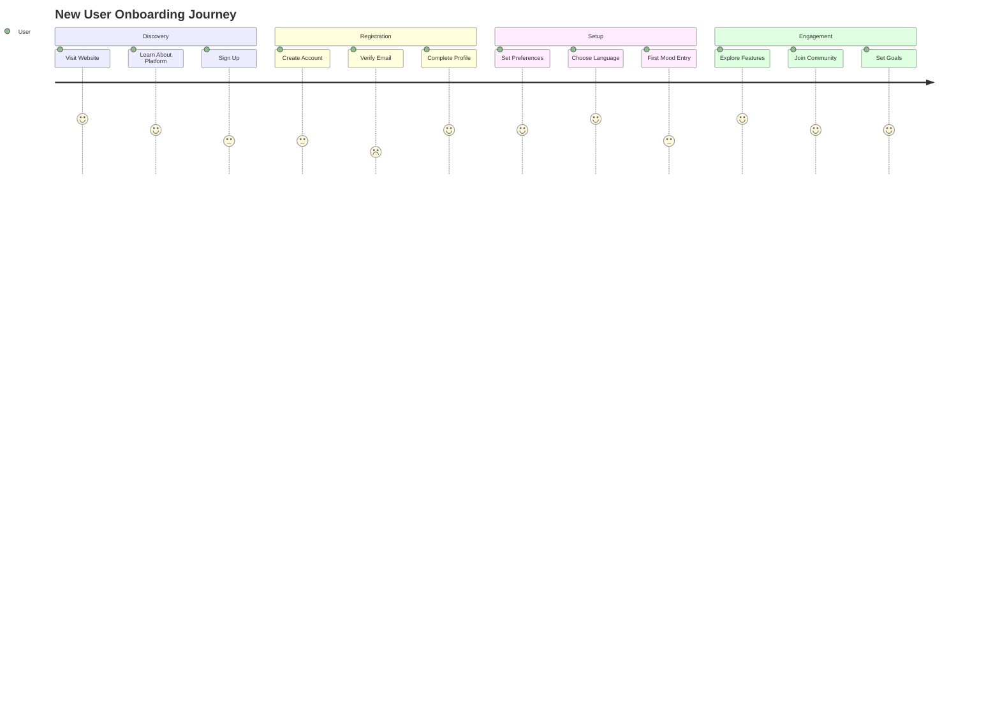
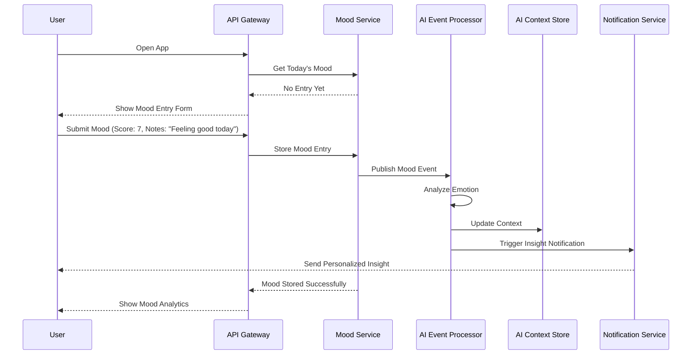
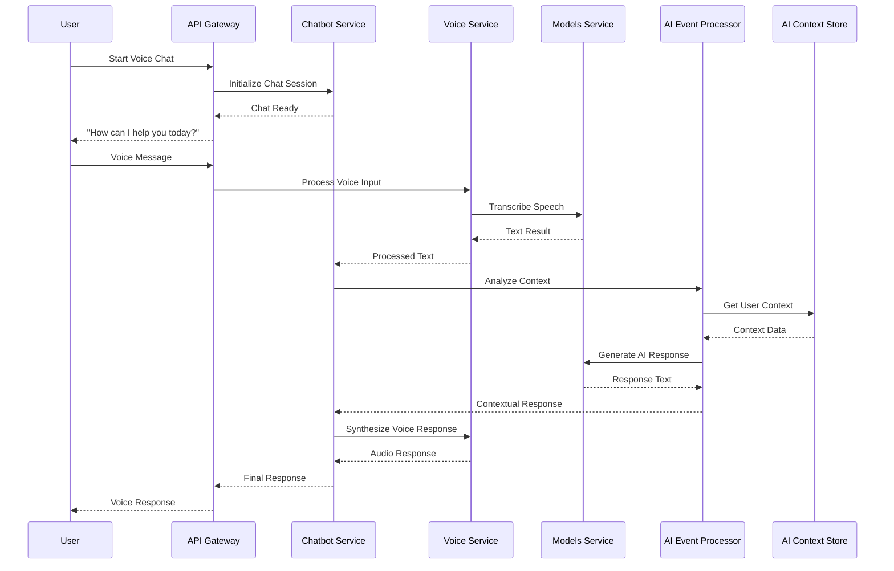
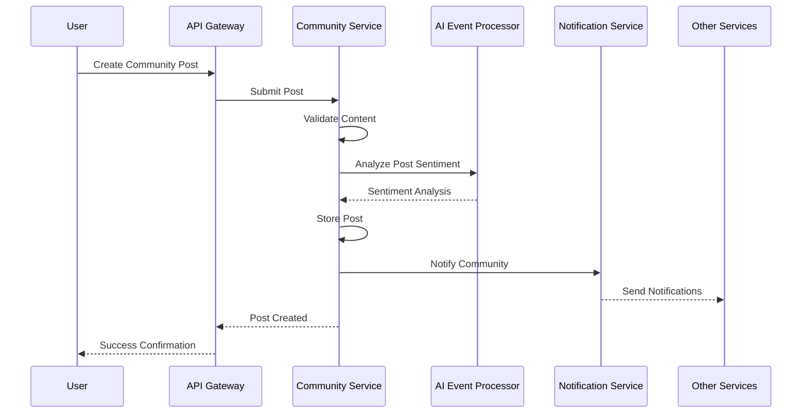
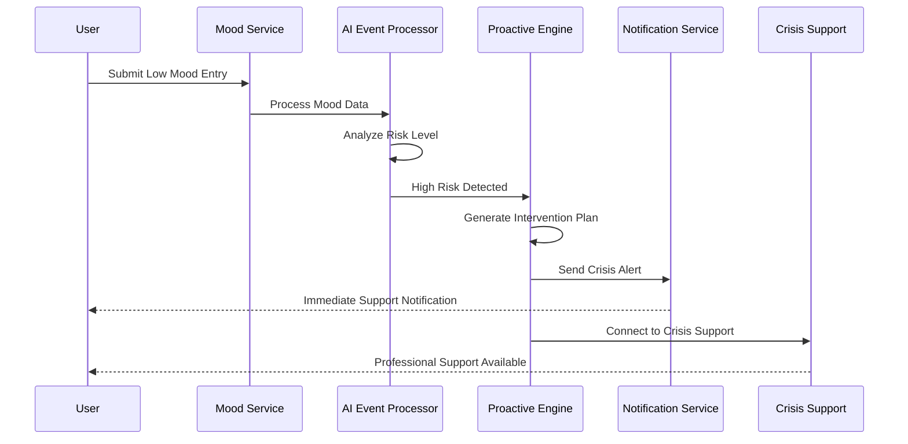
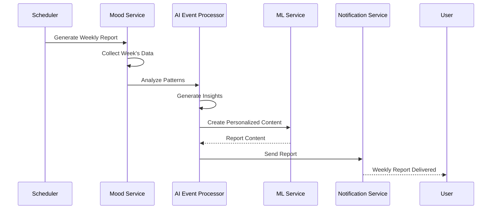
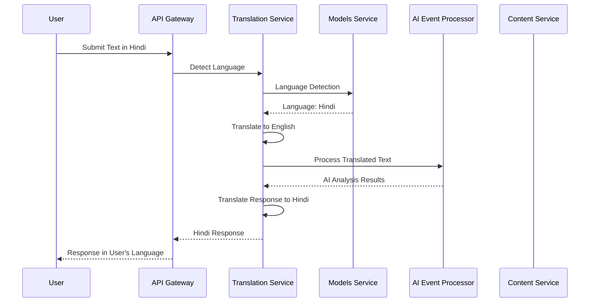
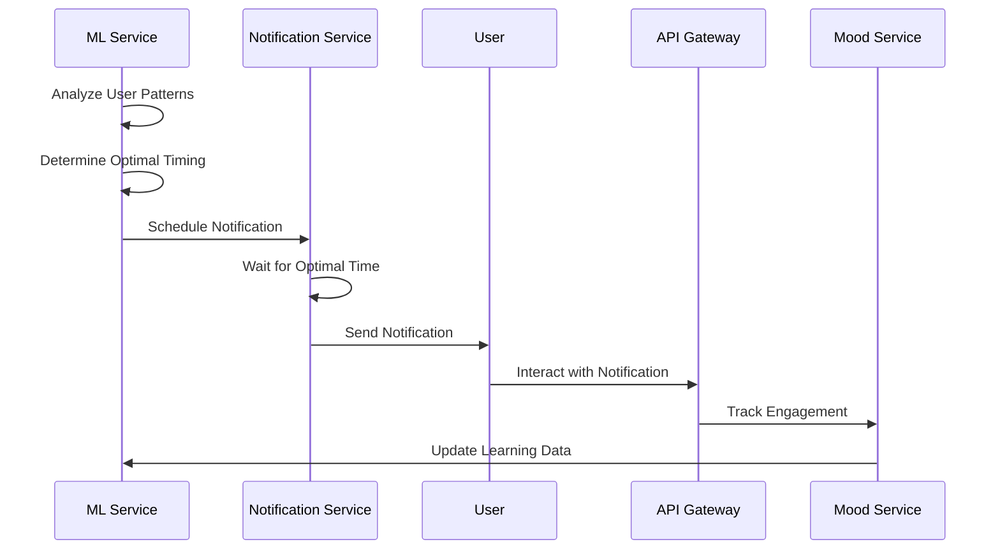

# MantraPath User Workflows

## 🎯 Overview

This document outlines the key user workflows in MantraPath, detailing how users interact with the platform and how the system responds to provide personalized mental health support.

## 👤 User Journey Map

### **1. New User Onboarding**



#### **Detailed Onboarding Flow**

1. **Landing Page Experience**
   - User visits MantraPath website
   - Views platform features and benefits
   - Reads about mental health support
   - Clicks "Get Started" or "Sign Up"

2. **Account Creation**
   ```
   User → API Gateway → Auth Service → Database
   ```
   - User fills registration form
   - System validates email format and password strength
   - Account created with verification token
   - Welcome email sent with verification link

3. **Email Verification**
   ```
   User → Email Link → API Gateway → Auth Service → Database
   ```
   - User clicks verification link
   - System validates token and activates account
   - User redirected to profile setup

4. **Profile Setup**
   ```
   User → API Gateway → Profile Service → Database
   ```
   - User completes profile information
   - Sets timezone and language preferences
   - Chooses notification preferences
   - Uploads profile picture (optional)

5. **First Mood Entry**
   ```
   User → API Gateway → Mood Service → AI Event Processor → Context Store
   ```
   - User logs first mood entry
   - System analyzes emotion and context
   - AI generates personalized insights
   - User receives welcome insights

### **2. Daily Mood Tracking Workflow**

#### **Morning Check-in**



#### **Detailed Mood Tracking Process**

1. **User Opens App**
   - App checks for today's mood entry
   - If no entry, shows mood tracking interface
   - If entry exists, shows mood analytics

2. **Mood Entry Submission**
   - User selects mood score (1-10)
   - Optionally adds notes about feelings
   - Selects activities that influenced mood
   - Submits entry

3. **AI Processing**
   - Mood data sent to AI Event Processor
   - Emotion analysis performed on notes
   - Cultural context applied based on user preferences
   - Patterns compared with historical data

4. **Context Update**
   - AI Context Store updated with new mood data
   - User context enriched with emotional insights
   - Behavioral patterns analyzed

5. **Insight Generation**
   - Personalized insights generated
   - Recommendations provided based on mood patterns
   - Notifications sent if intervention needed

### **3. AI-Powered Chat Interaction**

#### **Voice Chat Workflow**



#### **Text Chat Workflow**

1. **Chat Initiation**
   - User opens chat interface
   - System loads conversation history
   - AI context retrieved for personalization

2. **Message Processing**
   - User types or speaks message
   - Voice converted to text (if applicable)
   - Message sent to AI Event Processor

3. **AI Analysis**
   - Emotion analysis performed on message
   - User context considered for response
   - Cultural preferences applied
   - Appropriate response generated

4. **Response Delivery**
   - AI response generated
   - Voice synthesis (if voice chat)
   - Response delivered to user
   - Conversation history updated

### **4. Community Engagement Workflow**

#### **Community Post Creation**



#### **Community Interaction Flow**

1. **Post Creation**
   - User navigates to community section
   - Selects appropriate forum/category
   - Writes post content
   - Optionally adds tags or mood context

2. **Content Moderation**
   - AI analyzes post for appropriate content
   - Sentiment analysis performed
   - Cultural sensitivity checked
   - Post approved or flagged for review

3. **Community Notification**
   - Post published to community
   - Relevant users notified
   - Post appears in community feed

4. **Engagement**
   - Other users can like, comment, or share
   - Supportive interactions encouraged
   - Moderation ensures positive environment

### **5. Crisis Intervention Workflow**

#### **High-Risk Detection and Response**



#### **Crisis Detection Process**

1. **Risk Assessment**
   - AI analyzes mood patterns
   - Identifies concerning trends
   - Calculates risk score
   - Triggers intervention if threshold exceeded

2. **Immediate Response**
   - Crisis notification sent to user
   - Support resources provided
   - Professional help options offered
   - Follow-up scheduled

3. **Support Connection**
   - User connected with crisis support
   - Professional resources provided
   - Ongoing monitoring activated
   - Family/emergency contacts notified (if consent given)

### **6. Weekly Report Generation**

#### **Insight Report Workflow**



#### **Report Generation Process**

1. **Data Collection**
   - System collects week's mood entries
   - Analyzes patterns and trends
   - Identifies significant events
   - Compares with previous weeks

2. **Insight Generation**
   - AI analyzes emotional patterns
   - Identifies triggers and coping strategies
   - Generates personalized recommendations
   - Creates visual representations

3. **Report Delivery**
   - Personalized report generated
   - Sent via notification or email
   - User can view detailed analytics
   - Actionable insights provided

### **7. Multi-Language Support Workflow**

#### **Language Detection and Translation**



#### **Language Processing Flow**

1. **Language Detection**
   - System detects input language
   - Identifies user's preferred language
   - Determines if translation needed

2. **Content Translation**
   - Text translated to processing language
   - AI analysis performed
   - Results translated back to user's language

3. **Cultural Adaptation**
   - Cultural context applied
   - Region-specific insights provided
   - Appropriate cultural references used

### **8. Notification Management Workflow**

#### **Smart Notification Delivery**



#### **Notification Process**

1. **Timing Optimization**
   - ML analyzes user engagement patterns
   - Determines optimal notification times
   - Considers user's timezone and schedule
   - Schedules notifications accordingly

2. **Content Personalization**
   - Notifications tailored to user's mood
   - Cultural preferences considered
   - Appropriate tone and language used
   - Actionable content provided

3. **Engagement Tracking**
   - User interactions monitored
   - Effectiveness measured
   - ML models updated
   - Future notifications improved

## 🎯 Key User Personas and Workflows

### **1. New User (Sarah)**
- **Background**: First-time user, dealing with anxiety
- **Goals**: Learn about mental health, track mood, find support
- **Workflow**: Onboarding → Mood tracking → Community exploration → AI chat

### **2. Regular User (Ahmed)**
- **Background**: Daily user, managing depression
- **Goals**: Maintain mood stability, get insights, connect with community
- **Workflow**: Daily check-ins → AI insights → Community engagement → Weekly reports

### **3. Crisis User (Maria)**
- **Background**: Experiencing mental health crisis
- **Goals**: Immediate support, professional help, safety
- **Workflow**: Crisis detection → Immediate intervention → Professional support → Ongoing monitoring

### **4. Community User (Raj)**
- **Background**: Active community member, helping others
- **Goals**: Support others, share experiences, build connections
- **Workflow**: Community browsing → Post creation → Support others → Moderation

### **5. Multilingual User (Chen)**
- **Background**: Non-English speaker, prefers native language
- **Goals**: Use platform in native language, cultural relevance
- **Workflow**: Language selection → Content translation → Cultural adaptation → Localized experience

## 🔧 Technical Implementation of Workflows

### **1. Workflow State Management**

```python
class WorkflowState:
    def __init__(self, user_id: str, workflow_type: str):
        self.user_id = user_id
        self.workflow_type = workflow_type
        self.current_step = 0
        self.completed_steps = []
        self.data = {}
        self.created_at = datetime.utcnow()
    
    def advance_step(self, step_data: dict = None):
        self.completed_steps.append(self.current_step)
        self.current_step += 1
        if step_data:
            self.data.update(step_data)
    
    def is_complete(self) -> bool:
        return self.current_step >= len(self.workflow_steps)
```

### **2. Workflow Orchestration**

```python
class WorkflowOrchestrator:
    def __init__(self):
        self.workflows = {
            "onboarding": OnboardingWorkflow(),
            "mood_tracking": MoodTrackingWorkflow(),
            "crisis_intervention": CrisisInterventionWorkflow(),
            "weekly_report": WeeklyReportWorkflow()
        }
    
    async def execute_workflow(self, workflow_type: str, user_id: str, data: dict):
        workflow = self.workflows[workflow_type]
        state = WorkflowState(user_id, workflow_type)
        
        for step in workflow.steps:
            try:
                result = await step.execute(state, data)
                state.advance_step(result)
            except Exception as e:
                logger.error(f"Workflow step failed: {e}")
                await self.handle_workflow_error(state, e)
                break
        
        return state
```

### **3. User Journey Tracking**

```python
class UserJourneyTracker:
    def __init__(self, redis_client):
        self.redis = redis_client
    
    async def track_event(self, user_id: str, event_type: str, data: dict):
        event = {
            "user_id": user_id,
            "event_type": event_type,
            "data": data,
            "timestamp": datetime.utcnow().isoformat()
        }
        
        # Store in Redis for real-time analysis
        await self.redis.lpush(f"user_journey:{user_id}", json.dumps(event))
        
        # Publish event for other services
        await self.publish_journey_event(event)
    
    async def get_user_journey(self, user_id: str) -> List[dict]:
        events = await self.redis.lrange(f"user_journey:{user_id}", 0, -1)
        return [json.loads(event) for event in events]
```

## 📊 Workflow Analytics

### **1. User Engagement Metrics**

```python
class WorkflowAnalytics:
    def __init__(self, db: Session):
        self.db = db
    
    def calculate_completion_rate(self, workflow_type: str) -> float:
        total_started = self.db.query(WorkflowState).filter(
            WorkflowState.workflow_type == workflow_type
        ).count()
        
        total_completed = self.db.query(WorkflowState).filter(
            and_(
                WorkflowState.workflow_type == workflow_type,
                WorkflowState.is_complete == True
            )
        ).count()
        
        return total_completed / total_started if total_started > 0 else 0
    
    def identify_drop_off_points(self, workflow_type: str) -> List[dict]:
        # Analyze where users drop off in workflows
        step_completion = self.db.query(
            WorkflowState.current_step,
            func.count(WorkflowState.id).label('count')
        ).filter(
            WorkflowState.workflow_type == workflow_type
        ).group_by(WorkflowState.current_step).all()
        
        return [
            {"step": step, "user_count": count}
            for step, count in step_completion
        ]
```

### **2. A/B Testing for Workflows**

```python
class WorkflowABTesting:
    def __init__(self):
        self.experiments = {}
    
    def create_experiment(self, workflow_type: str, variants: List[dict]):
        experiment = {
            "workflow_type": workflow_type,
            "variants": variants,
            "start_date": datetime.utcnow(),
            "status": "active"
        }
        
        self.experiments[workflow_type] = experiment
    
    def assign_variant(self, user_id: str, workflow_type: str) -> dict:
        if workflow_type not in self.experiments:
            return {"variant": "control"}
        
        # Simple hash-based assignment
        hash_value = hash(f"{user_id}_{workflow_type}") % 100
        variants = self.experiments[workflow_type]["variants"]
        
        cumulative = 0
        for variant in variants:
            cumulative += variant["traffic_percentage"]
            if hash_value < cumulative:
                return variant
        
        return variants[0]  # Fallback to first variant
```

This comprehensive user workflow documentation provides detailed insights into how users interact with MantraPath, ensuring a smooth, personalized, and supportive mental health experience.
