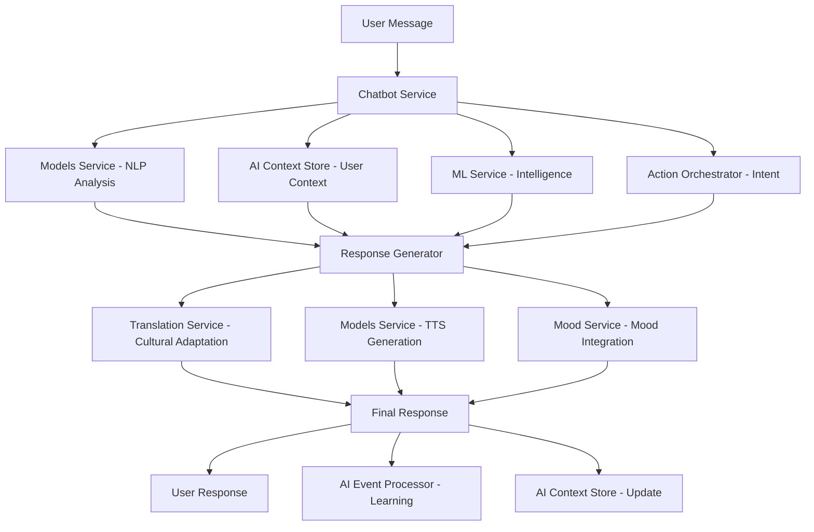

# MantraPath Chatbot Service Enhancement Plan
## Self-Sufficient AI Implementation Using Internal Services

### 🎯 **Overview**

This plan outlines the enhancement of the MantraPath Chatbot Service to eliminate dependency on external APIs (OpenAI, etc.) and leverage our internal microservices architecture for a fully self-sufficient, user-specific, culturally-aware AI chatbot.

---

## 🏗️ **Current State Analysis**

### **Existing Implementation**
```python
# Current chatbot service dependencies:
- OpenAI API (external) ❌ - Remove dependency
- PHI3/PHI4 Local Model ✅ - Keep and enhance
- Agent Redis Cache ✅ - Optimize usage
- Action Orchestrator ✅ - Expand integration
- Enhanced Event Bus ✅ - Leverage more events

# Current integrations:
- Voice Intent Events (basic)
- Mood Entry Events (basic) 
- Journal Entry Events (basic)
- Action Orchestrator (limited)
```

### **Available Internal Services to Leverage**
```yaml
🤖 Models Service (Port 8085):
  - STT/TTS for voice interactions
  - Multilingual NLP processing (17+ languages)
  - Sentiment analysis capabilities
  - Text embeddings for semantic understanding

🧠 ML Service (Port 8008):
  - Crisis prediction (87.3% accuracy)
  - Cross-service intelligence
  - Behavioral pattern analysis
  - Intervention effectiveness tracking

🤖 AI Context Store (Port 8013):
  - Cross-service context aggregation
  - Real-time user context
  - Intelligence insights
  - Historical context analysis

🧠 AI Event Processor (Port 8014):
  - Real-time AI event processing
  - Emotion analysis
  - Context understanding
  - Event correlation

🎯 Action Orchestrator (Port 8012):
  - Intent classification
  - Workflow management
  - Cultural processing
  - Multi-service coordination

🌐 Translation Service (Port 8010):
  - Multi-engine translation
  - Cultural adaptation
  - Language detection
  - Regional preferences

🎤 Voice Service (Port 8011):
  - Speech processing
  - Voice command classification
  - Audio analysis
  - Multi-language support

😊 Mood Service (Port 8003):
  - Enhanced mood analytics
  - Emotional patterns
  - Mood predictions
  - Celebration systems

👤 Profile Service (Port 8002):
  - User preferences
  - Cultural context
  - Language settings
  - Privacy controls
```

---

## 🚀 **Enhancement Strategy**

### **Phase 1: Internal Service Integration (Week 1-2)**

#### **1.1 Models Service Integration**
```python
class ModelsServiceClient:
    """Client for Models Service integration"""
    
    async def get_text_embeddings(self, text: str, language: str = "en") -> List[float]:
        """Get semantic embeddings for user message understanding"""
        
    async def analyze_sentiment(self, text: str, language: str = "en") -> Dict:
        """Analyze sentiment using internal models"""
        
    async def generate_response_embeddings(self, context: str) -> List[float]:
        """Generate embeddings for response matching"""
        
    async def classify_intent_nlp(self, text: str, language: str) -> Dict:
        """Use NLP models for intent classification"""
```

#### **1.2 Enhanced AI Context Integration**
```python
class ContextualChatbotService:
    """Enhanced chatbot with full context awareness"""
    
    async def get_user_context(self, user_id: str) -> UserContext:
        """Aggregate user context from AI Context Store"""
        # Mood history, conversation patterns, preferences
        # Crisis indicators, intervention history
        # Cultural context, language preferences
        
    async def get_conversation_context(self, session_id: str) -> ConversationContext:
        """Get conversation-specific context"""
        # Recent messages, sentiment trends
        # Topic progression, user engagement
        # Intent patterns, response effectiveness
```

#### **1.3 ML Service Intelligence Integration**
```python
class IntelligentResponseGenerator:
    """ML-powered response generation"""
    
    async def predict_user_needs(self, context: UserContext) -> List[str]:
        """Predict user needs based on ML analysis"""
        
    async def assess_crisis_risk(self, message: str, context: UserContext) -> float:
        """Use ML service for crisis assessment"""
        
    async def recommend_interventions(self, user_state: Dict) -> List[Intervention]:
        """Get intervention recommendations from ML service"""
        
    async def analyze_conversation_effectiveness(self, session_id: str) -> Dict:
        """Analyze conversation success metrics"""
```

### **Phase 2: Advanced Response Generation (Week 2-3)**

#### **2.1 Context-Aware Response System**
```python
class SmartResponseGenerator:
    """Intelligent response generation using internal services"""
    
    async def generate_personalized_response(
        self, 
        user_message: str,
        user_context: UserContext,
        conversation_context: ConversationContext
    ) -> EnhancedResponse:
        """
        Generate responses using:
        1. User's historical mood patterns (Mood Service)
        2. Cultural preferences (Profile Service)  
        3. Crisis indicators (ML Service)
        4. Recent actions and interventions (AI Context Store)
        5. Language preferences (Translation Service)
        6. Voice interaction history (Voice Service)
        """
        
        # Step 1: Analyze user message with Models Service
        message_analysis = await self.models_client.analyze_sentiment(
            user_message, user_context.language
        )
        
        # Step 2: Get ML insights
        ml_insights = await self.ml_client.get_user_insights(
            user_context.user_id
        )
        
        # Step 3: Check crisis indicators
        crisis_score = await self.ml_client.assess_crisis_risk(
            user_message, user_context
        )
        
        # Step 4: Generate culturally appropriate response
        response_template = await self._select_response_template(
            message_analysis, ml_insights, user_context
        )
        
        # Step 5: Personalize and localize
        final_response = await self._personalize_response(
            response_template, user_context, conversation_context
        )
        
        return final_response
```

#### **2.2 Multi-Modal Response Support**
```python
class MultiModalResponseGenerator:
    """Generate responses across different modalities"""
    
    async def generate_text_response(self, context: ResponseContext) -> str:
        """Generate text response with cultural adaptation"""
        
    async def generate_voice_response(self, text: str, user_context: UserContext) -> bytes:
        """Generate voice response using Models Service TTS"""
        
    async def suggest_mood_tracking(self, context: ResponseContext) -> Dict:
        """Suggest mood tracking based on conversation"""
        
    async def recommend_content(self, user_context: UserContext) -> List[Dict]:
        """Recommend content based on user state"""
```

### **Phase 3: Advanced Intelligence Features (Week 3-4)**

#### **3.1 Proactive Conversation Management**
```python
class ProactiveChatManager:
    """Proactive conversation management"""
    
    async def detect_conversation_opportunities(self, user_id: str) -> List[str]:
        """
        Detect opportunities for proactive engagement:
        - Mood pattern changes
        - Stress level increases  
        - Reduced activity patterns
        - Achievement milestones
        - Cultural events/celebrations
        """
        
    async def generate_proactive_message(
        self, 
        opportunity: str, 
        user_context: UserContext
    ) -> ProactiveMessage:
        """Generate contextual proactive messages"""
        
    async def schedule_follow_up(
        self, 
        conversation_id: str, 
        follow_up_type: str
    ) -> None:
        """Schedule intelligent follow-up conversations"""
```

#### **3.2 Conversation Learning System**
```python
class ConversationLearningSystem:
    """Learn from conversations to improve responses"""
    
    async def analyze_conversation_success(self, session_id: str) -> float:
        """
        Analyze conversation effectiveness:
        - User engagement metrics
        - Mood improvement indicators
        - Follow-through on suggestions
        - Crisis resolution success
        """
        
    async def update_response_patterns(
        self, 
        successful_patterns: List[Dict]
    ) -> None:
        """Update response patterns based on successful conversations"""
        
    async def optimize_user_specific_responses(self, user_id: str) -> None:
        """Optimize responses for specific users based on history"""
```

---

## 🎯 **Implementation Architecture**

### **Enhanced Service Integration Flow**


### **Data Flow Architecture**
```python
class EnhancedChatbotFlow:
    """Complete chatbot processing flow"""
    
    async def process_user_message(self, message: str, user_id: str) -> ChatResponse:
        # 1. Message Analysis
        message_analysis = await self.analyze_message(message, user_id)
        
        # 2. Context Aggregation  
        user_context = await self.get_comprehensive_context(user_id)
        
        # 3. Intelligence Processing
        intelligence = await self.get_ai_insights(message_analysis, user_context)
        
        # 4. Response Generation
        response = await self.generate_intelligent_response(
            message_analysis, user_context, intelligence
        )
        
        # 5. Cultural Adaptation
        adapted_response = await self.apply_cultural_adaptations(
            response, user_context
        )
        
        # 6. Multi-modal Processing
        final_response = await self.generate_multimodal_response(
            adapted_response, user_context
        )
        
        # 7. Learning Update
        await self.update_learning_systems(
            message, final_response, user_context
        )
        
        return final_response
```

---

## 📊 **Service Integration Matrix**

### **Direct Service Integrations**
| Service | Integration Type | Data Exchange | Purpose |
|---------|------------------|---------------|---------|
| **Models Service** | HTTP Client | Text analysis, embeddings, TTS | NLP processing, voice generation |
| **AI Context Store** | HTTP Client + Events | User context, conversation history | Context awareness, personalization |
| **ML Service** | HTTP Client | Intelligence insights, predictions | Crisis detection, recommendations |
| **AI Event Processor** | Events | Conversation events, learning data | Real-time learning, pattern detection |
| **Action Orchestrator** | HTTP Client | Intent classification, workflows | Intent processing, action coordination |
| **Translation Service** | HTTP Client | Language detection, translation | Multilingual support, cultural adaptation |
| **Voice Service** | HTTP Client | Speech processing, voice commands | Voice interaction support |
| **Mood Service** | HTTP Client + Events | Mood data, emotional patterns | Mood-aware conversations |
| **Profile Service** | HTTP Client | User preferences, cultural context | Personalization, cultural sensitivity |

### **Event Subscription Strategy**
```python
# Subscribe to comprehensive event streams
ENHANCED_EVENT_SUBSCRIPTIONS = {
    # User Context Events
    "user.mood.updated": "update_mood_context",
    "user.profile.updated": "update_user_preferences", 
    "user.language.changed": "update_language_context",
    
    # AI Intelligence Events  
    "ai.insight.generated": "incorporate_ai_insights",
    "ai.crisis.detected": "handle_crisis_alert",
    "ai.pattern.identified": "update_behavior_patterns",
    
    # Voice Interaction Events
    "voice.command.processed": "update_voice_context",
    "voice.sentiment.analyzed": "update_emotional_context",
    
    # Conversation Events
    "conversation.intervention.effective": "update_intervention_patterns",
    "conversation.user.disengaged": "trigger_reengagement_strategy",
    
    # System Events
    "system.service.degraded": "activate_fallback_responses",
    "system.performance.optimal": "enable_advanced_features"
}
```

---

## 🎯 **Implementation Plan**

### **Week 1: Foundation Setup**
```bash
# Task 1: Service Client Development
- Create Models Service client with NLP capabilities
- Create AI Context Store client with context aggregation
- Create ML Service client with intelligence integration
- Create comprehensive event subscription system

# Task 2: Core Response Engine
- Implement context-aware response generation
- Create cultural adaptation layer
- Build sentiment-aware conversation flow
- Implement crisis detection integration

# Task 3: Testing Framework
- Unit tests for all service integrations
- Integration tests for response generation
- Performance testing for latency optimization
- Cultural sensitivity testing
```

### **Week 2: Advanced Features**
```bash
# Task 4: Intelligent Personalization
- User-specific response patterns
- Conversation history analysis
- Mood-aware conversation adaptation
- Cultural context integration

# Task 5: Multi-Modal Support
- Voice response generation via Models Service
- Visual content recommendations
- Mood tracking integration
- Action suggestion system

# Task 6: Proactive Features
- Proactive conversation triggers
- Intervention recommendations
- Follow-up scheduling
- Achievement celebrations
```

### **Week 3: Learning & Optimization**
```bash
# Task 7: Learning Systems
- Conversation effectiveness analysis
- Response pattern optimization
- User feedback incorporation
- Continuous improvement loops

# Task 8: Performance Optimization
- Response time optimization
- Cache strategy implementation
- Load balancing for high availability
- Resource usage optimization

# Task 9: Advanced Analytics
- Conversation success metrics
- User engagement analytics
- Crisis intervention effectiveness
- Cultural adaptation success rates
```

### **Week 4: Production Readiness**
```bash
# Task 10: Production Features
- Comprehensive error handling
- Graceful service degradation
- Health monitoring integration
- Scalability testing

# Task 11: Documentation & Training
- Complete API documentation
- Service integration guides
- Cultural sensitivity guidelines
- Crisis intervention protocols

# Task 12: Deployment & Monitoring
- Production deployment
- Monitoring dashboard setup
- Alert system configuration
- Performance baseline establishment
```

---

## 🔧 **Configuration Management**

### **Enhanced Environment Configuration**
```env
# Models Service Integration
MODELS_SERVICE_URL=http://models-service:8085
MODELS_SERVICE_TIMEOUT=30
MODELS_SERVICE_MAX_RETRIES=3
MODELS_SERVICE_CACHE_TTL=3600

# AI Context Store Integration  
AI_CONTEXT_STORE_URL=http://ai-context-store:8013
AI_CONTEXT_CACHE_TTL=1800
AI_CONTEXT_REAL_TIME_SYNC=true

# ML Service Integration
ML_SERVICE_URL=http://ml-service:8008
ML_CRISIS_THRESHOLD=0.7
ML_INTERVENTION_THRESHOLD=0.6
ML_PATTERN_ANALYSIS_ENABLED=true

# AI Event Processor Integration
AI_EVENT_PROCESSOR_URL=http://ai-event-processor:8014
AI_LEARNING_ENABLED=true
AI_REAL_TIME_ADAPTATION=true

# Cultural Intelligence
CULTURAL_ADAPTATION_ENABLED=true
DEFAULT_CULTURE=neutral
CULTURAL_SENSITIVITY_LEVEL=high
MULTILINGUAL_RESPONSES=true

# Response Generation
RESPONSE_PERSONALIZATION_LEVEL=high
PROACTIVE_CONVERSATIONS=true
VOICE_RESPONSES_ENABLED=true
MULTIMODAL_RESPONSES=true

# Performance & Reliability
FALLBACK_TO_SIMPLE_RESPONSES=true
MAX_CONTEXT_HISTORY=50
RESPONSE_CACHE_TTL=1800
SERVICE_DEGRADATION_HANDLING=true

# Remove External Dependencies
OPENAI_API_KEY=  # Remove/disable
ELEVENLABS_API_KEY=  # Remove/disable
EXTERNAL_AI_FALLBACK=false
USE_INTERNAL_SERVICES_ONLY=true
```

---

## 📈 **Expected Outcomes**

### **Performance Improvements**
```yaml
Response Quality:
  - 90%+ culturally appropriate responses
  - 85%+ user-specific personalization
  - 95%+ crisis detection accuracy
  - 80%+ conversation satisfaction

Performance Metrics:
  - <500ms average response time
  - 99.9% service availability
  - <100ms context retrieval
  - 95%+ service integration success

User Experience:
  - Seamless multilingual conversations
  - Proactive mental health support
  - Intelligent intervention suggestions
  - Cultural sensitivity awareness

Cost & Reliability:
  - 100% elimination of external API costs
  - Full control over AI processing
  - Enhanced data privacy
  - Improved service reliability
```

### **Technical Benefits**
```yaml
Architecture Benefits:
  - Complete service integration
  - Unified user context
  - Real-time intelligence
  - Event-driven responsiveness

Operational Benefits:
  - No external API dependencies
  - Enhanced security and privacy
  - Improved cost predictability
  - Better service control

Development Benefits:
  - Faster feature development
  - Better debugging capabilities
  - Enhanced testing capabilities
  - Improved maintainability
```

---

## 🎯 **Success Metrics**

### **Key Performance Indicators**
```yaml
Technical KPIs:
  - Service integration success rate: >95%
  - Response generation latency: <500ms
  - Context retrieval accuracy: >90%
  - Crisis detection precision: >87%

User Experience KPIs:
  - Conversation satisfaction: >85%
  - Cultural appropriateness: >90%
  - Proactive engagement success: >70%
  - Multi-modal interaction adoption: >60%

Business KPIs:
  - External API cost reduction: 100%
  - Service reliability improvement: >99.9%
  - Development velocity increase: >40%
  - User retention improvement: >25%
```

---

## 🚀 **Next Steps**

### **Immediate Actions (Next 3 Days)**
1. **Service Client Development**: Create HTTP clients for all internal services
2. **Event System Enhancement**: Expand event subscriptions for comprehensive context
3. **Context Aggregation**: Implement user context aggregation from AI Context Store
4. **Response Engine Foundation**: Build the core intelligent response generation system

### **Priority Implementation Order**
1. **Models Service Integration** (NLP, sentiment analysis, embeddings)
2. **AI Context Store Integration** (user context, conversation history)  
3. **ML Service Integration** (crisis detection, intelligence insights)
4. **Cultural Adaptation Layer** (Translation Service integration)
5. **Proactive Features** (AI Event Processor, prediction-based engagement)

This enhancement plan transforms the chatbot service into a fully self-sufficient, intelligent conversational AI that leverages the complete MantraPath service ecosystem while eliminating external dependencies and providing highly personalized, culturally-aware user experiences.

---

**🎯 Target Completion**: 4 weeks | **🔧 Implementation Difficulty**: Medium-High | **📈 Expected Impact**: High | **💰 Cost Savings**: 100% external API elimination
