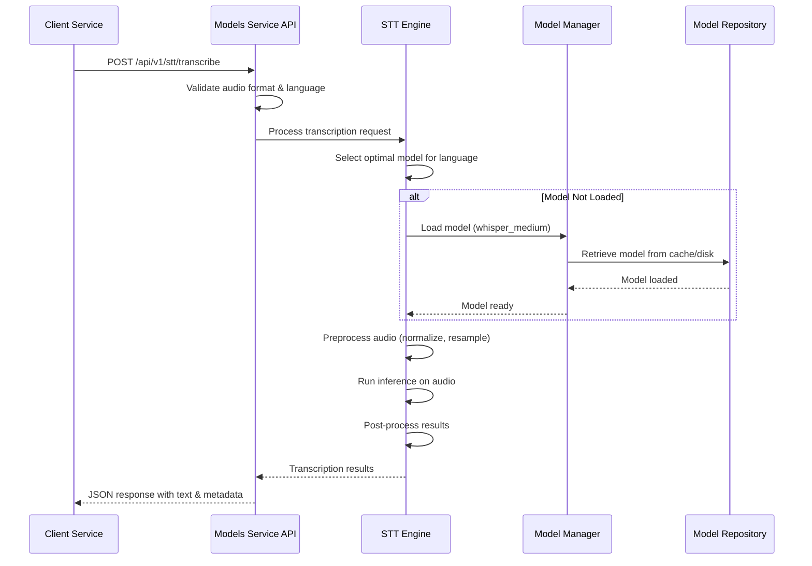
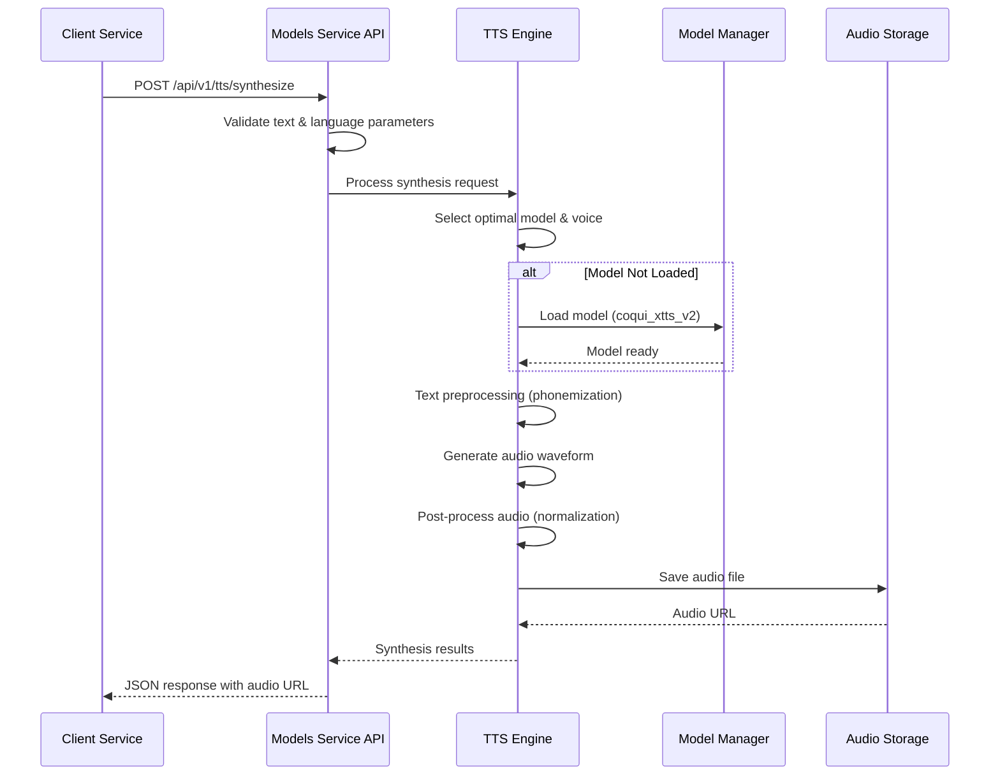
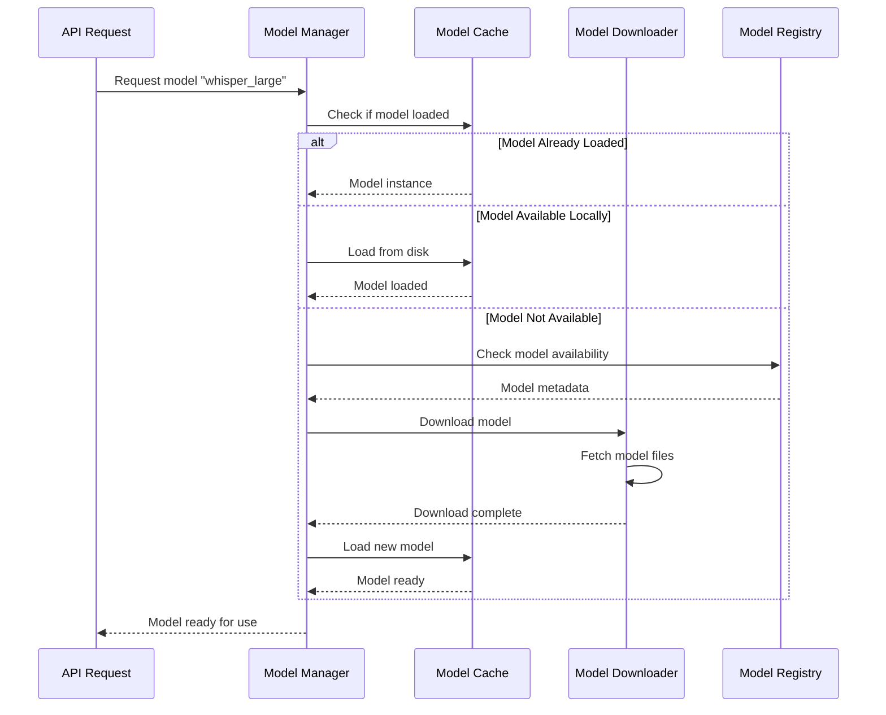

# MantraPath Models Service 🤖

## Overview

The **MantraPath Models Service** is a centralized AI model management and inference platform that serves as the backbone for all machine learning capabilities across the MantraPath wellness ecosystem. It provides unified access to Speech-to-Text (STT), Text-to-Speech (TTS), Natural Language Processing (NLP), and AI model management functionalities through a scalable REST API.

### Key Capabilities

- 🎤 **Speech-to-Text Processing** - Multi-engine STT with Whisper, Vosk, and Wav2Vec2
- 🔊 **Text-to-Speech Synthesis** - High-quality TTS with Coqui TTS, eSpeak, and Festival
- 🧠 **Natural Language Processing** - Embeddings, translation, and text analysis
- 📦 **Dynamic Model Management** - Automated model downloading, caching, and lifecycle management
- 🌍 **Multi-Language Support** - Comprehensive support for Indian and international languages
- ⚡ **Performance Optimization** - GPU acceleration, model caching, and load balancing
- 🔄 **Service Integration** - Seamless integration with all MantraPath platform services

## Service Architecture

```
┌─────────────────────────────────────────────────────────────────┐
│                    Platform Services                            │
│  ┌─────────────┐  ┌─────────────┐  ┌─────────────────────────┐ │
│  │   Voice     │  │  Chatbot    │  │    Translation          │ │
│  │  Service    │  │  Service    │  │     Service             │ │
│  │ (Port 8011) │  │ (Port 8004) │  │   (Port 8005)          │ │
│  └─────────────┘  └─────────────┘  └─────────────────────────┘ │
│  ┌─────────────┐  ┌─────────────┐  ┌─────────────────────────┐ │
│  │   Media     │  │   ML        │  │    Community            │ │
│  │  Service    │  │  Service    │  │     Service             │ │
│  │ (Port 8021) │  │ (Port 8008) │  │   (Port 8006)          │ │
│  └─────────────┘  └─────────────┘  └─────────────────────────┘ │
└─────────────────────────────────────────────────────────────────┘
                              │
                              ▼ Model Requests
┌─────────────────────────────────────────────────────────────────┐
│                Models Service (Port 8080)                       │
│  ┌─────────────┐  ┌─────────────┐  ┌─────────────────────────┐ │
│  │    STT      │  │    TTS      │  │       NLP               │ │
│  │   Engine    │  │   Engine    │  │     Engine              │ │
│  └─────────────┘  └─────────────┘  └─────────────────────────┘ │
│  ┌─────────────┐  ┌─────────────┐  ┌─────────────────────────┐ │
│  │   Model     │  │ Embeddings  │  │    Phi-3 AI             │ │
│  │  Manager    │  │Integration  │  │     Engine              │ │
│  └─────────────┘  └─────────────┘  └─────────────────────────┘ │
└─────────────────────────────────────────────────────────────────┘
                              │
                              ▼
┌─────────────────────────────────────────────────────────────────┐
│                      AI Model Repository                        │
│  ┌─────────────┐  ┌─────────────┐  ┌─────────────────────────┐ │
│  │   Whisper   │  │ Coqui TTS   │  │    Sentence             │ │
│  │   Models    │  │   Models    │  │  Transformers           │ │
│  └─────────────┘  └─────────────┘  └─────────────────────────┘ │
│  ┌─────────────┐  ┌─────────────┐  ┌─────────────────────────┐ │
│  │    Vosk     │  │   eSpeak    │  │     Phi-3               │ │
│  │   Models    │  │   Voices    │  │    Models               │ │
│  └─────────────┘  └─────────────┘  └─────────────────────────┘ │
└─────────────────────────────────────────────────────────────────┘
```

## Directory Structure

```
models_service/
├── main.py                           # FastAPI application entry point (254 lines)
├── requirements.txt                  # Python dependencies (47 lines)
├── Dockerfile                        # Container configuration (Port 8080)
├── start_simple.sh                   # Simple startup script
├── embeddings_integration.py         # TEI embeddings client integration
├── ollama_integration.py             # Ollama model integration
├── __init__.py                       # Package initialization
├── api/                             # API endpoint modules
│   ├── __init__.py
│   ├── routes.py                    # Core STT/TTS/NLP API routes (390 lines)
│   ├── translation_routes.py        # Translation service endpoints
│   ├── text_generation_routes.py    # Text generation via Ollama
│   └── emotion_routes.py            # Emotion analysis endpoints
├── models/                          # AI model engines
│   ├── __init__.py
│   ├── model_manager.py             # Central model management (462 lines)
│   ├── stt_engine.py                # Speech-to-Text engine (454 lines)
│   ├── tts_engine.py                # Text-to-Speech engine (506 lines)
│   ├── nlp_engine.py                # NLP processing engine (103 lines)
│   └── phi3_engine.py               # Phi-3 AI model integration
├── config/                          # Configuration management
│   ├── __init__.py
│   └── settings.py                  # Service configuration (344 lines)
├── utils/                           # Utility modules
│   ├── __init__.py
│   └── logger.py                    # Structured logging configuration
├── tests/                           # Test suites
│   ├── __init__.py
│   ├── conftest.py                  # Test configuration
│   ├── test_main.py                 # Main application tests
│   ├── test_model_manager.py        # Model manager tests
│   ├── test_stt_engine.py           # STT engine tests
│   ├── test_tts_engine.py           # TTS engine tests
│   ├── test_nlp_engine.py           # NLP engine tests
│   ├── test_api_routes.py           # API endpoint tests
│   ├── test_config.py               # Configuration tests
│   └── test_utils.py                # Utility tests
└── logs/                           # Application logs
    └── (runtime log files)
```

## API Endpoints

### Health & Status Monitoring

#### GET `/health`
**Basic Health Check**
```json
Response:
{
  "status": "healthy",
  "timestamp": "2025-09-27T14:30:00Z",
  "service": "models_service",
  "version": "1.0.0"
}
```

#### GET `/status`
**Detailed Service Status**
```json
Response:
{
  "service": "models_service",
  "timestamp": "2025-09-27T14:30:00Z",
  "status": "running",
  "hardware": {
    "cpu_count": 8,
    "memory_gb": 32.0,
    "gpu_available": true,
    "gpu_count": 1,
    "gpu_memory_gb": [24.0]
  },
  "models": {
    "stt_loaded": 3,
    "tts_loaded": 2,
    "nlp_loaded": 1
  },
  "supported_languages": {
    "stt": ["en", "hi", "bn", "te", "ta", "mr", "es", "fr", "de"],
    "tts": ["en", "hi", "bn", "te", "ta", "mr", "es", "fr", "de", "zh", "ja"]
  }
}
```

### Model Management

#### GET `/models/available`
**List All Available Models**
```json
Response:
{
  "stt_models": [
    {
      "name": "whisper_medium",
      "type": "stt",
      "languages": ["multilingual"],
      "quality": "high",
      "size": "769MB",
      "device": ["cpu", "cuda"]
    },
    {
      "name": "vosk_en_us",
      "type": "stt", 
      "languages": ["en"],
      "quality": "good",
      "size": "50MB",
      "device": ["cpu"]
    }
  ],
  "tts_models": [
    {
      "name": "coqui_xtts_v2",
      "type": "tts",
      "languages": ["multilingual"],
      "quality": "high",
      "size": "2.3GB",
      "device": ["cpu", "cuda"]
    }
  ],
  "nlp_models": [
    {
      "name": "sentence_transformers",
      "type": "embeddings",
      "languages": ["multilingual"],
      "quality": "high",
      "size": "438MB",
      "device": ["cpu", "cuda"]
    }
  ]
}
```

#### GET `/models/loaded`
**List Currently Loaded Models**
```json
Response:
{
  "stt": ["whisper_medium", "vosk_en_us", "vosk_hi"],
  "tts": ["coqui_xtts_v2", "espeak_en"],
  "nlp": ["sentence_transformers", "tei_embeddings"]
}
```

### Speech-to-Text (STT) Endpoints

#### POST `/api/v1/stt/transcribe`
**Transcribe Audio to Text**
```json
Request:
Content-Type: multipart/form-data
audio: (audio file - WAV, MP3, FLAC, M4A)
language: "auto" | "en" | "hi" | "bn" | etc.
model_preference: "whisper_medium" (optional)

Response:
{
  "success": true,
  "text": "Hello, how are you feeling today?",
  "language_detected": "en",
  "confidence": 0.94,
  "model_used": "whisper_medium",
  "processing_time_ms": 1250
}
```

#### GET `/api/v1/stt/languages`
**Get Supported STT Languages**
```json
Response:
{
  "supported_languages": {
    "en": {
      "name": "English",
      "models": ["whisper_medium", "vosk_en_us", "wav2vec2_en"],
      "quality_levels": ["high", "medium", "fast"]
    },
    "hi": {
      "name": "हिंदी (Hindi)",
      "models": ["whisper_medium", "vosk_hi", "wav2vec2_hi"],
      "quality_levels": ["high", "medium", "fast"]
    },
    "bn": {
      "name": "বাংলা (Bengali)",
      "models": ["whisper_medium", "wav2vec2_bn"],
      "quality_levels": ["high", "medium"]
    }
  }
}
```

### Text-to-Speech (TTS) Endpoints

#### POST `/api/v1/tts/synthesize`
**Synthesize Speech from Text**
```json
Request:
{
  "text": "Welcome to MantraPath wellness platform",
  "language": "en",
  "voice": "default",
  "model_preference": "coqui_xtts_v2"
}

Response:
{
  "success": true,
  "audio_url": "/api/v1/tts/audio/session_123_audio.wav",
  "duration": 3.2,
  "sample_rate": 22050,
  "model_used": "coqui_xtts_v2",
  "processing_time_ms": 2100
}
```

#### GET `/api/v1/tts/languages`
**Get Supported TTS Languages**
```json
Response:
{
  "supported_languages": {
    "en": {
      "name": "English",
      "voices": ["default", "male", "female"],
      "models": ["coqui_xtts_v2", "espeak_en", "festival_en"],
      "quality_levels": ["high", "medium", "fast"]
    },
    "hi": {
      "name": "हिंदी (Hindi)",
      "voices": ["default", "male", "female"],
      "models": ["coqui_xtts_v2", "coqui_hi", "espeak_hi"],
      "quality_levels": ["high", "medium", "fast"]
    }
  }
}
```

#### GET `/api/v1/tts/voices/{language}`
**Get Available Voices for Language**
```json
Response:
{
  "language": "en",
  "voices": [
    {
      "id": "default",
      "name": "Default English",
      "gender": "neutral",
      "model": "coqui_xtts_v2",
      "quality": "high"
    },
    {
      "id": "male_formal",
      "name": "Formal Male",
      "gender": "male", 
      "model": "coqui_xtts_v2",
      "quality": "high"
    }
  ]
}
```

### Natural Language Processing (NLP) Endpoints

#### POST `/api/v1/nlp/embeddings`
**Generate Text Embeddings**
```json
Request:
{
  "texts": [
    "I am feeling peaceful after meditation",
    "Today was a challenging day at work"
  ],
  "model": "sentence_transformers"
}

Response:
{
  "success": true,
  "embeddings": [
    [0.1234, -0.5678, 0.9012, ...],  // 384-dimensional vector
    [0.2345, -0.6789, 0.8901, ...]
  ],
  "model_used": "sentence_transformers",
  "dimensions": 384,
  "processing_time_ms": 156
}
```

#### POST `/api/v1/nlp/similarity`
**Calculate Text Similarity**
```json
Request:
{
  "text1": "I feel happy and energetic",
  "text2": "I am joyful and full of energy",
  "model": "sentence_transformers"
}

Response:
{
  "success": true,
  "similarity_score": 0.87,
  "model_used": "sentence_transformers",
  "processing_time_ms": 89
}
```

### Translation Endpoints

#### POST `/api/v1/translation/translate`
**Translate Text Between Languages**
```json
Request:
{
  "text": "I am feeling better today",
  "source_lang": "en",
  "target_lang": "hi",
  "model_preference": "nllb_200"
}

Response:
{
  "success": true,
  "translated_text": "मुझे आज बेहतर महसूस हो रहा है",
  "source_lang": "en",
  "target_lang": "hi",
  "confidence": 0.91,
  "model_used": "nllb_200",
  "processing_time_ms": 234
}
```

#### POST `/api/v1/translation/detect-language`
**Detect Language of Text**
```json
Request:
{
  "text": "मैं खुश हूं"
}

Response:
{
  "success": true,
  "detected_language": "hi",
  "confidence": 0.98,
  "language_name": "Hindi",
  "supported_by_translation": true
}
```

### Text Generation Endpoints (Ollama Integration)

#### POST `/api/v1/nlp/generate`
**Generate Text Using AI Models**
```json
Request:
{
  "prompt": "Write a short meditation guide for beginners",
  "model": "phi3:mini",
  "max_tokens": 200,
  "temperature": 0.7
}

Response:
{
  "success": true,
  "generated_text": "Here's a simple meditation guide for beginners:\n\n1. Find a quiet, comfortable space...",
  "model_used": "phi3:mini",
  "tokens_used": 156,
  "processing_time_ms": 3400
}
```

#### POST `/api/v1/nlp/chat`
**Interactive Chat with AI Models**
```json
Request:
{
  "message": "How can I manage stress better?",
  "conversation_id": "conv_123",
  "model": "phi3:mini",
  "context": {
    "user_mood": "stressed",
    "previous_conversations": 3
  }
}

Response:
{
  "success": true,
  "response": "Here are some effective stress management techniques...",
  "conversation_id": "conv_123", 
  "model_used": "phi3:mini",
  "processing_time_ms": 2100
}
```

## Port Configuration

### Service Port Details
- **Primary Port**: **8080** (Configurable via MODELS_SERVICE_PORT)
- **Health Check Port**: Same as primary (8080)
- **Internal Communication**: Port 8080 for container-to-container communication
- **External Access**: Via API Gateway (Port 8000) with routing to `/models/*`

### Environment Configuration
```bash
# Service Configuration
MODELS_SERVICE_PORT=8080
MODELS_SERVICE_MODE=normal  # normal|minimal
DEBUG=false

# Model Configuration
DEFAULT_STT_MODEL=whisper_medium
DEFAULT_TTS_MODEL=coqui_xtts_v2
DEFAULT_NLP_MODEL=sentence_transformers

# Hardware Configuration
USE_GPU=true
MAX_GPU_MEMORY=0.8
TORCH_DEVICE=auto  # auto|cpu|cuda
MAX_CONCURRENT_REQUESTS=10

# Model Loading Strategy
MODELS_PRELOAD_LIST=whisper_medium,coqui_xtts_v2
MODELS_PRELOAD_BACKGROUND=true
MODELS_SERVICE_SKIP_DEFAULTS=false

# External Services
ENABLE_OLLAMA_ROUTES=false
OLLAMA_BASE_URL=http://ollama:11434
TEI_ENDPOINT=http://tei:3000

# Performance Settings
MODEL_CACHE_SIZE=5
REQUEST_TIMEOUT=300
CACHE_SIZE_LIMIT=10737418240  # 10GB

# Paths
MODELS_DIR=/app/models
CACHE_DIR=/app/cache
LOGS_DIR=/app/logs
```

## Request Flow

### STT Processing Flow


### TTS Processing Flow


### Dynamic Model Loading Flow


## Service Communication

### Internal Service Dependencies

#### Model Repository Integration
```python
# Model Storage and Caching Strategy
Model Storage:
├── Local Disk Cache (MODELS_DIR)
│   ├── whisper_medium/        # 769MB - Multilingual STT
│   ├── coqui_xtts_v2/        # 2.3GB - High-quality TTS
│   ├── vosk_en_us/           # 50MB - Fast English STT
│   └── sentence_transformers/ # 438MB - Text embeddings
├── Memory Cache (Active Models)
│   ├── Recently used models kept in RAM/VRAM
│   ├── LRU eviction policy when cache full
│   └── Configurable cache size limits
└── Remote Model Registry
    ├── Hugging Face Hub integration
    ├── Custom model repository support
    └── Automatic model discovery and metadata
```

#### External Service Integration
```python
# External AI Service Integration
TEI (Text Embeddings Inference):
├── Endpoint: http://tei:3000
├── Purpose: High-performance embeddings generation
├── Models: sentence-transformers variants
└── Load balancing: Round-robin with health checks

Ollama Integration:
├── Endpoint: http://ollama:11434
├── Purpose: Local LLM inference (Phi-3, Llama)
├── Models: phi3:mini, phi3:medium, llama2
└── Context: Conversational AI and text generation

Model Downloads:
├── Hugging Face Hub (huggingface.co)
├── Whisper models (openai/whisper)
├── Coqui TTS models (coqui-ai/TTS)
└── Custom model repositories via HTTP/HTTPS
```

### Cross-Service Communication

#### API Gateway Integration (Port 8000)
```python
# Route Registration in API Gateway
Routes:
├── /models/* → models-service:8080/*
├── Health checks via /health endpoint
├── Model status via /status endpoint
└── Authentication bypass for internal services

# Service Discovery
Configuration:
├── DNS-based service discovery (models-service)
├── Health-based routing decisions
├── Circuit breaker for failure handling
└── Request timeout management (300s default)
```

#### Voice Service Integration (Port 8011)
```python
# Voice Processing Pipeline
Voice Service Communication:
├── STT Processing: POST /api/v1/stt/transcribe
│   ├── Audio format: WAV, MP3, FLAC
│   ├── Languages: en, hi, bn, te, ta, mr
│   └── Real-time processing support
├── TTS Processing: POST /api/v1/tts/synthesize
│   ├── Text input with language detection
│   ├── Voice selection and customization
│   └── Streaming audio response support
└── Language Detection: POST /api/v1/translation/detect-language
    ├── Automatic language identification
    ├── Confidence scoring
    └── Fallback language handling
```

#### Chatbot Service Integration (Port 8004)
```python
# NLP Processing Pipeline
Chatbot Service Communication:
├── Text Generation: POST /api/v1/nlp/generate
│   ├── Conversational AI with Phi-3
│   ├── Context-aware responses
│   └── Mood-based response adaptation
├── Embeddings: POST /api/v1/nlp/embeddings
│   ├── Semantic similarity calculations
│   ├── Context retrieval for conversations
│   └── User intent classification
├── Translation: POST /api/v1/translation/translate
│   ├── Multi-language conversation support
│   ├── Real-time translation
│   └── Cultural context preservation
└── Emotion Analysis: POST /api/v1/emotion/analyze
    ├── Sentiment analysis of user input
    ├── Emotional state detection
    └── Crisis intervention triggers
```

#### Translation Service Integration (Port 8005)
```python
# Translation Pipeline
Translation Service Communication:
├── Text Translation: POST /api/v1/translation/translate
│   ├── NLLB-200 multilingual model
│   ├── Indian language specialization
│   └── Context-aware translation
├── Language Detection: POST /api/v1/translation/detect-language
│   ├── Automatic source language identification
│   ├── Script detection (Devanagari, Latin, etc.)
│   └── Confidence scoring
└── Batch Processing: POST /api/v1/translation/batch
    ├── Large text processing
    ├── Document translation
    └── Asynchronous processing support
```

## High-Level Architecture

### System Design Principles

#### 1. **Centralized Model Management**
```python
Architecture Pattern:
├── Single Source of Truth → All AI models centrally managed
├── Lazy Loading → Models loaded on-demand to optimize memory
├── Intelligent Caching → LRU eviction with configurable limits
├── Hot Swapping → Dynamic model updates without service restart
└── Resource Optimization → GPU/CPU load balancing
```

#### 2. **Multi-Engine Support**
```python
Engine Architecture:
├── STT Engines → Whisper, Vosk, Wav2Vec2, SpeechRecognition
├── TTS Engines → Coqui TTS, eSpeak, Festival, gTTS
├── NLP Engines → Transformers, TEI, Ollama, OpenAI
├── Translation Engines → NLLB, mBART, Google Translate
└── Custom Engines → Plugin architecture for proprietary models
```

#### 3. **Language-First Design**
```python
Language Support:
├── Indian Languages → Hindi, Bengali, Telugu, Tamil, Marathi, etc.
├── International Languages → English, Spanish, French, German, etc.
├── Script Support → Devanagari, Latin, Arabic, Chinese, etc.
├── Cultural Context → Language-specific processing adaptations
└── Accessibility → Voice interfaces for diverse user base
```

### Low-Level Design

#### Model Manager Core Architecture
```python
class ModelManager:
    """Central model lifecycle management with intelligent caching"""
    
    def __init__(self, models_dir: Path):
        self.models_dir = models_dir
        self.available_models: Dict[str, Dict] = {}
        self.loaded_models: Dict[str, Any] = {}
        self.download_progress: Dict[str, Dict] = {}
        self.cache_size_limit = 10 * 1024**3  # 10GB
        self.model_usage_stats: Dict[str, Dict] = {}
    
    async def get_model(self, model_name: str, **kwargs) -> Any:
        """Get model with automatic loading and caching"""
        # 1. Check if model already loaded
        if model_name in self.loaded_models:
            await self._update_usage_stats(model_name)
            return self.loaded_models[model_name]
        
        # 2. Check if model available locally
        if not self.is_model_available(model_name):
            await self.download_model(model_name)
        
        # 3. Load model into memory
        model = await self._load_model_from_disk(model_name, **kwargs)
        
        # 4. Manage cache size
        await self._manage_cache_size()
        
        # 5. Store in loaded models
        self.loaded_models[model_name] = model
        await self._update_usage_stats(model_name)
        
        return model
    
    async def download_model(self, model_name: str) -> bool:
        """Download model with progress tracking"""
        if model_name in self.downloading:
            return await self._wait_for_download(model_name)
        
        self.downloading.add(model_name)
        
        try:
            config = self.model_configs.get(model_name)
            if not config:
                raise ValueError(f"Unknown model: {model_name}")
            
            # Download from appropriate source
            if config.get("source") == "huggingface":
                success = await self._download_from_huggingface(model_name, config)
            elif config.get("source") == "custom":
                success = await self._download_from_url(model_name, config)
            else:
                success = await self._download_from_registry(model_name, config)
            
            if success:
                await self._validate_downloaded_model(model_name)
            
            return success
            
        finally:
            self.downloading.discard(model_name)
```

#### STT Engine Architecture
```python
class STTEngine:
    """Multi-engine speech-to-text processing"""
    
    def __init__(self, model_manager: ModelManager):
        self.model_manager = model_manager
        self.loaded_models: Dict[str, Any] = {}
        
        # Engine-specific handlers
        self.engine_handlers = {
            "whisper": self._handle_whisper,
            "vosk": self._handle_vosk,
            "wav2vec2": self._handle_wav2vec2,
            "speech_recognition": self._handle_speech_recognition
        }
    
    async def transcribe(self, audio_data: bytes, language: str = "auto", 
                        model_preference: Optional[str] = None) -> Dict[str, Any]:
        """Transcribe audio with automatic model selection"""
        
        # 1. Preprocess audio
        processed_audio = await self._preprocess_audio(audio_data)
        
        # 2. Select optimal model
        model_name = await self._select_optimal_model(language, model_preference)
        
        # 3. Load model if needed
        model = await self.model_manager.get_model(model_name)
        
        # 4. Determine engine type
        engine_type = self._get_engine_type(model_name)
        handler = self.engine_handlers[engine_type]
        
        # 5. Run inference
        result = await handler(model, processed_audio, language)
        
        # 6. Post-process results
        return await self._postprocess_results(result, model_name)
    
    async def _select_optimal_model(self, language: str, 
                                  preference: Optional[str] = None) -> str:
        """Select best model based on language, quality, and availability"""
        if preference and self._is_model_suitable(preference, language):
            return preference
        
        # Get available models for language
        suitable_models = self.supported_languages.get(language, [])
        
        if not suitable_models:
            # Fallback to multilingual models
            suitable_models = ["whisper_medium", "whisper_base"]
        
        # Prioritize by quality and availability
        for model_name in suitable_models:
            if self.model_manager.is_model_available(model_name):
                return model_name
        
        # Return best available model
        return suitable_models[0] if suitable_models else "whisper_base"
```

#### TTS Engine Architecture
```python
class TTSEngine:
    """Multi-engine text-to-speech synthesis"""
    
    def __init__(self, model_manager: ModelManager):
        self.model_manager = model_manager
        self.loaded_models: Dict[str, Any] = {}
        
        # Voice configuration per language
        self.voice_configs = {
            "en": {"default": "neutral", "male": "formal", "female": "gentle"},
            "hi": {"default": "neutral", "male": "traditional", "female": "modern"},
            "bn": {"default": "neutral", "male": "classic", "female": "contemporary"}
        }
    
    async def synthesize(self, text: str, language: str = "en", 
                        voice: Optional[str] = None,
                        model_preference: Optional[str] = None) -> Dict[str, Any]:
        """Synthesize speech with voice customization"""
        
        # 1. Text preprocessing
        processed_text = await self._preprocess_text(text, language)
        
        # 2. Select model and voice
        model_name = await self._select_optimal_model(language, model_preference)
        voice_config = await self._select_voice(language, voice)
        
        # 3. Load model
        model = await self.model_manager.get_model(model_name)
        
        # 4. Generate audio
        audio_data = await self._generate_audio(
            model, processed_text, language, voice_config
        )
        
        # 5. Post-process and save
        return await self._save_audio_file(audio_data, model_name)
    
    async def _generate_audio(self, model: Any, text: str, 
                            language: str, voice_config: Dict) -> bytes:
        """Generate audio using appropriate TTS engine"""
        engine_type = self._get_engine_type(model)
        
        if engine_type == "coqui":
            return await self._coqui_synthesis(model, text, language, voice_config)
        elif engine_type == "espeak":
            return await self._espeak_synthesis(model, text, language, voice_config)
        elif engine_type == "festival":
            return await self._festival_synthesis(model, text, language, voice_config)
        else:
            raise ValueError(f"Unsupported TTS engine: {engine_type}")
```

## Design Documentation

### Model Configuration Schema

#### Core Model Registry
```yaml
# Model Configuration Format
model_configs:
  whisper_medium:
    type: "stt"
    engine: "whisper"
    source: "huggingface"
    repository: "openai/whisper-medium"
    languages: ["multilingual"]
    quality: "high"
    size_mb: 769
    device: ["cpu", "cuda"]
    requirements:
      python: ">=3.8"
      torch: ">=1.13.0"
    performance:
      cpu_inference_time: 2.5  # seconds per minute of audio
      gpu_inference_time: 0.8
      memory_usage_mb: 2048
  
  coqui_xtts_v2:
    type: "tts"
    engine: "coqui"
    source: "huggingface"
    repository: "coqui/XTTS-v2"
    languages: ["multilingual"]
    quality: "high" 
    size_mb: 2304
    device: ["cpu", "cuda"]
    voices:
      - id: "default"
        name: "Default Neutral"
        gender: "neutral"
      - id: "male_formal"
        name: "Formal Male"
        gender: "male"
```

#### Indian Language Configuration
```yaml
# Indian Languages Support Matrix
indian_languages:
  hi:  # Hindi
    name: "हिंदी"
    script: "Devanagari"
    iso_639_1: "hi"
    iso_639_3: "hin"
    stt_models:
      - "whisper_medium"      # High quality, slower
      - "vosk_hi"            # Medium quality, faster
      - "wav2vec2_hi"        # Good quality, local
    tts_models:
      - "coqui_xtts_v2"      # High quality, multilingual
      - "coqui_hi"           # Hindi-specific model
      - "espeak_hi"          # Fast, lightweight
    quality_rankings:
      stt: ["whisper_medium", "wav2vec2_hi", "vosk_hi"]
      tts: ["coqui_xtts_v2", "coqui_hi", "espeak_hi"]
  
  bn:  # Bengali
    name: "বাংলা"
    script: "Bengali"
    iso_639_1: "bn"
    iso_639_3: "ben"
    stt_models:
      - "whisper_medium"
      - "wav2vec2_bn"
    tts_models:
      - "coqui_xtts_v2"
      - "coqui_bn"
      - "espeak_bn"
```

### Performance Optimization Strategy

#### Memory Management
```python
# Memory Usage Optimization
Memory_Strategy:
├── Model Quantization → 8-bit/16-bit model loading for efficiency
├── Lazy Loading → Models loaded only when requested
├── LRU Eviction → Least recently used models removed first
├── GPU Memory Pools → Efficient VRAM allocation and cleanup
└── Batch Processing → Multiple requests processed together

# Cache Management
Cache_Levels:
├── L1: In-Memory Model Cache (loaded models)
├── L2: Disk Cache (downloaded models)
├── L3: Network Cache (model registry metadata)
└── Session Cache (temporary audio files)
```

#### Inference Optimization
```python
# Performance Optimizations
Inference_Optimizations:
├── Model Compilation → TorchScript/ONNX for faster inference
├── Batch Inference → Process multiple inputs simultaneously
├── Async Processing → Non-blocking API responses
├── GPU Acceleration → CUDA/ROCm/Metal support
├── Mixed Precision → FP16/BF16 for faster processing
└── Model Distillation → Smaller models for edge deployment
```

### Security & Privacy Design

#### Data Protection
```python
Privacy_Measures:
├── Data Encryption → All audio/text data encrypted in transit
├── Temporary Storage → Audio files automatically deleted after processing
├── No Data Logging → Model inputs not logged in production
├── Memory Cleanup → Sensitive data cleared from memory after use
└── Access Control → API authentication and rate limiting

# GDPR Compliance
GDPR_Features:
├── Data Minimization → Only process necessary data
├── Right to Deletion → Automatic cleanup of temporary files
├── Data Portability → Standard formats for all outputs
├── Privacy by Design → Default privacy-friendly settings
└── Consent Management → Clear data processing agreements
```

#### Model Security
```python
Security_Layers:
├── Model Validation → Cryptographic verification of downloaded models
├── Sandboxed Execution → Isolated model runtime environments
├── Resource Limits → CPU/memory/GPU usage constraints
├── Input Validation → Comprehensive sanitization of all inputs
└── Audit Logging → Complete access and usage logging
```

## Incomplete Implementations & TODOs

### Current Limitations

#### 1. **Advanced Model Features Missing**
```python
# TODO: Advanced Model Capabilities
class AdvancedModelFeatures:
    # Currently basic model loading and inference
    # Needed: Advanced model optimization and deployment features
    
    async def model_quantization(self, model_name: str, precision: str):
        """Model quantization for efficiency - NOT YET IMPLEMENTED"""
        # TODO: 8-bit and 16-bit model quantization
        # TODO: Dynamic quantization based on hardware
        # TODO: Calibration dataset for post-training quantization
        raise NotImplementedError("Model quantization not implemented")
    
    async def model_compilation(self, model_name: str, target_device: str):
        """Model compilation optimization - NOT YET IMPLEMENTED"""
        # TODO: TorchScript compilation for faster inference
        # TODO: ONNX conversion for cross-platform deployment
        # TODO: TensorRT optimization for NVIDIA GPUs
        # TODO: OpenVINO optimization for Intel hardware
        raise NotImplementedError("Model compilation not implemented")
    
    async def distributed_inference(self, model_name: str, input_data: Any):
        """Distributed model inference - NOT YET IMPLEMENTED"""
        # TODO: Multi-GPU inference support
        # TODO: Model parallelism for large models
        # TODO: Pipeline parallelism for sequential processing
        raise NotImplementedError("Distributed inference not implemented")
```

#### 2. **Real-time Processing Gaps**
```python
# TODO: Real-time Audio Processing
class RealTimeProcessing:
    # Current: Batch audio processing only
    # Missing: Streaming and real-time capabilities
    
    async def streaming_stt(self, audio_stream: AsyncIterator[bytes]):
        """Real-time streaming STT - NOT YET IMPLEMENTED"""
        # TODO: WebSocket-based streaming audio input
        # TODO: Incremental transcription with confidence scores
        # TODO: Voice activity detection (VAD)
        # TODO: Real-time language detection
        pass
    
    async def streaming_tts(self, text_stream: AsyncIterator[str]):
        """Real-time streaming TTS - NOT YET IMPLEMENTED"""
        # TODO: Real-time audio synthesis streaming
        # TODO: Low-latency voice synthesis
        # TODO: Adaptive audio quality based on bandwidth
        # TODO: Voice cloning and customization
        pass
    
    async def real_time_translation(self, audio_stream: AsyncIterator[bytes]):
        """Real-time speech translation - NOT YET IMPLEMENTED"""
        # TODO: Live speech-to-speech translation
        # TODO: Simultaneous interpretation capabilities
        # TODO: Multi-speaker handling
        pass
```

#### 3. **Advanced NLP Features**
```python
# TODO: Comprehensive NLP Pipeline
class AdvancedNLPFeatures:
    """Advanced natural language processing - PARTIALLY IMPLEMENTED"""
    
    async def emotion_analysis(self, text: str, context: Dict):
        """Emotion and sentiment analysis - BASIC IMPLEMENTATION"""
        # TODO: Multi-dimensional emotion analysis
        # TODO: Cultural context in emotion detection
        # TODO: Temporal emotion tracking
        # TODO: Voice-based emotion recognition
        pass
    
    async def intent_classification(self, text: str, domain: str):
        """Intent classification and entity extraction - NOT YET IMPLEMENTED"""
        # TODO: Domain-specific intent recognition
        # TODO: Named entity recognition (NER)
        # TODO: Slot filling for structured data
        # TODO: Context-aware intent understanding
        pass
    
    async def conversation_ai(self, message: str, context: Dict):
        """Advanced conversational AI - BASIC IMPLEMENTATION"""
        # TODO: Multi-turn conversation management
        # TODO: Personality-based response generation
        # TODO: Emotional intelligence in responses
        # TODO: Memory and context retention
        pass
```

#### 4. **Missing API Endpoints**
```python
# TODO: Advanced Model Management
@app.post("/api/v1/models/optimize")
async def optimize_model():
    """Model optimization and quantization - NOT YET IMPLEMENTED"""
    pass

@app.post("/api/v1/models/fine-tune")
async def fine_tune_model():
    """Model fine-tuning capabilities - NOT YET IMPLEMENTED"""
    pass

# TODO: Batch Processing Endpoints
@app.post("/api/v1/stt/batch")
async def batch_transcribe():
    """Batch audio transcription - NOT YET IMPLEMENTED"""
    pass

@app.post("/api/v1/tts/batch")
async def batch_synthesize():
    """Batch text synthesis - NOT YET IMPLEMENTED"""
    pass

# TODO: Advanced Audio Processing
@app.post("/api/v1/audio/enhance")
async def enhance_audio():
    """Audio enhancement and noise reduction - NOT YET IMPLEMENTED"""
    pass

@app.post("/api/v1/audio/speaker-diarization")
async def speaker_diarization():
    """Speaker separation and identification - NOT YET IMPLEMENTED"""
    pass

# TODO: Model Analytics
@app.get("/api/v1/analytics/model-performance")
async def get_model_analytics():
    """Model performance analytics - NOT YET IMPLEMENTED"""
    pass

@app.get("/api/v1/analytics/usage-statistics")
async def get_usage_statistics():
    """Service usage statistics - NOT YET IMPLEMENTED"""
    pass
```

#### 5. **Performance Monitoring Gaps**
```python
# TODO: Comprehensive Monitoring
class PerformanceMonitoring:
    """Advanced performance monitoring - NOT YET IMPLEMENTED"""
    
    async def model_performance_tracking(self):
        # TODO: Real-time inference latency monitoring
        # TODO: Model accuracy tracking over time
        # TODO: Resource utilization per model
        # TODO: Cost analysis per inference
        pass
    
    async def predictive_scaling(self):
        # TODO: Auto-scaling based on load patterns
        # TODO: Model preloading based on usage prediction
        # TODO: Dynamic resource allocation
        # TODO: Load balancing across model instances
        pass
```

#### 6. **Voice Quality Enhancement**
```python
# TODO: Advanced Audio Processing
class AudioProcessing:
    """Audio enhancement and quality improvement - NOT YET IMPLEMENTED"""
    
    async def noise_reduction(self, audio_data: bytes):
        """Noise reduction and audio enhancement - NOT YET IMPLEMENTED"""
        # TODO: Spectral noise reduction
        # TODO: Echo cancellation
        # TODO: Audio normalization
        # TODO: Dynamic range compression
        pass
    
    async def voice_conversion(self, audio_data: bytes, target_voice: str):
        """Voice conversion and cloning - NOT YET IMPLEMENTED"""
        # TODO: Real-time voice conversion
        # TODO: Custom voice training
        # TODO: Emotional voice synthesis
        # TODO: Age/gender voice transformation
        pass
```

### Technical Debt

#### 1. **Testing Infrastructure**
```python
# Current: Basic unit tests exist
# Missing:
├── Comprehensive integration tests with real models
├── Performance benchmarking tests
├── Load testing for concurrent requests
├── Audio quality regression tests
└── Cross-language consistency tests

# TODO: Test Coverage Improvement
Target Coverage:
├── Unit Tests: 95%+ coverage for all engines
├── Integration Tests: All API endpoints tested
├── Performance Tests: Latency and throughput validation
└── Audio Quality Tests: Automated quality assessment
```

#### 2. **Error Handling & Resilience**
```python
# TODO: Comprehensive Error Handling
Error_Handling_Gaps:
├── Graceful model loading failures
├── Audio format compatibility issues
├── Out-of-memory handling for large models
├── Network failure recovery during downloads
└── Partial model corruption detection and recovery
```

#### 3. **Configuration Management**
```python
# TODO: Advanced Configuration
Configuration_Needs:
├── Dynamic configuration updates without restart
├── A/B testing for different models
├── Feature flags for experimental features
├── Environment-specific model configurations
└── User-specific model preferences
```

## Future Development Plans

### Phase 1 - Real-time Processing (Q4 2025)

#### 1.1 **Streaming Audio Support**
- [ ] **WebSocket Streaming** - Real-time audio input/output via WebSockets
- [ ] **Voice Activity Detection** - Automatic speech/silence detection
- [ ] **Incremental STT** - Progressive transcription with live updates
- [ ] **Low-latency TTS** - Sub-second audio generation for real-time responses
- [ ] **Adaptive Quality** - Dynamic quality adjustment based on network conditions

#### 1.2 **Real-time Translation**
```python
Real_Time_Features:
├── Speech-to-speech translation with <3s latency
├── Simultaneous interpretation capabilities
├── Multi-speaker conversation handling
├── Real-time language detection and switching
└── Cultural context preservation in translation
```

#### 1.3 **Performance Optimization**
```python
Performance_Improvements:
├── Model quantization for 50% faster inference
├── GPU memory optimization for concurrent processing
├── Batch inference for improved throughput
├── Model compilation with TorchScript/ONNX
└── Edge deployment for local processing
```

### Phase 2 - Advanced AI Features (Q1 2026)

#### 2.1 **Emotion-Aware Processing**
- [ ] **Emotional STT** - Emotion detection from speech patterns
- [ ] **Emotional TTS** - Voice synthesis with emotional expression
- [ ] **Sentiment Analysis** - Real-time sentiment tracking in conversations
- [ ] **Mood-based Responses** - AI responses adapted to user emotional state
- [ ] **Cultural Emotion Recognition** - Culture-specific emotion interpretation

#### 2.2 **Advanced Conversational AI**
```python
Conversational_Features:
├── Multi-turn conversation memory and context
├── Personality-based AI assistants
├── Domain-specific knowledge integration
├── Proactive conversation engagement
└── Therapeutic conversation capabilities
```

#### 2.3 **Voice Personalization**
```python
Voice_Personalization:
├── Custom voice training from user samples
├── Voice cloning with minimal data
├── Emotional voice modulation
├── Age and accent adaptation
└── Accessibility-focused voice options
```

### Phase 3 - Enterprise Platform (Q2 2026)

#### 3.1 **Model Management Platform**
- [ ] **Model Registry** - Centralized model versioning and deployment
- [ ] **A/B Testing** - Model performance comparison and rollout
- [ ] **Custom Models** - Support for user-trained models
- [ ] **Model Marketplace** - Community model sharing and discovery
- [ ] **Automated Optimization** - Self-tuning model performance

#### 3.2 **Analytics & Monitoring**
```python
Analytics_Platform:
├── Real-time inference monitoring and alerting
├── Model accuracy tracking and degradation detection
├── Usage analytics and cost optimization
├── Performance benchmarking across models
└── Quality assurance automation
```

#### 3.3 **Integration Ecosystem**
```python
Integration_Features:
├── Webhook system for external model integrations
├── Plugin architecture for custom processing pipelines
├── Third-party model provider integrations
├── Multi-cloud deployment support
└── Edge computing distribution
```

### Phase 4 - Research & Innovation (Q3-Q4 2026)

#### 4.1 **Cutting-edge AI Research**
- [ ] **Multimodal AI** - Text, speech, and visual processing integration
- [ ] **Few-shot Learning** - Rapid adaptation to new voices and languages
- [ ] **Neural Architecture Search** - Automated model design optimization
- [ ] **Continual Learning** - Models that improve through usage
- [ ] **Federated Learning** - Privacy-preserving collaborative model training

#### 4.2 **Innovation Features**
```python
Innovation_Research:
├── Quantum-enhanced audio processing algorithms
├── Brain-computer interface integration
├── Augmented reality voice interaction
├── Emotional AI for mental health applications
└── Cross-modal learning (audio-visual-text)
```

### Development Roadmap Timeline

```
2025 Q4: Real-time Processing & Performance
├── Week 1-4: WebSocket streaming implementation
├── Week 5-8: Voice activity detection and incremental STT
├── Week 9-12: Real-time translation pipeline
└── Week 13-16: Performance optimization and testing

2026 Q1: Advanced AI Features
├── Month 1: Emotion-aware processing implementation
├── Month 2: Advanced conversational AI capabilities
└── Month 3: Voice personalization features

2026 Q2: Enterprise Platform Development
├── Month 1: Model management platform
├── Month 2: Analytics and monitoring system
└── Month 3: Integration ecosystem development

2026 Q3-Q4: Research & Innovation Phase
├── Q3: Cutting-edge AI research implementation
└── Q4: Innovation features and future-proofing
```

## Development & Testing

### Local Development Setup

#### Prerequisites
```bash
# System requirements
Python 3.11+
PyTorch 1.13+
CUDA 11.8+ (optional, for GPU acceleration)
FFmpeg (for audio processing)
Docker & Docker Compose (optional)

# Hardware recommendations
CPU: 8+ cores for concurrent processing
RAM: 16GB+ (32GB recommended for large models)
GPU: 8GB+ VRAM (optional, for acceleration)
Storage: 50GB+ SSD for model cache
```

#### Quick Start
```bash
# 1. Clone and navigate to service
cd /home/sachin/mantrapath/backend/services/models_service

# 2. Create virtual environment
python3 -m venv venv
source venv/bin/activate

# 3. Install dependencies
pip install -r requirements.txt

# 4. Set environment variables
export MODELS_SERVICE_PORT=8080
export MODELS_DIR=./models
export USE_GPU=true
export DEBUG=true

# 5. Start service in minimal mode (fast startup)
export MODELS_SERVICE_MODE=minimal
python main.py

# 6. Or start with preloaded models
export MODELS_PRELOAD_LIST=whisper_medium,espeak_en
python main.py
```

#### Docker Development
```bash
# Build and run with Docker
docker build -t mantrapath/models-service .
docker run -d \
  --name models-service \
  -p 8080:8080 \
  --gpus all \
  -e MODELS_SERVICE_MODE=minimal \
  -e USE_GPU=true \
  -v $(pwd)/models:/app/models \
  mantrapath/models-service
```

### Testing Strategy

#### Unit Testing
```bash
# Run all tests
python -m pytest tests/ -v

# Test specific components
python -m pytest tests/test_stt_engine.py -v
python -m pytest tests/test_tts_engine.py -v
python -m pytest tests/test_model_manager.py -v
python -m pytest tests/test_nlp_engine.py -v

# Coverage reporting
python -m pytest tests/ --cov=. --cov-report=html
```

#### Integration Testing
```bash
# API endpoint testing
python -m pytest tests/test_api_routes.py -v

# Model loading testing
python -m pytest tests/test_model_integration.py -v

# Cross-engine compatibility testing
python -m pytest tests/test_engine_compatibility.py -v
```

#### Performance Testing
```bash
# Load testing with multiple concurrent requests
python tests/performance/test_concurrent_requests.py

# Audio quality testing
python tests/quality/test_audio_quality.py

# Model inference benchmarking
python tests/benchmarks/test_model_performance.py
```

### Production Deployment

#### Container Deployment
```dockerfile
# Production-optimized Dockerfile
FROM python:3.11-slim
WORKDIR /app

# System dependencies for audio processing
RUN apt-get update && apt-get install -y \
    ffmpeg sox libsndfile1 espeak-ng festival \
    build-essential gcc g++ && \
    rm -rf /var/lib/apt/lists/*

# Python dependencies with caching
COPY requirements.txt .
RUN pip install --no-cache-dir -r requirements.txt

# Application code
COPY . .

# Create non-root user
RUN groupadd -r modelsuser && useradd -r -g modelsuser modelsuser
RUN chown -R modelsuser:modelsuser /app
USER modelsuser

# Expose port and health check
EXPOSE 8080
HEALTHCHECK --interval=30s --timeout=10s --start-period=120s \
    CMD curl -f http://localhost:8080/health || exit 1

# Run application
CMD ["python", "main.py"]
```

#### Kubernetes Deployment
```yaml
apiVersion: apps/v1
kind: Deployment
metadata:
  name: models-service
spec:
  replicas: 2
  selector:
    matchLabels:
      app: models-service
  template:
    metadata:
      labels:
        app: models-service
    spec:
      containers:
      - name: models-service
        image: mantrapath/models-service:latest
        ports:
        - containerPort: 8080
        env:
        - name: MODELS_SERVICE_MODE
          value: "minimal"
        - name: USE_GPU
          value: "true"
        - name: MODELS_PRELOAD_LIST
          value: "whisper_medium,espeak_en,espeak_hi"
        resources:
          requests:
            memory: "4Gi"
            cpu: "2"
          limits:
            memory: "16Gi"
            cpu: "8"
            nvidia.com/gpu: 1
        volumeMounts:
        - name: models-cache
          mountPath: /app/models
        livenessProbe:
          httpGet:
            path: /health
            port: 8080
          initialDelaySeconds: 120
          periodSeconds: 30
        readinessProbe:
          httpGet:
            path: /status
            port: 8080
          initialDelaySeconds: 60
          periodSeconds: 10
      volumes:
      - name: models-cache
        persistentVolumeClaim:
          claimName: models-cache-pvc
```

## Monitoring & Observability

### Health Monitoring
```python
# Service health endpoints provide comprehensive status
Health_Checks:
├── /health → Basic health status for load balancers
├── /status → Detailed status including hardware and models
├── /models/loaded → Currently loaded models status
└── /models/available → Available models inventory

# Key metrics to monitor
Critical_Metrics:
├── Model loading success rate (percentage)
├── STT processing latency (seconds per minute of audio)
├── TTS synthesis quality (MOS scores)
├── GPU utilization and memory usage (percentage)
├── Concurrent request handling (requests/second)
├── Model cache hit ratio (percentage)
└── Download success rate for new models (percentage)
```

### Logging Strategy
```python
# Structured logging format for production
{
    "timestamp": "2025-09-27T14:30:00Z",
    "level": "INFO",
    "service": "models_service",
    "component": "stt_engine",
    "model_name": "whisper_medium",
    "operation": "transcribe",
    "audio_duration": 45.2,
    "processing_time_ms": 1150.7,
    "language_detected": "en",
    "confidence": 0.94,
    "gpu_memory_used": 2048,
    "correlation_id": "req_abc123"
}
```

### Performance Metrics
```python
# Business metrics for monitoring
Business_KPIs:
├── STT accuracy rate > 95% for supported languages
├── TTS naturalness score > 4.0/5.0 (MOS)
├── Average processing latency < 2x real-time
├── Model availability uptime > 99.9%
├── GPU utilization efficiency > 80%
└── User satisfaction with voice quality > 90%
```

## Contributing

### Development Guidelines
1. **Code Quality**: Follow PEP 8 style guidelines and comprehensive type hints
2. **Testing**: Write unit tests for all new model integrations
3. **Documentation**: Update API documentation for all endpoint changes
4. **Performance**: Consider memory usage implications of new models
5. **Accessibility**: Ensure voice interfaces work for diverse user needs

### Key Areas for Contribution
- **Model Integration** - Adding support for new STT/TTS/NLP models
- **Language Support** - Expanding language coverage, especially Indian languages
- **Performance Optimization** - Model quantization, caching, and GPU acceleration
- **Real-time Processing** - Streaming audio and low-latency inference
- **Quality Enhancement** - Audio processing, noise reduction, and voice cloning
- **Testing Infrastructure** - Comprehensive test coverage and benchmarking

---

**Service Status**: ✅ Active Development  
**Port**: 8080 (Configurable)  
**Version**: 1.0.0  
**Last Updated**: September 2025  
**Maintainer**: MantraPath Development Team  
**License**: MIT License