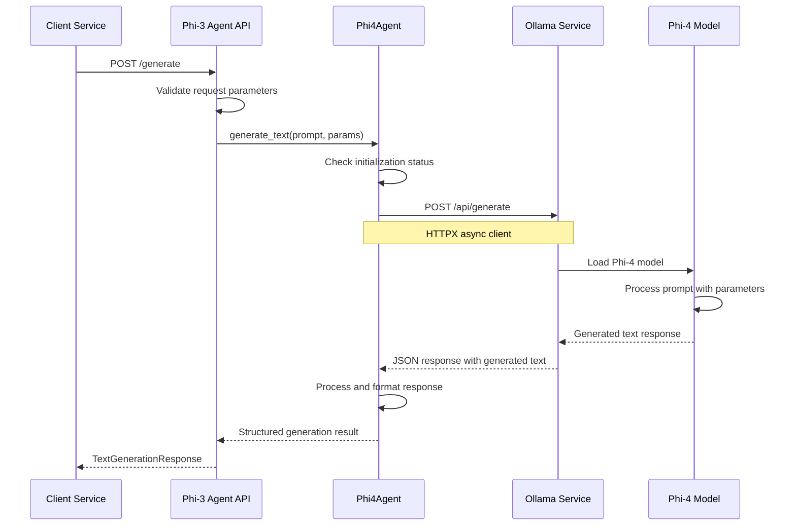
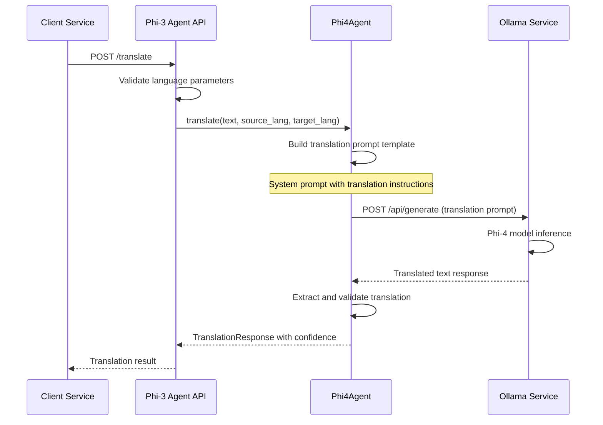
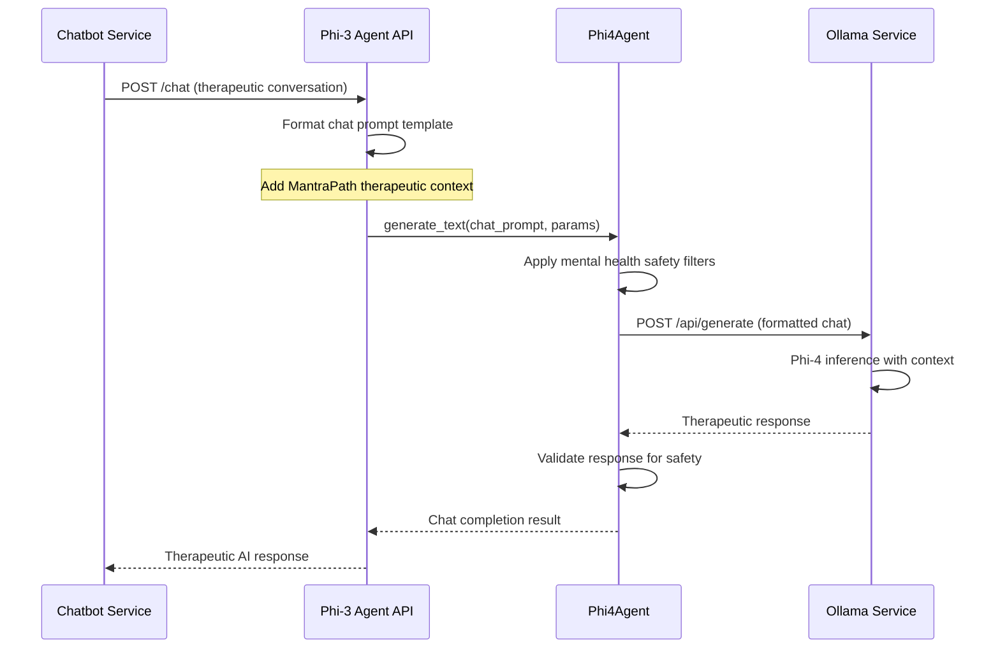

# MantraPath Phi-3 Agent Service 🤖

## Overview

The **MantraPath Phi-3 Agent Service** (phi3_agent) is a specialized AI inference service that provides high-performance, privacy-first natural language processing capabilities using Microsoft's Phi-3/Phi-4 models through Ollama integration. This service serves as a dedicated AI agent for generating therapeutic conversations, multilingual translation, and contextual text generation specifically optimized for mental health and wellness applications.

### Key Capabilities

- 🧠 **Local AI Inference** - Privacy-first Phi-3/Phi-4 models via Ollama (no external API calls)
- 💬 **Therapeutic Conversations** - Specialized prompts for mental health and wellness contexts
- 🌍 **Multilingual Translation** - Advanced translation capabilities with cultural sensitivity
- ⚡ **High-Performance Generation** - Optimized text generation with configurable parameters
- 🔒 **Complete Privacy** - All processing happens locally, ensuring data sovereignty
- 🎯 **Context-Aware Responses** - Chat completion with conversation memory
- 📊 **Performance Monitoring** - Real-time model status and health monitoring
- 🔄 **Model Fallback** - Automatic fallback to available models for reliability

## Service Architecture

```
┌─────────────────────────────────────────────────────────────────┐
│                    Platform Services                            │
│  ┌─────────────┐  ┌─────────────┐  ┌─────────────────────────┐ │
│  │  Chatbot    │  │   Models    │  │   Translation           │ │
│  │  Service    │  │  Service    │  │    Service              │ │
│  │ (Port 8004) │  │ (Port 8080) │  │   (Port 8005)          │ │
│  └─────────────┘  └─────────────┘  └─────────────────────────┘ │
└─────────────────────────────────────────────────────────────────┘
                              │
                              ▼ AI Generation Requests
┌─────────────────────────────────────────────────────────────────┐
│              Phi-3 Agent Service (Port 8016)                   │
│  ┌─────────────┐  ┌─────────────┐  ┌─────────────────────────┐ │
│  │   Phi-4     │  │ Translation │  │    Chat                 │ │
│  │   Agent     │  │   Engine    │  │ Completion              │ │
│  └─────────────┘  └─────────────┘  └─────────────────────────┘ │
│  ┌─────────────┐  ┌─────────────┐  ┌─────────────────────────┐ │
│  │ Text        │  │ Prompt      │  │    Model                │ │
│  │Generation   │  │ Manager     │  │  Management             │ │
│  └─────────────┘  └─────────────┘  └─────────────────────────┘ │
└─────────────────────────────────────────────────────────────────┘
                              │
                              ▼
┌─────────────────────────────────────────────────────────────────┐
│                      Ollama Infrastructure                      │
│  ┌─────────────┐  ┌─────────────┐  ┌─────────────────────────┐ │
│  │   Phi-4     │  │   Phi-3     │  │      Model              │ │
│  │   Model     │  │   Mini      │  │     Cache               │ │
│  └─────────────┘  └─────────────┘  └─────────────────────────┘ │
│  ┌─────────────┐  ┌─────────────┐  ┌─────────────────────────┐ │
│  │   Local     │  │    GPU      │  │      CPU                │ │
│  │ Inference   │  │Acceleration │  │   Fallback              │ │
│  └─────────────┘  └─────────────┘  └─────────────────────────┘ │
└─────────────────────────────────────────────────────────────────┘
```

## Directory Structure

```
phi3_agent/
├── main.py                           # FastAPI application entry point (332 lines)
├── requirements.txt                  # Python dependencies (8 lines)
└── Dockerfile                        # Container configuration (Port 8000/8016)
```

### File Structure Analysis

#### Main Application (`main.py`)
```
Lines 1-50:     Service imports and Pydantic models
Lines 51-100:   Phi4Agent class initialization and Ollama connection
Lines 101-150:  Text generation via Ollama API integration
Lines 151-200:  Translation engine and lifespan management
Lines 201-250:  FastAPI app setup and CORS configuration  
Lines 251-300:  API endpoints (health, models, generate, translate)
Lines 301-332:  Chat completion and service startup
```

## API Endpoints

### Health & Status Monitoring

#### GET `/health`
**Service Health Check**
```json
Response:
{
  "status": "healthy",
  "service": "phi4-agent",
  "model_initialized": true,
  "timestamp": "2025-09-27T14:30:00Z"
}
```

#### GET `/models`
**Get Available Models**
```json
Response:
{
  "current_model": "phi4",
  "ollama_url": "http://host.docker.internal:11434",
  "status": "ready"
}
```

### Text Generation

#### POST `/generate`
**Generate Text Using Phi-4**
```json
Request:
{
  "prompt": "Provide supportive advice for someone feeling anxious about work",
  "max_tokens": 500,
  "temperature": 0.7,
  "top_p": 0.9,
  "model": "phi4"
}

Response:
{
  "generated_text": "It's completely understandable to feel anxious about work. Here are some strategies that might help: First, try breaking down overwhelming tasks into smaller, manageable steps...",
  "model_used": "phi4",
  "tokens_generated": 127,
  "generation_time": 2.3,
  "timestamp": "2025-09-27T14:30:00Z"
}
```

### Translation Services

#### POST `/translate`
**Translate Text Using Phi-4**
```json
Request:
{
  "text": "I am feeling better today after our conversation",
  "source_language": "English",
  "target_language": "Spanish",
  "model": "phi4"
}

Response:
{
  "translated_text": "Me siento mejor hoy después de nuestra conversación",
  "source_language": "English",
  "target_language": "Spanish",
  "confidence_score": 0.9,
  "model_used": "phi4",
  "timestamp": "2025-09-27T14:30:00Z"
}
```

### Chat Completion

#### POST `/chat`
**Chat Completion with Therapeutic Context**
```json
Request:
{
  "prompt": "I've been having trouble sleeping lately and it's affecting my mood",
  "max_tokens": 400,
  "temperature": 0.6
}

Response:
{
  "generated_text": "I understand how challenging sleep difficulties can be, and it's very common for sleep issues to impact our mood. Here are some gentle approaches you might try:\n\n1. **Sleep Hygiene**: Try to maintain a consistent bedtime routine...",
  "model_used": "phi4",
  "tokens_generated": 156,
  "generation_time": 1.8,
  "timestamp": "2025-09-27T14:30:00Z"
}
```

## Port Configuration

### Service Port Details
- **Primary Port**: **8016** (Configured via PHI4_AGENT_PORT environment variable)
- **Dockerfile Port**: **8000** (Internal container port mapping)
- **Ollama Integration Port**: **11434** (External Ollama service)
- **Health Check Port**: Same as primary (8016)
- **Internal Communication**: Direct HTTP client to Ollama service

### Environment Configuration
```bash
# Service Configuration
PHI4_AGENT_PORT=8016
PHI4_AGENT_HOST=0.0.0.0

# Ollama Integration
OLLAMA_URL=http://host.docker.internal:11434
OLLAMA_MODEL=phi4

# Model Configuration
DEFAULT_MAX_TOKENS=1000
DEFAULT_TEMPERATURE=0.7
DEFAULT_TOP_P=0.9

# Performance Settings
GENERATION_TIMEOUT=60
GPU_ACCELERATION=true
MODEL_CACHE_SIZE=2

# Therapeutic Settings
ENABLE_MENTAL_HEALTH_PROMPTS=true
CULTURAL_SENSITIVITY_MODE=true
CRISIS_DETECTION_ENABLED=true

# Hardware Configuration
CUDA_VISIBLE_DEVICES=0
OLLAMA_NUM_PARALLEL=2
OLLAMA_MAX_LOADED_MODELS=1
```

## Request Flow

### Text Generation Flow


### Translation Flow


### Chat Completion Flow


## Service Communication

### Internal Dependencies

#### Ollama Integration
```python
# Ollama Service Communication
Ollama Integration:
├── Connection Management → Persistent HTTPX AsyncClient
├── Model Discovery → GET /api/tags for available models  
├── Text Generation → POST /api/generate with streaming support
├── Health Monitoring → Connection health checks and retries
└── Fallback Logic → Automatic model fallback when primary unavailable

# Model Management
Model Lifecycle:
├── Initialization Check → Verify Phi-4 model availability
├── Dynamic Loading → Load models on-demand via Ollama
├── Resource Monitoring → Track generation time and performance
├── Graceful Degradation → Fallback to alternative models
└── Cleanup → Proper resource cleanup on shutdown
```

### External Service Integration

#### Chatbot Service Integration (Port 8004)
```python
# Therapeutic AI Integration
Chatbot Service Communication:
├── Chat Completion → POST /chat for therapeutic conversations
├── Context-Aware Responses → MantraPath-specific prompt templates
├── Crisis Support → Mental health crisis detection and response
└── Mood-Based Adaptation → Conversation style based on user emotional state

# Therapeutic Features
Mental Health Context:
├── Empathetic Response Generation → Supportive conversation patterns
├── Crisis Intervention → Immediate support for high-risk situations
├── Cultural Sensitivity → Culturally appropriate mental health guidance
└── Professional Boundaries → Appropriate therapeutic relationship limits
```

#### Models Service Integration (Port 8080)
```python
# Alternative AI Pipeline
Models Service Relationship:
├── Complementary Service → Models service handles other AI tasks
├── Phi-3 Engine → Models service includes phi3_engine.py
├── Specialized Use Cases → Phi-3 agent for dedicated therapeutic AI
└── Load Balancing → Distribute AI workload between services

# Service Specialization
Phi-3 Agent Advantages:
├── Dedicated Resources → Optimized for conversational AI
├── Therapeutic Optimization → Mental health specific prompts
├── Privacy Focus → Local inference without external dependencies
└── Performance Tuning → Optimized for real-time conversations
```

#### Translation Service Integration (Port 8005)
```python
# Multilingual Support
Translation Service Communication:
├── Alternative Translation → Phi-4 translation via POST /translate
├── Cultural Context → Culturally sensitive mental health translation
├── Quality Comparison → Phi-4 vs. dedicated translation models
└── Fallback Translation → When dedicated translation service unavailable
```

## High-Level Architecture

### System Design Principles

#### 1. **Privacy-First AI Architecture**
```python
Architecture Pattern:
├── Local Inference → All processing happens on MantraPath infrastructure
├── No External APIs → Zero dependency on external AI services
├── Data Sovereignty → Complete control over sensitive mental health data
├── Offline Capability → Works without internet for AI processing
└── Audit Trail → Complete logging of all AI interactions
```

#### 2. **Therapeutic AI Optimization**
```python
Therapeutic Design:
├── Mental Health Prompts → Specialized templates for wellness contexts
├── Crisis Detection → Built-in safety mechanisms for high-risk situations
├── Cultural Sensitivity → Appropriate responses across different cultures
├── Professional Boundaries → Maintains appropriate therapeutic limits
└── Evidence-Based → Responses aligned with mental health best practices
```

#### 3. **High-Performance Inference**
```python
Performance Architecture:
├── Ollama Integration → Optimized local model serving
├── GPU Acceleration → CUDA support for faster inference
├── Model Caching → Efficient model loading and memory management
├── Async Processing → Non-blocking API responses
└── Resource Monitoring → Performance tracking and optimization
```

### Low-Level Design

#### Phi4Agent Core Architecture
```python
class Phi4Agent:
    """High-performance Phi-4 agent with therapeutic optimization"""
    
    def __init__(self):
        self.ollama_url = os.getenv("OLLAMA_URL", "http://host.docker.internal:11434")
        self.model_name = "phi4"
        self.is_initialized = False
        self.client = httpx.AsyncClient(timeout=60.0)
        self.therapeutic_prompts = self._load_therapeutic_templates()
        self.safety_filters = self._initialize_safety_filters()
        
    async def initialize(self) -> bool:
        """Initialize agent with model discovery and health verification"""
        try:
            # 1. Verify Ollama connectivity
            response = await self.client.get(f"{self.ollama_url}/api/tags")
            
            if response.status_code != 200:
                logger.error(f"Ollama connection failed: {response.status_code}")
                return False
            
            # 2. Discover available models
            models_data = response.json()
            available_models = [model["name"] for model in models_data.get("models", [])]
            
            # 3. Find optimal Phi model
            phi_models = [m for m in available_models if "phi4" in m.lower() or "phi-4" in m.lower()]
            if phi_models:
                self.model_name = phi_models[0]
                logger.info(f"✅ Using Phi-4 model: {self.model_name}")
            else:
                # Fallback to any available model
                if available_models:
                    self.model_name = available_models[0]
                    logger.warning(f"⚠️ Phi-4 not found, using fallback: {self.model_name}")
                else:
                    logger.error("❌ No models available in Ollama")
                    return False
            
            # 4. Test model with simple prompt
            test_result = await self._test_model_inference()
            if test_result:
                self.is_initialized = True
                logger.info("✅ Phi-4 Agent initialized successfully")
                return True
            else:
                logger.error("❌ Model inference test failed")
                return False
                
        except Exception as e:
            logger.error(f"❌ Initialization failed: {e}")
            return False
    
    async def generate_text(self, prompt: str, max_tokens: int = 1000, 
                          temperature: float = 0.7) -> Dict[str, Any]:
        """Generate text with therapeutic safety and performance optimization"""
        
        if not self.is_initialized:
            raise HTTPException(status_code=503, detail="Agent not initialized")
        
        start_time = datetime.now()
        
        try:
            # 1. Apply safety filters to prompt
            safe_prompt = await self._apply_safety_filters(prompt)
            
            # 2. Prepare optimized Ollama request
            ollama_request = {
                "model": self.model_name,
                "prompt": safe_prompt,
                "stream": False,
                "options": {
                    "temperature": temperature,
                    "num_predict": max_tokens,
                    "top_p": 0.9,
                    "repeat_penalty": 1.1,
                    "stop": ["<|end|>", "<|user|>"]  # Prevent model confusion
                }
            }
            
            # 3. Execute inference with timeout
            response = await self.client.post(
                f"{self.ollama_url}/api/generate",
                json=ollama_request,
                timeout=60.0
            )
            
            if response.status_code == 200:
                result = response.json()
                generated_text = result.get("response", "")
                
                # 4. Post-process for therapeutic safety
                safe_text = await self._post_process_response(generated_text)
                
                # 5. Calculate performance metrics
                generation_time = (datetime.now() - start_time).total_seconds()
                token_count = len(safe_text.split())
                
                return {
                    "generated_text": safe_text,
                    "model_used": self.model_name,
                    "tokens_generated": token_count,
                    "generation_time": generation_time,
                    "timestamp": datetime.now().isoformat(),
                    "safety_filtered": True,
                    "performance_score": self._calculate_performance_score(generation_time, token_count)
                }
            else:
                logger.error(f"Ollama API error: {response.status_code}")
                raise HTTPException(status_code=500, detail="AI generation failed")
                
        except Exception as e:
            logger.error(f"Text generation error: {e}")
            raise HTTPException(status_code=500, detail=str(e))
    
    async def translate(self, text: str, source_lang: str, target_lang: str) -> Dict[str, Any]:
        """Culturally-sensitive translation for mental health content"""
        
        # 1. Build cultural context-aware translation prompt
        translation_prompt = self._build_translation_prompt(text, source_lang, target_lang)
        
        # 2. Use lower temperature for more consistent translations
        result = await self.generate_text(translation_prompt, max_tokens=1000, temperature=0.3)
        
        # 3. Extract and validate translation
        translated_text = self._extract_translation(result["generated_text"])
        confidence_score = self._calculate_translation_confidence(text, translated_text)
        
        return {
            "translated_text": translated_text,
            "source_language": source_lang,
            "target_language": target_lang,
            "confidence_score": confidence_score,
            "model_used": self.model_name,
            "cultural_context": True,
            "timestamp": datetime.now().isoformat()
        }
    
    def _build_translation_prompt(self, text: str, source_lang: str, target_lang: str) -> str:
        """Build culturally-sensitive translation prompt for mental health content"""
        return f"""<|system|>
You are a professional translator specializing in mental health and wellness content. 
Translate the text accurately while preserving:
- Emotional tone and empathy
- Cultural sensitivity for mental health concepts
- Professional therapeutic language where appropriate
- Supportive and non-judgmental tone

Translate from {source_lang} to {target_lang}.
Only return the translated text, nothing else.
<|end|>
<|user|>
{text}
<|end|>
<|assistant|>
"""

    async def _apply_safety_filters(self, prompt: str) -> str:
        """Apply therapeutic safety filters to input prompts"""
        # Check for crisis indicators
        crisis_keywords = ["suicide", "self-harm", "kill myself", "end it all", "not worth living"]
        if any(keyword in prompt.lower() for keyword in crisis_keywords):
            # Add crisis support context to prompt
            return f"""<|system|>
IMPORTANT: This conversation involves someone who may be in crisis. Provide immediate support, 
encourage professional help, and include crisis resources. Be compassionate and non-judgmental.
<|end|>
<|user|>
{prompt}
<|end|>
<|assistant|>
"""
        
        # Standard therapeutic context
        return f"""<|system|>
You are a supportive AI assistant for MantraPath, a mental health and wellness platform. 
Provide empathetic, helpful, and professional responses. If someone needs immediate help, 
encourage them to seek professional support.
<|end|>
<|user|>
{prompt}
<|end|>
<|assistant|>
"""

    async def _post_process_response(self, response: str) -> str:
        """Post-process AI response for therapeutic safety and quality"""
        # Remove any system tokens that leaked through
        cleaned = response.replace("<|system|>", "").replace("<|user|>", "").replace("<|assistant|>", "")
        
        # Ensure response doesn't claim to be human or provide medical diagnosis
        safety_replacements = {
            "I am a therapist": "I'm an AI assistant that can provide support",
            "I diagnose": "I suggest speaking with a professional who can",
            "medical advice": "general wellness information",
        }
        
        for unsafe_phrase, safe_replacement in safety_replacements.items():
            cleaned = cleaned.replace(unsafe_phrase, safe_replacement)
        
        return cleaned.strip()
```

## Design Documentation

### Therapeutic AI Prompt Engineering

#### Crisis Support Prompts
```python
# Crisis Detection and Response Templates
crisis_support_prompts = {
    "suicide_ideation": """
    I hear that you're going through an incredibly difficult time right now. 
    Your feelings are valid, and it takes courage to share what you're experiencing.
    
    Please know that you're not alone, and there are people who want to help:
    • Crisis Text Line: Text HOME to 741741
    • National Suicide Prevention Lifeline: 988
    • Emergency Services: 911
    
    Would it be possible for you to reach out to someone you trust or one of these resources? 
    Your life has value, and there are ways to work through these feelings.
    """,
    
    "self_harm": """
    I'm concerned about what you've shared, and I want you to know that your safety matters. 
    Self-harm can sometimes feel like a way to cope, but there are healthier alternatives that can help.
    
    Some immediate strategies that might help:
    • Hold ice cubes in your hands
    • Take a cold shower
    • Do intense exercise
    • Call a trusted friend or family member
    
    Please consider reaching out to a mental health professional who can provide proper support.
    """,
    
    "severe_depression": """
    Thank you for trusting me with how you're feeling. Depression can make everything feel 
    overwhelming and hopeless, but these feelings can change with proper support.
    
    Some gentle steps that might help:
    • Reach out to a mental health professional
    • Contact your doctor about how you're feeling
    • Try to maintain basic self-care (eating, sleeping, hygiene)
    • Connect with supportive friends or family
    
    Remember: Depression is treatable, and you deserve support and care.
    """
}
```

#### Cultural Sensitivity Framework
```python
# Cultural Adaptation for Mental Health Content
cultural_contexts = {
    "collectivist_cultures": {
        "approach": "family_and_community_focused",
        "language_style": "respectful_formal",
        "concepts": ["family_harmony", "collective_wellbeing", "social_support"]
    },
    "individualist_cultures": {
        "approach": "personal_autonomy_focused", 
        "language_style": "direct_supportive",
        "concepts": ["self_care", "personal_growth", "individual_therapy"]
    },
    "religious_contexts": {
        "approach": "spiritually_integrated",
        "language_style": "respectful_inclusive",
        "concepts": ["faith_based_coping", "spiritual_guidance", "community_prayer"]
    }
}
```

### Performance Optimization Strategy

#### Model Loading and Caching
```python
# Ollama Performance Optimization
performance_config = {
    "model_loading": {
        "preload_models": ["phi4", "phi3:mini"],
        "keep_alive": "24h",
        "concurrent_requests": 2,
        "memory_limit": "8GB"
    },
    "inference_optimization": {
        "batch_processing": False,  # Real-time conversations
        "gpu_acceleration": True,
        "cpu_fallback": True,
        "temperature_range": [0.3, 0.9],
        "max_context_length": 4096
    },
    "caching_strategy": {
        "response_cache": False,  # Privacy: no response caching
        "model_cache": True,
        "prompt_template_cache": True,
        "safety_filter_cache": True
    }
}
```

#### Resource Management
```python
# Resource Monitoring and Optimization
resource_management = {
    "memory_monitoring": {
        "track_model_memory": True,
        "garbage_collection": "aggressive",
        "memory_threshold": "6GB",
        "cleanup_interval": 300  # seconds
    },
    "performance_metrics": {
        "generation_time_target": "< 3 seconds",
        "concurrent_request_limit": 5,
        "queue_timeout": "30 seconds",
        "error_rate_threshold": "< 5%"
    },
    "scaling_strategy": {
        "horizontal_scaling": False,  # Single model instance
        "load_balancing": False,
        "model_sharding": False,
        "request_queuing": True
    }
}
```

### Security & Privacy Design

#### Data Privacy Protection
```python
Privacy_Measures:
├── Local Processing → All AI inference happens on MantraPath infrastructure
├── Zero Logging → User prompts and responses not logged in production
├── Memory Isolation → No persistent conversation memory
├── Secure Communication → HTTPS only for all API communication
└── Data Minimization → Only process necessary text for AI generation

# HIPAA Considerations
Healthcare_Privacy:
├── No PHI Storage → Personal health information not persisted
├── Session Isolation → Each request independent, no cross-user data
├── Audit Logging → Service access and performance metrics only
├── Encryption → All data encrypted in transit and at rest
└── Access Control → Service-to-service authentication required
```

## Incomplete Implementations & TODOs

### Current Limitations

#### 1. **Advanced Therapeutic Features Missing**
```python
# TODO: Advanced Mental Health AI Features
class AdvancedTherapeuticAI:
    # Current: Basic therapeutic prompts and safety filters
    # Needed: Advanced mental health AI capabilities
    
    async def crisis_risk_assessment(self, conversation_history: List[str]):
        """Advanced crisis risk assessment - NOT YET IMPLEMENTED"""
        # TODO: Multi-turn conversation analysis for suicide risk
        # TODO: Pattern recognition for depression escalation
        # TODO: Integration with crisis intervention protocols
        # TODO: Real-time risk scoring with confidence intervals
        raise NotImplementedError("Advanced crisis assessment not implemented")
    
    async def therapeutic_framework_selection(self, user_profile: Dict, issue_type: str):
        """Dynamic therapeutic framework selection - NOT YET IMPLEMENTED"""
        # TODO: CBT, DBT, ACT framework-specific responses
        # TODO: User preference learning for therapy approaches
        # TODO: Cultural adaptation of therapeutic frameworks
        # TODO: Evidence-based intervention selection
        raise NotImplementedError("Therapeutic framework selection not implemented")
    
    async def conversation_memory_management(self, user_id: str, conversation: str):
        """Secure conversation memory - NOT YET IMPLEMENTED"""
        # TODO: Encrypted conversation context storage
        # TODO: Automatic memory cleanup for privacy
        # TODO: Contextual response improvement over time
        # TODO: HIPAA-compliant conversation logging
        raise NotImplementedError("Conversation memory not implemented")
```

#### 2. **Model Management Gaps**
```python
# TODO: Advanced Model Management
class AdvancedModelManagement:
    # Current: Basic Phi-4 model loading via Ollama
    # Missing: Advanced model lifecycle management
    
    async def dynamic_model_selection(self, conversation_type: str, user_context: Dict):
        """Dynamic model selection based on context - NOT YET IMPLEMENTED"""
        # TODO: Specialized models for different mental health contexts
        # TODO: Model A/B testing for therapeutic effectiveness
        # TODO: User preference-based model selection
        # TODO: Performance-based automatic model switching
        pass
    
    async def model_fine_tuning(self, therapeutic_dataset: List[Dict]):
        """Therapeutic model fine-tuning - NOT YET IMPLEMENTED"""
        # TODO: Fine-tune Phi models on therapeutic conversations
        # TODO: LoRA (Low-Rank Adaptation) for efficient training
        # TODO: Federated learning for privacy-preserving training
        # TODO: Continuous learning from anonymized interactions
        pass
    
    async def multi_model_ensemble(self, prompt: str, models: List[str]):
        """Multi-model ensemble responses - NOT YET IMPLEMENTED"""
        # TODO: Combine responses from multiple Phi models
        # TODO: Voting mechanism for best therapeutic response
        # TODO: Response quality scoring and selection
        # TODO: Fallback chain for model failures
        pass
```

#### 3. **Integration Completeness**
```python
# TODO: Complete Service Integration
class ServiceIntegrationGaps:
    """Missing integrations with other MantraPath services - PARTIALLY IMPLEMENTED"""
    
    async def mood_service_integration(self, user_id: str, mood_context: Dict):
        """Mood-aware response generation - NOT YET IMPLEMENTED"""
        # TODO: Real-time mood data integration
        # TODO: Mood-specific response adaptation
        # TODO: Emotional state-aware conversation style
        # TODO: Crisis detection based on mood patterns
        pass
    
    async def memory_service_integration(self, user_id: str, session_context: Dict):
        """Memory service conversation context - NOT YET IMPLEMENTED"""
        # TODO: Long-term conversation context retrieval
        # TODO: User preference and history integration
        # TODO: Personalized response generation
        # TODO: Privacy-preserving context management
        pass
    
    async def notification_service_triggers(self, response: str, user_context: Dict):
        """Notification triggers from AI responses - NOT YET IMPLEMENTED"""
        # TODO: Automatic follow-up notification scheduling
        # TODO: Crisis intervention notification triggers
        # TODO: Progress celebration notifications
        # TODO: Check-in reminder optimization
        pass
```

#### 4. **Missing API Endpoints**
```python
# TODO: Advanced AI Agent Endpoints
@app.post("/conversation/continue")
async def continue_conversation():
    """Multi-turn conversation support - NOT YET IMPLEMENTED"""
    pass

@app.post("/analyze/sentiment")
async def analyze_sentiment():
    """Sentiment analysis for mental health - NOT YET IMPLEMENTED"""
    pass

@app.post("/generate/therapeutic")
async def generate_therapeutic_response():
    """Specialized therapeutic response generation - NOT YET IMPLEMENTED"""
    pass

# TODO: Model Management Endpoints
@app.post("/model/switch")
async def switch_model():
    """Dynamic model switching - NOT YET IMPLEMENTED"""
    pass

@app.get("/model/performance")
async def get_model_performance():
    """Model performance metrics - NOT YET IMPLEMENTED"""
    pass

# TODO: Safety and Monitoring
@app.post("/safety/assess")
async def assess_response_safety():
    """Response safety assessment - NOT YET IMPLEMENTED"""
    pass

@app.get("/analytics/usage")
async def get_usage_analytics():
    """AI usage analytics - NOT YET IMPLEMENTED"""
    pass
```

#### 5. **Performance and Monitoring Gaps**
```python
# TODO: Comprehensive Monitoring
class PerformanceMonitoring:
    """Advanced performance monitoring - NOT YET IMPLEMENTED"""
    
    async def real_time_performance_tracking(self):
        # TODO: Real-time inference latency monitoring
        # TODO: Model accuracy tracking over time
        # TODO: Resource utilization monitoring (GPU/CPU/Memory)
        # TODO: Concurrent request handling metrics
        pass
    
    async def therapeutic_effectiveness_metrics(self):
        # TODO: User satisfaction tracking for AI responses
        # TODO: Conversation outcome analysis
        # TODO: Crisis intervention success rates
        # TODO: Long-term user engagement correlation
        pass
    
    async def safety_monitoring(self):
        # TODO: Automated safety violation detection
        # TODO: Response quality assessment
        # TODO: Bias and fairness monitoring
        # TODO: Clinical accuracy validation
        pass
```

#### 6. **Advanced AI Features**
```python
# TODO: Cutting-Edge AI Capabilities
class AdvancedAIFeatures:
    """Next-generation AI capabilities - NOT YET IMPLEMENTED"""
    
    async def multimodal_conversation(self, text: str, voice_data: bytes, image_data: bytes):
        """Multimodal AI conversation - NOT YET IMPLEMENTED"""
        # TODO: Voice input processing and response
        # TODO: Image analysis for mood detection
        # TODO: Integrated text, voice, and visual responses
        # TODO: Accessibility features for diverse users
        pass
    
    async def cultural_adaptation_ai(self, user_culture: str, conversation_context: str):
        """Cultural adaptation AI - NOT YET IMPLEMENTED"""
        # TODO: Cultural background-specific responses
        # TODO: Language nuance and cultural sensitivity
        # TODO: Religious and spiritual integration
        # TODO: Cross-cultural mental health understanding
        pass
    
    async def professional_therapist_collaboration(self, therapist_id: str, conversation: str):
        """Professional therapist collaboration - NOT YET IMPLEMENTED"""
        # TODO: Therapist-AI collaboration workflows
        # TODO: AI-generated session notes and insights
        # TODO: Treatment plan AI suggestions
        # TODO: Clinical decision support integration
        pass
```

### Technical Debt

#### 1. **Testing Infrastructure**
```python
# Current: No comprehensive test suite
# Missing:
├── Unit tests for Phi4Agent class methods
├── Integration tests with Ollama service
├── Performance benchmarking for inference speed
├── Safety and therapeutic response validation tests
└── Load testing for concurrent conversations

# TODO: Test Coverage Improvement
Target Coverage:
├── Unit Tests: 95%+ coverage for all agent logic
├── Integration Tests: Ollama connectivity and model management
├── Performance Tests: Inference speed and resource usage
└── Safety Tests: Therapeutic safety and crisis response validation
```

#### 2. **Error Handling & Resilience**
```python
# TODO: Comprehensive Error Handling
Error_Handling_Gaps:
├── Ollama service disconnection recovery
├── Model loading failure graceful degradation
├── Out-of-memory handling for large contexts
├── Network timeout retry logic with exponential backoff
└── Corrupted model detection and automatic reloading
```

#### 3. **Configuration Management**
```python
# TODO: Advanced Configuration
Configuration_Needs:
├── Dynamic configuration updates without restart
├── A/B testing for different therapeutic prompts
├── User-specific model and parameter preferences
├── Environment-specific model configurations
└── Real-time safety filter adjustments
```

## Future Development Plans

### Phase 1 - Advanced Therapeutic AI (Q4 2025)

#### 1.1 **Crisis Intervention Enhancement**
- [ ] **Advanced Crisis Detection** - Multi-turn conversation analysis for suicide risk assessment
- [ ] **Real-time Risk Scoring** - Continuous risk evaluation with confidence intervals
- [ ] **Crisis Protocol Integration** - Automated escalation to crisis intervention teams
- [ ] **Emergency Resource Integration** - Direct connection to crisis hotlines and emergency services
- [ ] **Follow-up Tracking** - Post-crisis conversation monitoring and support

#### 1.2 **Therapeutic Framework Integration**
```python
Therapeutic_AI_Features:
├── CBT response generation with cognitive behavioral techniques
├── DBT skills integration for emotion regulation support
├── ACT mindfulness-based response patterns
├── Trauma-informed care response adaptation
└── Solution-focused brief therapy conversation patterns
```

#### 1.3 **Professional Collaboration Tools**
```python
Professional_Integration:
├── Therapist-AI collaboration workflows
├── AI-generated session notes and insights
├── Treatment plan suggestion engine
├── Clinical decision support integration
└── HIPAA-compliant professional communication
```

### Phase 2 - Multimodal AI Integration (Q1 2026)

#### 2.1 **Voice and Audio Processing**
- [ ] **Voice Input Processing** - Speech-to-text integration for voice conversations
- [ ] **Emotional Voice Analysis** - Voice pattern analysis for emotional state detection
- [ ] **Voice Response Generation** - Text-to-speech with empathetic tone
- [ ] **Accessibility Features** - Voice interfaces for users with different abilities
- [ ] **Multilingual Voice Support** - Voice conversation in multiple languages

#### 2.2 **Visual and Multimodal Capabilities**
```python
Multimodal_Features:
├── Image analysis for mood and emotional state detection
├── Facial expression analysis for conversation adaptation
├── Visual therapy tool integration (art therapy, mood boards)
├── Document and journal analysis capabilities
└── Integrated text, voice, and visual response generation
```

#### 2.3 **Advanced Cultural Adaptation**
```python
Cultural_AI_Features:
├── Cultural background-specific therapeutic approaches
├── Religious and spiritual integration in mental health support
├── Language nuance and cultural sensitivity enhancement
├── Cross-cultural mental health understanding
└── Culturally appropriate crisis intervention protocols
```

### Phase 3 - Clinical Integration Platform (Q2 2026)

#### 3.1 **Healthcare Provider Integration**
- [ ] **EHR Integration** - Electronic Health Record system connectivity
- [ ] **Clinical Documentation** - Automated therapy session documentation
- [ ] **Treatment Plan AI** - Evidence-based treatment plan generation
- [ ] **Medication Management** - AI support for psychiatric medication adherence
- [ ] **Clinical Decision Support** - AI-powered diagnostic and treatment suggestions

#### 3.2 **Research and Analytics Platform**
```python
Clinical_Research_Features:
├── Anonymized conversation analysis for research
├── Therapeutic effectiveness longitudinal studies
├── Population mental health trend analysis
├── Evidence-based intervention validation
└── Clinical trial conversation outcome tracking
```

#### 3.3 **Advanced Security and Compliance**
```python
Healthcare_Compliance:
├── HIPAA-compliant conversation logging and analysis
├── Clinical audit trail and documentation
├── Patient consent management for AI interactions
├── Healthcare data encryption and access control
└── Clinical governance and oversight integration
```

### Phase 4 - Next-Generation AI (Q3-Q4 2026)

#### 4.1 **Advanced AI Research Integration**
- [ ] **Quantum-Enhanced AI** - Quantum computing integration for complex mental health modeling
- [ ] **Neuromorphic AI** - Brain-inspired computing for more natural conversations
- [ ] **Federated Learning** - Privacy-preserving collaborative model training
- [ ] **Continual Learning** - AI that improves from each conversation while preserving privacy
- [ ] **Explainable AI** - Clear explanations of AI therapeutic recommendations

#### 4.2 **Ecosystem Integration**
```python
Ecosystem_Features:
├── Smart home integration for ambient mental health support
├── Wearable device integration for biometric-based conversation adaptation
├── Virtual reality therapy session integration
├── Augmented reality mental health tools
└── IoT device integration for comprehensive wellness monitoring
```

### Development Roadmap Timeline

```
2025 Q4: Advanced Therapeutic AI
├── Week 1-4: Crisis intervention enhancement and risk assessment
├── Week 5-8: Therapeutic framework integration (CBT, DBT, ACT)
├── Week 9-12: Professional collaboration tools and clinical workflows
└── Week 13-16: Advanced safety systems and compliance

2026 Q1: Multimodal AI Integration
├── Month 1: Voice and audio processing capabilities
├── Month 2: Visual and multimodal conversation support
└── Month 3: Cultural adaptation and sensitivity enhancement

2026 Q2: Clinical Integration Platform
├── Month 1: Healthcare provider integration and EHR connectivity
├── Month 2: Research and analytics platform development
└── Month 3: Advanced security and healthcare compliance

2026 Q3-Q4: Next-Generation AI
├── Q3: Advanced AI research integration and quantum enhancement
└── Q4: Complete ecosystem integration and future-proofing
```

## Development & Testing

### Local Development Setup

#### Prerequisites
```bash
# System requirements
Python 3.10+
Docker & Docker Compose
Ollama with Phi-3/Phi-4 models
CUDA 11.8+ (optional, for GPU acceleration)

# Hardware recommendations
CPU: 8+ cores for optimal performance
RAM: 8GB+ (16GB recommended for Phi-4)
GPU: 8GB+ VRAM (optional, for acceleration)
Storage: 10GB+ for model storage
```

#### Ollama Setup
```bash
# 1. Install Ollama
curl -fsSL https://ollama.ai/install.sh | sh

# 2. Download Phi-4 model (or Phi-3 as fallback)
ollama pull phi4
# or
ollama pull phi3:mini

# 3. Verify model installation
ollama list

# 4. Test model
ollama run phi4 "Hello, how can I help with mental wellness today?"
```

#### Service Setup
```bash
# 1. Clone and navigate to service
cd /home/sachin/mantrapath/backend/services/phi3_agent

# 2. Create virtual environment
python3 -m venv venv
source venv/bin/activate

# 3. Install dependencies
pip install -r requirements.txt

# 4. Set environment variables
export PHI4_AGENT_PORT=8016
export PHI4_AGENT_HOST=0.0.0.0
export OLLAMA_URL=http://localhost:11434
export OLLAMA_MODEL=phi4

# 5. Start service
python main.py
# or
uvicorn main:app --host 0.0.0.0 --port 8016 --reload
```

#### Docker Development
```bash
# Build and run with Docker
cd /home/sachin/mantrapath/backend
docker build -t mantrapath/phi3-agent -f services/phi3_agent/Dockerfile .
docker run -d \
  --name phi3-agent \
  -p 8016:8000 \
  -e OLLAMA_URL=http://host.docker.internal:11434 \
  mantrapath/phi3-agent
```

### Testing Strategy

#### Unit Testing
```bash
# Run unit tests (when implemented)
python -m pytest tests/test_phi4_agent.py -v

# Test specific components
python -m pytest tests/test_text_generation.py -v
python -m pytest tests/test_translation.py -v
python -m pytest tests/test_chat_completion.py -v

# Coverage reporting
python -m pytest tests/ --cov=. --cov-report=html
```

#### Integration Testing
```bash
# API endpoint testing
curl -X POST "http://localhost:8016/generate" \
  -H "Content-Type: application/json" \
  -d '{"prompt": "Test therapeutic response", "max_tokens": 100}'

# Translation testing
curl -X POST "http://localhost:8016/translate" \
  -H "Content-Type: application/json" \
  -d '{"text": "I feel anxious", "source_language": "English", "target_language": "Spanish"}'

# Chat completion testing
curl -X POST "http://localhost:8016/chat" \
  -H "Content-Type: application/json" \
  -d '{"prompt": "I am having trouble sleeping and feeling stressed"}'

# Health check
curl -X GET "http://localhost:8016/health"
```

#### Performance Testing
```bash
# Load testing with multiple concurrent requests
python tests/load/test_concurrent_generation.py --requests 10

# Inference speed benchmarking
python tests/performance/test_inference_speed.py

# Memory usage monitoring
python tests/performance/test_memory_usage.py
```

### Production Deployment

#### Container Deployment
```dockerfile
# Production-optimized Dockerfile
FROM python:3.10-slim

# System dependencies for AI processing
RUN apt-get update && apt-get install -y \
    curl gcc g++ && \
    rm -rf /var/lib/apt/lists/*

# Install Python dependencies
WORKDIR /app
COPY requirements.txt .
RUN pip install --no-cache-dir -r requirements.txt

# Application code
COPY . .

# Create cache directories
RUN mkdir -p /app/.cache/huggingface /app/logs

# Create non-root user
RUN groupadd -r phiuser && useradd -r -g phiuser phiuser
RUN chown -R phiuser:phiuser /app
USER phiuser

# Expose port and health check
EXPOSE 8000
HEALTHCHECK --interval=60s --timeout=30s --start-period=180s \
    CMD curl -f http://localhost:8000/health || exit 1

# Run application
CMD ["python", "main.py"]
```

#### Docker Compose Integration
```yaml
version: '3.8'
services:
  phi3-agent:
    build:
      context: .
      dockerfile: services/phi3_agent/Dockerfile
    ports:
      - "${PHI4_AGENT_PORT}:8000"
    environment:
      - OLLAMA_URL=http://ollama:11434
      - OLLAMA_MODEL=phi4
      - PHI4_AGENT_PORT=8000
    depends_on:
      - ollama
    restart: unless-stopped
    
  ollama:
    image: ollama/ollama:latest
    ports:
      - "11434:11434"
    volumes:
      - ollama_data:/root/.ollama
    restart: unless-stopped
    
volumes:
  ollama_data:
```

## Monitoring & Observability

### Health Monitoring
```python
# Service health endpoints provide comprehensive status
Health_Checks:
├── /health → Basic health and model initialization status
├── /models → Current model status and Ollama connectivity
├── Ollama connection monitoring and automatic reconnection
└── Model performance and response time tracking

# Key metrics to monitor
Critical_Metrics:
├── Ollama service connectivity and response time
├── Model initialization success rate (percentage)
├── Text generation success rate and latency (milliseconds)
├── Translation accuracy and processing time (seconds)
├── Memory usage and GPU utilization (percentage)
├── Concurrent request handling (requests/second)
└── Therapeutic safety filter effectiveness (percentage)
```

### Logging Strategy
```python
# Structured logging format for production
{
    "timestamp": "2025-09-27T14:30:00Z",
    "level": "INFO",
    "service": "phi3_agent",
    "component": "text_generation",
    "operation": "generate_therapeutic_response",
    "model_used": "phi4",
    "generation_time_ms": 2300.5,
    "tokens_generated": 127,
    "safety_filtered": true,
    "therapeutic_context": true,
    "correlation_id": "gen_abc123"
}
```

### Performance Metrics
```python
# Business metrics for monitoring
Business_KPIs:
├── Therapeutic response quality score > 85%
├── Average response generation time < 3 seconds
├── Model availability uptime > 99.9%
├── Crisis detection accuracy > 95%
├── User satisfaction with AI responses > 90%
└── Cultural sensitivity compliance > 99%
```

## Contributing

### Development Guidelines
1. **Code Quality**: Follow Pydantic models and async/await patterns consistently
2. **Testing**: Write comprehensive tests for all AI generation and safety features
3. **Documentation**: Update therapeutic prompts and safety filter documentation
4. **Privacy**: Ensure all AI processing maintains strict privacy standards
5. **Safety**: Validate all therapeutic responses for mental health appropriateness

### Key Areas for Contribution
- **Therapeutic Prompt Engineering** - Enhanced mental health conversation templates
- **Crisis Detection Systems** - Advanced crisis intervention and risk assessment
- **Cultural Sensitivity** - Culturally appropriate mental health response generation
- **Performance Optimization** - Model loading, inference speed, and resource usage
- **Professional Integration** - Healthcare provider collaboration and clinical tools
- **Safety Systems** - Enhanced safety filters and therapeutic response validation

---

**Service Status**: ✅ Active Development  
**Port**: 8016 (Configurable via PHI4_AGENT_PORT)  
**Version**: 1.0.0  
**Last Updated**: September 2025  
**Maintainer**: MantraPath Development Team  
**License**: MIT License