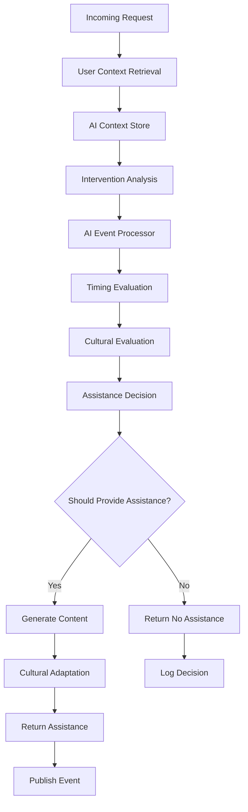
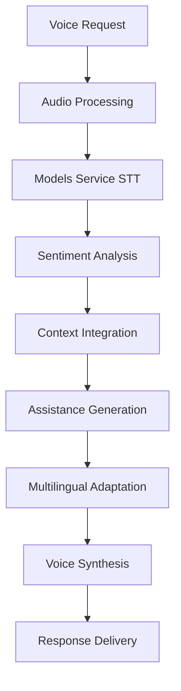
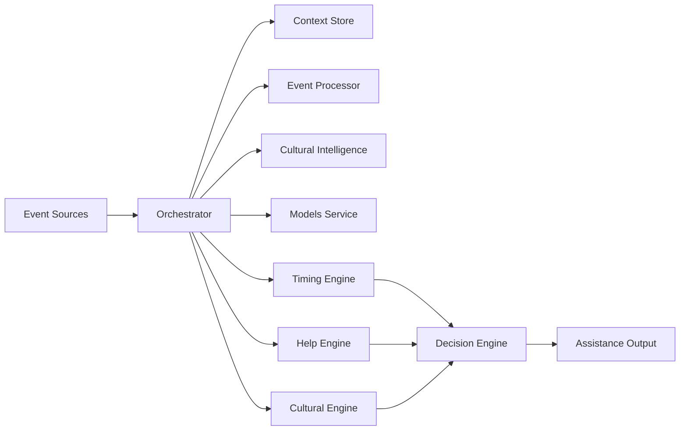

# Proactive Assistance Engine Service

## 📝 Overview

The **Proactive Assistance Engine** is a sophisticated orchestration service that coordinates existing AI capabilities into a cohesive proactive assistance system. It provides timely, contextually relevant, and culturally sensitive assistance to users by analyzing various data sources and determining when and how to provide appropriate interventions.

This service acts as the central intelligence for proactive user care, integrating multiple AI services to deliver personalized, culturally-aware assistance at optimal times.

## 📂 Directory and File Structure

```
proactive_assistance_engine/
├── main.py                     # FastAPI application entry point
├── Dockerfile                  # Container configuration
├── requirements.txt            # Python dependencies
├── pytest.ini                 # Test configuration
├── pytest_real.ini           # Real backend test configuration
├── config/
│   └── assistance.yaml        # Service configuration
├── src/
│   ├── core/                  # Core engines and orchestration logic
│   │   ├── assistance_orchestrator.py      # Main orchestration engine
│   │   ├── timing_predictor.py            # Optimal timing prediction
│   │   ├── contextual_help_engine.py      # Contextual help matching
│   │   └── cultural_sensitivity_engine.py # Cultural appropriateness evaluation
│   ├── integrations/          # External service clients
│   │   ├── ai_event_processor_client.py   # AI Event Processor integration
│   │   ├── ai_context_store_client.py     # AI Context Store integration
│   │   ├── cultural_intelligence_client.py # Cultural Intelligence integration
│   │   └── models_service_client.py       # Models Service integration (NEW)
│   └── models/
│       └── assistance_models.py           # Pydantic data models
└── tests/                     # Comprehensive test suite
    ├── conftest.py            # Test fixtures
    ├── conftest_real.py       # Real backend test fixtures
    ├── test_assistance_orchestrator.py    # Orchestrator tests
    ├── test_contextual_help_engine.py     # Help engine tests
    ├── test_cultural_sensitivity_engine.py # Cultural engine tests
    ├── test_timing_predictor.py           # Timing predictor tests
    └── test_real_backend.py              # Integration tests
```

### Key Components Description

#### 🎛️ Core Components
- **`assistance_orchestrator.py`**: Main orchestration engine that coordinates all services and makes assistance decisions
- **`timing_predictor.py`**: Evaluates optimal timing for assistance delivery based on user patterns and cultural considerations
- **`contextual_help_engine.py`**: Matches user needs with appropriate assistance content
- **`cultural_sensitivity_engine.py`**: Ensures all assistance respects cultural norms and preferences

#### 🔌 Integration Clients
- **`ai_event_processor_client.py`**: Retrieves intervention analysis and crisis detection data
- **`ai_context_store_client.py`**: Accesses comprehensive user context and intelligence insights
- **`cultural_intelligence_client.py`**: Provides cultural evaluation and content adaptation
- **`models_service_client.py`**: **NEW** - Integrates with Models Service for voice processing, translation, and sentiment analysis

#### 📊 Data Models
- **`assistance_models.py`**: Comprehensive Pydantic models for all assistance-related data structures

## ⚙️ Service Functionality Overview

### Primary Functions

1. **Proactive Assistance Orchestration**
   - Continuously monitors user context and behavioral patterns
   - Evaluates need for intervention based on AI analysis
   - Coordinates multiple AI services to provide comprehensive assistance

2. **Intelligent Timing Prediction**
   - Determines optimal timing for assistance delivery
   - Respects user activity patterns and cultural preferences
   - Implements minimum gap policies to avoid over-assistance

3. **Cultural Sensitivity Integration**
   - Evaluates cultural appropriateness of assistance content
   - Adapts communication styles based on cultural profiles
   - Respects cultural timing preferences and family considerations

4. **Contextual Help Matching**
   - Matches user needs with relevant assistance content
   - Provides crisis intervention, mood support, and behavioral guidance
   - Delivers culturally adapted help suggestions

5. **Voice and Multilingual Support** (**NEW**)
   - Processes voice assistance requests through Models Service
   - Generates multilingual responses with cultural adaptation
   - Provides sentiment analysis of user content

### System Integration

The service integrates with the broader MantraPath ecosystem:

- **Input Sources**: Mood entries, journal entries, voice activities, chat interactions
- **Processing**: AI analysis, cultural evaluation, timing optimization
- **Output**: Targeted assistance interventions, culturally appropriate content

## 🌐 Routing and API Endpoints

### Core Assistance Endpoints

| Method | Endpoint | Description | Input Format | Output Format |
|--------|----------|-------------|--------------|---------------|
| `POST` | `/api/v1/assistance/evaluate/{user_id}` | Evaluate assistance needs for user | Path: user_id | `AssistanceEvaluation` |
| `GET` | `/api/v1/assistance/status/{user_id}` | Get current assistance status | Path: user_id | Status object |
| `POST` | `/api/v1/assistance/trigger/{user_id}` | Manually trigger assistance | Path: user_id | Trigger response |

### Voice and Multilingual Endpoints (**NEW**)

| Method | Endpoint | Description | Input Format | Output Format |
|--------|----------|-------------|--------------|---------------|
| `POST` | `/api/v1/assistance/voice/{user_id}` | Process voice assistance request | Multipart: audio file, language, cultural_profile | Voice analysis result |
| `POST` | `/api/v1/assistance/multilingual-response` | Generate multilingual response | JSON: response_text, target_language, user_context | Multilingual response |
| `GET` | `/api/v1/assistance/voice/audio/{response_id}` | Retrieve audio response | Path: response_id | Audio file |
| `POST` | `/api/v1/assistance/sentiment-analysis` | Analyze user content sentiment | JSON: content_history, user_context | Sentiment analysis |

### Integration and Monitoring Endpoints

| Method | Endpoint | Description | Input Format | Output Format |
|--------|----------|-------------|--------------|---------------|
| `GET` | `/api/v1/integrations/status` | Check integration status | None | Integration status |
| `GET` | `/api/v1/models/status` | Get Models Service status | None | Models service status |
| `GET` | `/health` | Health check | None | Health status |
| `GET` | `/health/live` | Kubernetes liveness probe | None | Liveness status |
| `GET` | `/health/ready` | Kubernetes readiness probe | None | Readiness status |
| `GET` | `/api/v1/metrics` | Service performance metrics | None | Metrics data |
| `GET` | `/metrics` | Prometheus metrics | None | Prometheus format |

### Request/Response Examples

#### Evaluate Assistance Needs
```bash
POST /api/v1/assistance/evaluate/user123
```

**Response:**
```json
{
  "user_id": "user123",
  "evaluation_timestamp": "2025-09-27T10:00:00Z",
  "intervention_analysis": {
    "intervention_needed": true,
    "confidence": 0.85,
    "intervention_type": "mood_support",
    "urgency_level": "medium"
  },
  "assistance_decision": {
    "should_provide_assistance": true,
    "confidence": 0.9,
    "reasoning": ["Mood decline detected", "Cultural timing appropriate"]
  },
  "assistance_content": {
    "title": "Gentle Mood Support",
    "content": "I've noticed you might be going through a challenging time...",
    "actions": ["Try breathing exercise", "Contact trusted friend"]
  }
}
```

#### Voice Assistance Request
```bash
POST /api/v1/assistance/voice/user123
Content-Type: multipart/form-data

audio: [audio file]
language: "auto"
cultural_profile: "collectivist"
```

**Response:**
```json
{
  "status": "success",
  "user_id": "user123",
  "analysis": {
    "transcription": "I'm feeling really overwhelmed today",
    "sentiment": "negative",
    "assistance_recommendation": "mood_support"
  },
  "timestamp": "2025-09-27T10:00:00Z"
}
```

## 🔌 Port and Configuration Details

### Service Configuration

- **Default Port**: `8018`
- **Host**: `0.0.0.0` (configurable via `PROACTIVE_ASSISTANCE_HOST`)
- **Environment Variables**:
  - `PROACTIVE_ASSISTANCE_PORT`: Service port (default: 8018)
  - `AI_EVENT_PROCESSOR_URL`: AI Event Processor endpoint
  - `AI_CONTEXT_STORE_URL`: AI Context Store endpoint
  - `CULTURAL_INTELLIGENCE_URL`: Cultural Intelligence endpoint
  - `MODELS_SERVICE_URL`: Models Service endpoint (**NEW**)

### Docker Network Configuration

```yaml
# Service URLs in Docker network
AI_EVENT_PROCESSOR_URL: "http://ai-event-processor:8014"
AI_CONTEXT_STORE_URL: "http://ai-context-store:8013"
CULTURAL_INTELLIGENCE_URL: "http://cultural-intelligence:8017"
MODELS_SERVICE_URL: "http://models-service:8080"
```

### Configuration File Structure

The service uses `/config/assistance.yaml` for comprehensive configuration:

```yaml
proactive_assistance:
  evaluation:
    interval_minutes: 30
    min_gap_between_assistance_hours: 2
    cultural_sensitivity_threshold: 0.9
    timing_confidence_threshold: 0.7
  
  integration:
    ai_event_processor_url: "http://ai-event-processor:8014"
    ai_context_store_url: "http://ai-context-store:8013"
    cultural_intelligence_url: "http://localhost:8017"
    models_service_url: "http://models-service:8080"  # NEW
    timeout_seconds: 30
    retry_attempts: 3
```

## 🔄 Request Flow

### Standard Assistance Evaluation Flow



### Voice Assistance Processing Flow (**NEW**)



### Detailed Processing Steps

1. **Context Retrieval**
   - Fetch user context from AI Context Store
   - Retrieve cultural profile and preferences
   - Analyze recent interaction history

2. **Intervention Analysis**
   - Query AI Event Processor for intervention needs
   - Evaluate risk factors and urgency levels
   - Assess confidence scores

3. **Timing Evaluation**
   - Check recent assistance history
   - Analyze current user activity patterns
   - Apply cultural timing preferences
   - Handle urgency overrides

4. **Cultural Assessment**
   - Evaluate cultural appropriateness
   - Adapt content for communication styles
   - Respect cultural timing and family considerations

5. **Decision Making**
   - Combine all evaluation factors
   - Apply confidence thresholds
   - Make final assistance decision

6. **Content Generation** (if assistance needed)
   - Match needs to help content database
   - Apply cultural adaptations
   - Generate actionable recommendations

7. **Event Publishing**
   - Publish assistance events to event bus
   - Update user context with assistance history
   - Track metrics and performance

## 🔗 Service Communication

### Upstream Dependencies

#### AI Event Processor (Port 8014)
- **Purpose**: Crisis detection and intervention analysis
- **Key Endpoint**: `/api/v1/predict/intervention/{user_id}`
- **Data Retrieved**: Intervention needs, risk factors, urgency levels
- **Fallback**: Safe fallback with no intervention recommended

#### AI Context Store (Port 8013)
- **Purpose**: User context and intelligence insights
- **Key Endpoints**: 
  - `/api/v1/context/user/{user_id}`
  - `/api/v1/intelligence/insights/{user_id}`
- **Data Retrieved**: Mood context, cultural profiles, interaction history
- **Authentication**: Service-to-service JWT tokens

#### Cultural Intelligence Service (Port 8017)
- **Purpose**: Cultural evaluation and content adaptation
- **Key Endpoints**:
  - `/api/v1/cultural/evaluate`
  - `/api/v1/cultural/adapt`
- **Data Retrieved**: Cultural appropriateness scores, adapted content

#### Models Service (Port 8080) (**NEW**)
- **Purpose**: Voice processing, translation, sentiment analysis
- **Key Endpoints**:
  - `/api/v1/stt/transcribe`
  - `/api/v1/tts/synthesize`
  - `/api/v1/nlp/sentiment`
  - `/api/v1/nlp/translate`
- **Capabilities**: Speech-to-text, text-to-speech, NLP processing

### Event Bus Integration

#### Subscribed Events
- `context.updated` - User context changes
- `ai.emotion_detected` - Emotional state changes
- `journal.entry_created` - New journal entries
- `mood.entry_created` - New mood entries
- `voice.activity_detected` - Voice interaction activity

#### Published Events
- `assistance.intervention_needed` - When assistance is required
- `assistance.triggered` - When assistance is manually triggered
- `assistance.evaluation_completed` - When evaluation is finished

### Communication Patterns

1. **Synchronous HTTP Calls**
   - Real-time data retrieval from integrated services
   - Health checks and status monitoring
   - Direct API interactions

2. **Asynchronous Event Processing**
   - Event-driven assistance evaluations
   - Debounced processing to prevent evaluation storms
   - Background assistance delivery

3. **Circuit Breaker Pattern**
   - Fallback responses when services are unavailable
   - Graceful degradation with reduced functionality
   - Health monitoring and automatic recovery

## 🧠 Design Documentation

### High-Level Architecture

#### System Context
The Proactive Assistance Engine sits at the center of MantraPath's AI-driven assistance ecosystem, coordinating multiple specialized services to deliver intelligent, culturally-aware proactive care.

#### Key Design Principles

1. **Orchestration over Implementation**
   - Leverages existing AI services rather than duplicating functionality
   - Acts as intelligent coordinator for proactive assistance decisions

2. **Cultural Sensitivity First**
   - Every assistance decision is evaluated for cultural appropriateness
   - Content adaptation based on cultural profiles and communication styles

3. **Intelligent Timing**
   - Sophisticated timing algorithms prevent assistance fatigue
   - Respects user activity patterns and cultural preferences

4. **Graceful Degradation**
   - Continues functioning with reduced capability when dependencies are unavailable
   - Provides safe fallback assistance when needed

5. **Event-Driven Architecture**
   - Responds to real-time events across the system
   - Enables proactive rather than reactive assistance

### Low-Level Design

#### Core Classes and Components

##### ProactiveAssistanceOrchestrator
```python
class ProactiveAssistanceOrchestrator:
    """Main orchestration engine"""
    
    # Key responsibilities:
    # - Coordinate service integrations
    # - Evaluate assistance needs
    # - Make timing and cultural decisions
    # - Manage assistance delivery
```

##### ComprehensiveTimingPredictor
```python
class ComprehensiveTimingPredictor:
    """Optimal timing prediction system"""
    
    # Evaluation factors:
    # - Recent assistance history
    # - User activity patterns
    # - Cultural timing preferences
    # - Urgency overrides
```

##### CulturalSensitivityEngine
```python
class CulturalSensitivityEngine:
    """Cultural appropriateness evaluation"""
    
    # Assessment areas:
    # - Content appropriateness
    # - Timing considerations
    # - Communication style adaptation
    # - Family involvement preferences
```

##### ContextualHelpEngine
```python
class ContextualHelpEngine:
    """Help content matching and adaptation"""
    
    # Content categories:
    # - Crisis intervention
    # - Mood support
    # - Behavioral guidance
    # - Cultural adaptation
```

#### Data Flow Architecture



#### Decision Engine Algorithm

```python
def make_assistance_decision(
    intervention_analysis: InterventionAnalysis,
    timing_evaluation: TimingEvaluation,
    cultural_evaluation: CulturalEvaluation,
    user_preferences: Dict[str, Any]
) -> AssistanceDecision:
    """
    Core decision algorithm that weighs:
    1. Intervention confidence and urgency
    2. Timing appropriateness
    3. Cultural sensitivity
    4. User preferences and history
    """
```

### Design Decisions and Rationale

#### 1. Orchestration Pattern Choice
**Decision**: Use orchestration rather than choreography for assistance decisions
**Rationale**: 
- Centralized control ensures consistent cultural sensitivity
- Easier to implement complex timing algorithms
- Better error handling and fallback strategies
- Clearer audit trail for assistance decisions

#### 2. Service Integration Strategy
**Decision**: HTTP-based integration with circuit breaker patterns
**Rationale**:
- Simpler than message queues for synchronous data retrieval
- Allows for immediate fallback when services are unavailable
- Easier testing and debugging
- Compatible with existing service architectures

#### 3. Cultural Evaluation Approach
**Decision**: Separate cultural sensitivity engine with mandatory evaluation
**Rationale**:
- Cultural considerations are critical for user safety and acceptance
- Separate engine allows for specialized cultural logic
- Mandatory evaluation prevents cultural blind spots
- Enables consistent cultural adaptation across all assistance types

#### 4. Event-Driven Trigger Mechanism
**Decision**: Subscribe to user activity events with debouncing
**Rationale**:
- Enables truly proactive assistance
- Debouncing prevents evaluation storms
- Event-driven approach scales better than polling
- Allows for immediate response to critical events

#### 5. Models Service Integration (**NEW**)
**Decision**: Integrate with centralized Models Service for voice and multilingual support
**Rationale**:
- Leverages existing voice processing infrastructure
- Enables consistent voice experience across services
- Supports multilingual assistance delivery
- Reduces duplicate model management

## 🚧 Incomplete Implementations & TODOs

### Current Limitations

#### 1. Database Integration
**Status**: Mock implementation
**TODO**: 
- Implement PostgreSQL integration for assistance history
- Add user preference storage and retrieval
- Create assistance pattern tracking
- Implement caching layer with Redis

#### 2. Audio Response Retrieval
**Status**: Not implemented
**Location**: `/api/v1/assistance/voice/audio/{response_id}`
**TODO**:
- Implement audio caching system
- Add audio file storage integration
- Create audio response retrieval mechanism
- Add audio format conversion support

#### 3. Advanced Cultural Profiles
**Status**: Basic implementation
**TODO**:
- Expand cultural profile definitions
- Add more granular cultural adaptations
- Implement dynamic cultural learning
- Add cultural preference validation

#### 4. Machine Learning Integration
**Status**: Rule-based implementation
**TODO**:
- Integrate ML models for timing prediction
- Add user behavior pattern learning
- Implement adaptive assistance algorithms
- Add recommendation system improvements

#### 5. Real-time Context Updates
**Status**: Polling-based
**TODO**:
- Implement WebSocket connections for real-time updates
- Add streaming context integration
- Create live user activity monitoring
- Add immediate assistance triggers

### Pending Features

#### 1. Advanced Analytics
- User assistance effectiveness tracking
- Cultural adaptation success metrics
- Timing optimization analytics
- A/B testing framework for assistance strategies

#### 2. Personalization Engine
- Individual user assistance pattern learning
- Personalized timing predictions
- Custom cultural adaptation per user
- Adaptive help content ranking

#### 3. Crisis Escalation
- Automatic escalation to human support
- Emergency contact integration
- Crisis severity assessment
- Multi-channel crisis communication

#### 4. Integration Enhancements
- Additional service integrations
- Enhanced error handling and recovery
- Performance optimization
- Caching strategy improvements

### Code TODOs and Comments

```python
# In assistance_orchestrator.py
# TODO: Implement proper database queries for assistance history
# TODO: Add Redis caching for user context
# TODO: Implement ML-based timing predictions
# TODO: Add more sophisticated cultural adaptations

# In timing_predictor.py  
# TODO: Replace mock data with real user behavior patterns
# TODO: Add machine learning model integration
# TODO: Implement predictive analytics for optimal timing

# In cultural_sensitivity_engine.py
# TODO: Expand cultural guidelines database
# TODO: Add dynamic cultural learning capabilities
# TODO: Implement cultural validation feedback loops

# In contextual_help_engine.py
# TODO: Add content management system integration
# TODO: Implement dynamic content generation
# TODO: Add multilingual content support
```

## 🌟 Future Development Plans

### Short-term Goals (Next 3 months)

#### 1. Database Integration Completion
- Complete PostgreSQL schema implementation
- Add comprehensive assistance history tracking
- Implement user preference management
- Create performance analytics database

#### 2. Enhanced Voice Processing
- Complete audio response retrieval system
- Add voice preference learning
- Implement voice-based cultural adaptation
- Add multi-language voice support

#### 3. Advanced Cultural Intelligence
- Expand cultural profile definitions
- Add regional cultural variations
- Implement cultural learning algorithms
- Create cultural validation mechanisms

### Medium-term Goals (3-6 months)

#### 1. Machine Learning Integration
- Replace rule-based systems with ML models
- Implement user behavior pattern recognition
- Add predictive assistance timing models
- Create adaptive cultural learning

#### 2. Real-time Processing
- Implement streaming data integration
- Add real-time context monitoring
- Create immediate assistance triggers
- Add live user activity analysis

#### 3. Advanced Personalization
- Build individual user assistance profiles
- Implement personalized timing predictions
- Add custom cultural adaptations
- Create adaptive help content systems

### Long-term Vision (6-12 months)

#### 1. Intelligent Assistance Ecosystem
- Autonomous assistance decision making
- Cross-cultural assistance optimization
- Predictive crisis prevention
- Personalized assistance journeys

#### 2. Multi-modal Assistance
- Visual assistance integration
- Gesture-based assistance triggers
- Contextual environmental awareness
- IoT device integration

#### 3. Advanced Analytics and Insights
- Assistance effectiveness measurement
- Population-level assistance analytics
- Cultural adaptation optimization
- Predictive assistance modeling

### Innovation Opportunities

#### 1. AI-Driven Cultural Learning
- Automatic cultural pattern recognition
- Dynamic cultural adaptation algorithms
- Cross-cultural assistance optimization
- Cultural sensitivity validation systems

#### 2. Predictive Assistance
- Pre-emptive assistance delivery
- Crisis prevention algorithms
- Behavioral pattern prediction
- Intervention timing optimization

#### 3. Collaborative Assistance
- Multi-user assistance scenarios
- Family-inclusive assistance protocols
- Community-based support systems
- Peer assistance coordination

## 🚀 Getting Started

### Development Setup

1. **Install Dependencies**
   ```bash
   cd backend/services/proactive_assistance_engine
   pip install -r requirements.txt
   ```

2. **Configure Environment**
   ```bash
   export PROACTIVE_ASSISTANCE_PORT=8018
   export AI_EVENT_PROCESSOR_URL="http://localhost:8014"
   export AI_CONTEXT_STORE_URL="http://localhost:8013"
   export MODELS_SERVICE_URL="http://localhost:8080"
   ```

3. **Run Service**
   ```bash
   python main.py
   ```

4. **Run Tests**
   ```bash
   pytest tests/ -v --cov=. --cov-report=term-missing
   ```

### Docker Deployment

```bash
# Build image
docker build -t proactive-assistance-engine .

# Run container
docker run -p 8018:8018 \
  -e AI_EVENT_PROCESSOR_URL="http://ai-event-processor:8014" \
  -e AI_CONTEXT_STORE_URL="http://ai-context-store:8013" \
  proactive-assistance-engine
```

### Health Checks

- **Basic Health**: `GET /health`
- **Liveness**: `GET /health/live`
- **Readiness**: `GET /health/ready`
- **Integration Status**: `GET /api/v1/integrations/status`

---

**Last Updated**: September 27, 2025  
**Service Version**: 1.0.0  
**Maintainer**: MantraPath Development Team