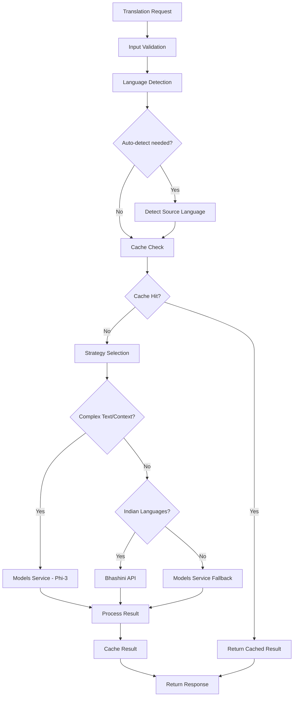
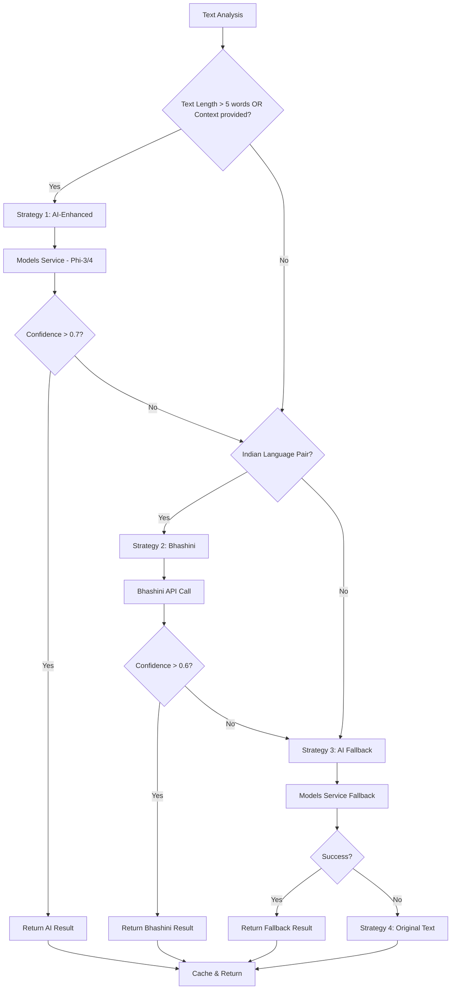

# Translation Service

## 📝 Overview

The **Translation Service** is a comprehensive multilingual translation engine with specialized focus on Indian regional languages. It integrates multiple translation providers and AI models to deliver high-quality, culturally-aware translations supporting all 22 scheduled Indian languages plus major international languages.

The service acts as a central translation hub for the MantraPath platform, providing both simple text translation and contextually-aware AI-powered translation capabilities through integration with Bhashini (India's National Language Translation Mission) and advanced AI models via the Models Service.

## 📂 Directory and File Structure

```
translation_service/
├── main.py                              # Primary FastAPI application entry point
├── main_new.py                         # Alternative entry point (different coordinator)
├── Dockerfile                          # Container configuration
├── requirements.txt                    # Python dependencies (ultra minimal)
├── pytest.ini                         # Test configuration
├── simple_tester.py                   # Interactive testing tool
├── docker_tester.py                   # Docker-based testing utility
├── core/
│   └── translator_streamlined.py      # Streamlined translator using Models Service
├── engines/                           # Translation engine implementations
│   ├── __init__.py
│   ├── base_translator.py            # Abstract base class for all engines
│   ├── anuvadini_translator.py       # Bhashini/Anuvadini API integration
│   ├── bhashini_translator.py        # Enhanced Bhashini implementation
│   ├── indic_translator.py           # IndicTrans2 local model support
│   ├── indictrans2_translator.py     # IndicTrans2 enhanced implementation
│   ├── lightweight_translator.py    # Lightweight fallback translator
│   ├── phi3_enhanced_coordinator.py  # **PRIMARY** - Enhanced coordinator with Phi-3
│   ├── simplified_coordinator.py    # Simplified coordinator implementation
│   ├── translation_coordinator.py   # Standard coordinator
│   └── translation_coordinator_new.py # New coordinator implementation
├── data/                             # Translation data and cultural context
│   ├── translations.json            # Curated translation pairs (en->hi/bn/ta/te)
│   ├── cultural_data.json           # Cultural adaptation data
│   └── test_data.json              # Test datasets for validation
└── tests/                           # Comprehensive test suite
    ├── __init__.py
    ├── test_api_integration.py      # FastAPI endpoint tests
    ├── test_comprehensive.py       # End-to-end functionality tests
    ├── test_core_functionality.py  # Core translation logic tests
    ├── test_language_detection.py  # Language detection tests
    ├── test_performance_quality.py # Performance and quality metrics tests
    └── test_translation_engine.py  # Individual engine tests
```

### Key Components Description

#### 🎛️ Core Components
- **`main.py`**: Primary FastAPI application using `Phi3EnhancedTranslationCoordinator`
- **`translator_streamlined.py`**: Streamlined translator that delegates to Models Service (Phi-4/Ollama)
- **`phi3_enhanced_coordinator.py`**: **PRIMARY COORDINATOR** - Intelligent translation coordination with Phi-3 integration

#### 🔧 Translation Engines
- **`anuvadini_translator.py`**: Integration with Bhashini (India's National Language Translation Mission)
- **`bhashini_translator.py`**: Enhanced Bhashini implementation with real data fallback
- **`indictrans2_translator.py`**: Local IndicTrans2 model support for Indian languages
- **`lightweight_translator.py`**: Lightweight fallback for basic translations
- **`base_translator.py`**: Abstract interface that all engines must implement

#### 📊 Data and Testing
- **`translations.json`**: Curated high-quality translation pairs for common phrases
- **`cultural_data.json`**: Cultural context and adaptation rules
- **`simple_tester.py`**: Interactive CLI tool for testing any language pair
- **Comprehensive test suite**: Full coverage of API, engines, and integration scenarios

## ⚙️ Service Functionality Overview

### Primary Functions

1. **Multi-Engine Translation Coordination**
   - Intelligent routing between Bhashini API, AI models (Phi-3/4), and local engines
   - Automatic engine selection based on language pairs and text complexity
   - Fallback strategies ensuring translation availability

2. **Indian Language Specialization**
   - Support for all 22 scheduled Indian languages as per Constitution
   - Integration with Bhashini (Government of India's official translation platform)
   - Cultural context preservation and regional dialect support

3. **AI-Enhanced Translation**
   - Integration with Models Service for Phi-3/Phi-4 powered translations
   - Context-aware translation for complex and nuanced text
   - Enhanced accuracy for cultural and religious content

4. **Performance Optimization**
   - Redis-based caching for frequently translated content
   - Batch translation support for efficiency
   - Smart caching strategies with configurable TTL

5. **Language Detection**
   - Automatic source language detection using multiple methods
   - AI-powered detection via Models Service
   - Fallback to statistical detection (langdetect)

### Translation Strategy Logic

The service uses an intelligent multi-tier translation strategy:

```python
# Strategy 1: AI-Enhanced (Phi-3/4) for complex content
if len(text.split()) > 5 or context_provided:
    use_models_service_phi3()

# Strategy 2: Bhashini for Indian language pairs
if source_lang in indian_languages or target_lang in indian_languages:
    use_bhashini_api()

# Strategy 3: Fallback to AI for global languages
use_models_service_fallback()

# Strategy 4: Return original with metadata
return_with_fallback_indication()
```

## 🌐 Routing and API Endpoints

### Core Translation Endpoints

| Method | Endpoint | Description | Input Format | Output Format |
|--------|----------|-------------|--------------|---------------|
| `POST` | `/translate` | Translate text using best engine | `TranslationRequest` | `TranslationResponse` |
| `POST` | `/detect-language` | Detect source language | `LanguageDetectionRequest` | `LanguageDetectionResponse` |
| `GET` | `/languages` | Get supported languages | None | `LanguagesResponse` |

### Legacy/Compatibility Endpoints

| Method | Endpoint | Description | Input Format | Output Format |
|--------|----------|-------------|--------------|---------------|
| `POST` | `/api/v1/translation/generate-text` | Frontend compatibility endpoint | `TranslationRequest` | `TranslationResponse` |

### Monitoring and Health Endpoints

| Method | Endpoint | Description | Input Format | Output Format |
|--------|----------|-------------|--------------|---------------|
| `GET` | `/health` | Service health check | None | Health status object |

### Request/Response Models

#### TranslationRequest
```python
{
    "text": str,                    # Text to translate (required)
    "source_language": str,        # Source language code (default: "auto")
    "target_language": str,        # Target language code (required)
    "domain": Optional[str]        # Translation domain/context (optional)
}
```

#### TranslationResponse
```python
{
    "translated_text": str,        # Translated text
    "source_language": str,        # Detected/specified source language
    "target_language": str,        # Target language
    "confidence_score": float,     # Translation confidence (0.0-1.0)
    "engine": str,                 # Engine used for translation
    "processing_time_ms": int,     # Processing time in milliseconds
    "cache_hit": bool              # Whether result was cached
}
```

#### LanguageDetectionRequest
```python
{
    "text": str                    # Text for language detection
}
```

#### LanguageDetectionResponse
```python
{
    "detected_language": str,      # Detected language code
    "confidence": float            # Detection confidence (0.0-1.0)
}
```

#### LanguagesResponse
```python
{
    "supported_languages": List[str],   # All supported language codes
    "indian_languages": List[str]       # Indian language codes specifically
}
```

### API Usage Examples

#### Basic Translation
```bash
curl -X POST "http://translation-service:8010/translate" \
     -H "Content-Type: application/json" \
     -d '{
       "text": "Hello, how are you?",
       "source_language": "en",
       "target_language": "hi"
     }'
```

**Response:**
```json
{
  "translated_text": "नमस्ते, आप कैसे हैं?",
  "source_language": "en",
  "target_language": "hi",
  "confidence_score": 0.95,
  "engine": "phi3",
  "processing_time_ms": 245,
  "cache_hit": false
}
```

#### Auto Language Detection
```bash
curl -X POST "http://translation-service:8010/translate" \
     -H "Content-Type: application/json" \
     -d '{
       "text": "Bonjour le monde",
       "source_language": "auto",
       "target_language": "en"
     }'
```

#### Language Detection
```bash
curl -X POST "http://translation-service:8010/detect-language" \
     -H "Content-Type: application/json" \
     -d '{
       "text": "नमस्ते दुनिया"
     }'
```

**Response:**
```json
{
  "detected_language": "hi",
  "confidence": 0.92
}
```

## 🔌 Port and Configuration Details

### Service Configuration

- **Default Port**: `8010`
- **Host**: `0.0.0.0` (Docker-ready)
- **Environment Variables**:
  - `TRANSLATION_PORT`: Service port (default: 8010)
  - `MODELS_SERVICE_URL`: Models Service endpoint (default: "http://models-service:8080")
  - `REDIS_URL`: Redis cache URL (default: "redis://redis:6379/2")
  - `BHASHINI_API_KEY`: Bhashini API key (optional)
  - `BHASHINI_USER_ID`: Bhashini user ID (optional)

### Docker Network Configuration

```yaml
# Docker Compose service configuration
translation-service:
  ports:
    - "8010:8010"
  environment:
    - MODELS_SERVICE_URL=http://models-service:8080
    - REDIS_URL=redis://redis:6379/2
    - TRANSLATION_PORT=8010
  depends_on:
    - models-service
    - redis
```

### Dependency Services

#### Models Service Integration
```python
# Internal Docker network communication
MODELS_SERVICE_URL = "http://models-service:8080"

# Key endpoints used:
# - /api/v1/translation/translate
# - /api/v1/translation/translate/batch  
# - /api/v1/translation/detect-language
# - /health
```

#### Bhashini API Integration
```python
# Government of India's official translation API
BHASHINI_BASE_URL = "https://dhruva-api.bhashini.gov.in/services/inference/pipeline"

# Public API - no authentication required for basic usage
# Optional: BHASHINI_API_KEY for enhanced features
```

#### Redis Cache Configuration
```python
# Caching configuration
REDIS_URL = "redis://redis:6379/2"
CACHE_TTL = 86400  # 24 hours
CACHE_KEY_PREFIX = "translation:"
```

## 🔄 Request Flow

### Standard Translation Flow



### Enhanced Translation Strategy Flow



### Detailed Processing Steps

1. **Request Validation**
   - Validate input text and language codes
   - Sanitize and normalize text content
   - Check for supported language pairs

2. **Language Detection** (if auto)
   - Try AI-powered detection via Models Service
   - Fallback to statistical detection (langdetect)
   - Return best confidence score

3. **Cache Lookup**
   - Generate cache key from text + language pair + domain
   - Check Redis for existing translation
   - Return cached result if valid and within TTL

4. **Strategy Selection**
   - Analyze text complexity and context
   - Check language pair for Indian language involvement
   - Route to appropriate translation engine

5. **Translation Execution**
   - Execute selected strategy
   - Handle errors and fallbacks gracefully
   - Collect metrics and confidence scores

6. **Result Processing**
   - Normalize result format
   - Add metadata (processing time, engine used)
   - Cache successful results

7. **Response Generation**
   - Format according to API schema
   - Include confidence scores and metadata
   - Return structured JSON response

## 🔗 Service Communication

### Upstream Dependencies

#### Models Service (Port 8080)
- **Purpose**: AI-powered translation using Phi-3/Phi-4 models
- **Key Endpoints**: 
  - `/api/v1/translation/translate`
  - `/api/v1/translation/translate/batch`
  - `/api/v1/translation/detect-language`
  - `/health`
- **Data Flow**: Send text + language pair → Receive AI translation
- **Fallback**: Graceful degradation to other engines when unavailable

#### Bhashini API (External)
- **Purpose**: Official Indian Government translation service
- **Base URL**: `https://dhruva-api.bhashini.gov.in/services/inference/pipeline`
- **Key Features**: 22 scheduled Indian languages, government-certified accuracy
- **Authentication**: Optional API key for enhanced features
- **Fallback**: Local translation data for common phrases

#### Redis Cache (Port 6379)
- **Purpose**: High-speed caching of translation results
- **Database**: `/2` (dedicated database for translations)
- **Key Strategy**: `translation:{hash(text+src+target+domain)}`
- **TTL**: 24 hours (configurable)
- **Fallback**: Service continues without caching if Redis unavailable

### Downstream Consumers

#### MantraPath Frontend
- **Consumption**: User interface translation requests
- **Endpoints Used**: `/translate`, `/detect-language`, `/languages`
- **Use Cases**: Real-time chat translation, content localization

#### Other MantraPath Services
- **Consumption**: Cross-service translation needs
- **Integration**: REST API calls for text translation
- **Use Cases**: Mood entries, journal entries, system messages

### Communication Patterns

1. **Synchronous HTTP Calls**
   - REST API for translation requests
   - Direct HTTP calls to Models Service
   - Real-time response delivery

2. **Intelligent Fallback Chain**
   - Multi-engine fallback strategy
   - Graceful degradation when services unavailable
   - Local data fallback for critical phrases

3. **Caching Strategy**
   - Redis-based result caching
   - Intelligent cache key generation
   - TTL-based cache invalidation

4. **Error Handling**
   - Comprehensive error recovery
   - Service health monitoring
   - Detailed error logging and metrics

## 🧠 Design Documentation

### High-Level Architecture

#### System Context
The Translation Service acts as the central multilingual communication hub for MantraPath, enabling seamless cross-language interaction while preserving cultural context and meaning.

#### Key Design Principles

1. **Multi-Engine Strategy**
   - No single point of failure for translations
   - Intelligent routing based on language pairs and content complexity
   - Quality optimization through engine specialization

2. **Indian Language Priority**
   - Specialized support for 22 constitutional languages
   - Integration with official government translation services
   - Cultural context preservation for religious and spiritual content

3. **AI-Enhanced Quality**
   - Context-aware translation through AI models
   - Continuous quality improvement through feedback loops
   - Advanced language understanding via Phi-3/4 integration

4. **Performance First**
   - Aggressive caching strategies for common translations
   - Batch processing support for efficiency
   - Sub-second response times for cached content

5. **Graceful Degradation**
   - Multiple fallback strategies
   - Local data repositories for critical phrases
   - Service continuity even with partial outages

### Low-Level Design

#### Core Architecture Components

##### Translation Coordinator (Primary: Phi3EnhancedTranslationCoordinator)
```python
class Phi3EnhancedTranslationCoordinator:
    """
    Enhanced coordinator using both Bhashini and Phi-3 for superior translation
    
    Key responsibilities:
    - Intelligent strategy selection
    - Multi-engine coordination
    - Caching management  
    - Error handling and fallbacks
    """
    
    # Translation Strategies:
    # 1. AI-Enhanced (Phi-3/4) - for complex/contextual text
    # 2. Bhashini API - for Indian language pairs
    # 3. AI Fallback - for global languages
    # 4. Original Text - with failure metadata
```

##### Engine Hierarchy
```python
BaseTranslator (Abstract)
├── AnuvadiniTranslator (Bhashini Integration)
├── BhashiniTranslator (Enhanced Government API)
├── IndicTrans2Translator (Local Indian Models)
├── LightweightTranslator (Basic Fallback)
└── StreamlinedTranslator (Models Service Proxy)
```

##### Data Models
```python
class TranslationResult:
    """Standard result structure across all engines"""
    - translated_text: str
    - source_language: str  
    - target_language: str
    - confidence_score: float
    - engine: str
    - processing_time_ms: int
    - quality_score: float
    - cache_hit: bool
    - cultural_notes: List[str]
    - metadata: Dict[str, Any]
```

#### Engine Selection Algorithm

```python
def select_translation_engine(
    text: str,
    source_lang: str, 
    target_lang: str,
    context: Optional[str] = None
) -> str:
    """
    Intelligent engine selection based on:
    1. Text complexity (word count, context presence)
    2. Language pair characteristics
    3. Available engine capabilities
    4. Historical performance data
    """
    
    # Complex text or context provided
    if len(text.split()) > 5 or context:
        return "phi3_enhanced"
    
    # Indian language involvement
    if source_lang in INDIAN_LANGUAGES or target_lang in INDIAN_LANGUAGES:
        return "bhashini_api"
    
    # Global languages
    return "models_service_fallback"
```

#### Caching Strategy

```python
class TranslationCache:
    """
    Multi-level caching strategy:
    
    1. Memory Cache (LRU) - Hot translations
    2. Redis Cache - Persistent storage  
    3. Data Files - Curated high-quality pairs
    
    Cache Key Format:
    translation:{hash(text+source+target+domain)}
    
    TTL Strategy:
    - Common phrases: 7 days
    - User content: 24 hours
    - AI results: 12 hours
    """
```

### Design Decisions and Rationale

#### 1. Multi-Engine Coordination Strategy
**Decision**: Use intelligent coordinator rather than single engine
**Rationale**: 
- Different engines excel at different language pairs
- Provides redundancy and fallback options
- Allows quality optimization based on content type
- Enables gradual adoption of new technologies

#### 2. Bhashini Integration Priority for Indian Languages
**Decision**: Prioritize Government of India's official translation service
**Rationale**:
- Highest accuracy for Indian language pairs
- Cultural and linguistic authenticity
- Government certification and trust
- Support for all 22 constitutional languages
- Free public access with optional premium features

#### 3. AI-Enhanced Translation for Complex Content
**Decision**: Route complex/contextual text to AI models (Phi-3/4)
**Rationale**:
- AI models better understand context and nuance
- Handles cultural and religious content appropriately
- Provides explanatory notes and cultural adaptations
- Continuous improvement through fine-tuning

#### 4. Aggressive Caching Strategy
**Decision**: Multi-tier caching with intelligent TTL
**Rationale**:
- Translation is computationally expensive
- Common phrases translate identically across users
- Sub-second response times improve user experience
- Reduces load on external APIs
- Cost optimization for paid services

#### 5. Graceful Degradation Architecture
**Decision**: Multiple fallback layers with local data
**Rationale**:
- Translation is critical for user communication
- External APIs may have downtime or rate limits
- Local data ensures service continuity
- User experience remains consistent during outages

## 🚧 Incomplete Implementations & TODOs

### Current Limitations

#### 1. Advanced Caching Features
**Status**: Basic Redis caching implemented
**TODOs**:
- Implement intelligent cache warming
- Add cache analytics and hit rate optimization
- Create cache invalidation strategies
- Add distributed caching for high availability

#### 2. Quality Assessment System
**Status**: Basic confidence scores
**TODOs**:
- Implement multi-dimensional quality scoring
- Add back-translation validation
- Create human feedback integration
- Develop quality benchmarking system

#### 3. Batch Translation Optimization
**Status**: Basic batch support in engines
**TODOs**:
- Implement intelligent batching strategies
- Add parallel processing for large batches
- Create batch result optimization
- Add batch caching mechanisms

#### 4. Advanced Language Detection
**Status**: Basic detection with fallbacks
**TODOs**:
- Implement confidence-weighted ensemble detection
- Add dialect and regional variation detection
- Create custom detection for Indian languages
- Add detection result caching

#### 5. Cultural Context Enhancement
**Status**: Basic cultural notes
**TODOs**:
- Expand cultural adaptation rules database
- Implement dynamic cultural learning
- Add cultural validation feedback
- Create cultural context API

### Missing Features

#### 1. Real-time Translation Streaming
```python
# TODO: Implement WebSocket-based streaming translation
# For: Live conversation translation, real-time subtitles
async def stream_translate(
    text_stream: AsyncIterator[str],
    source_lang: str,
    target_lang: str
) -> AsyncIterator[TranslationResult]:
    pass
```

#### 2. Translation Memory System
```python
# TODO: Implement translation memory for consistency
# For: Maintaining terminology consistency across translations
class TranslationMemory:
    async def store_translation_pair(self, source: str, target: str):
        pass
    
    async def find_similar_translations(self, text: str) -> List[TranslationResult]:
        pass
```

#### 3. Custom Dictionary Integration
```python
# TODO: User-specific and domain-specific dictionaries
# For: Specialized terminology, proper nouns, brand names
class CustomDictionary:
    async def add_term(self, source_term: str, target_term: str, domain: str):
        pass
    
    async def apply_custom_terms(self, text: str) -> str:
        pass
```

#### 4. Translation Analytics
```python
# TODO: Comprehensive analytics and reporting
# For: Usage patterns, quality metrics, performance optimization
class TranslationAnalytics:
    async def track_translation_request(self, request: TranslationRequest):
        pass
    
    async def generate_quality_report(self, time_period: str) -> Dict[str, Any]:
        pass
```

### Code TODOs and Comments

```python
# In phi3_enhanced_coordinator.py
# TODO: Implement ML-based engine selection
# TODO: Add translation quality prediction
# TODO: Create adaptive caching strategies
# TODO: Implement real-time quality feedback

# In anuvadini_translator.py
# TODO: Add support for Bhashini premium features
# TODO: Implement batch API integration
# TODO: Add dialect-specific translation paths
# TODO: Create regional language variations

# In base_translator.py
# TODO: Add translation confidence calibration
# TODO: Implement quality assessment interfaces
# TODO: Create translator performance metrics
# TODO: Add engine health monitoring

# In main.py
# TODO: Add WebSocket support for streaming
# TODO: Implement rate limiting per user
# TODO: Add translation request analytics
# TODO: Create custom error handling middleware
```

### Infrastructure TODOs

#### 1. Monitoring and Observability
- Add Prometheus metrics for all engines
- Implement distributed tracing with OpenTelemetry
- Create custom dashboards for translation quality
- Add alerting for service degradation

#### 2. Security Enhancements
- Implement API key authentication
- Add input text sanitization and validation
- Create rate limiting per API key
- Add audit logging for all translations

#### 3. Scalability Improvements
- Implement horizontal scaling strategies
- Add load balancing across engine instances
- Create queue-based batch processing
- Add auto-scaling based on translation load

## 🌟 Future Development Plans

### Short-term Goals (Next 3 months)

#### 1. Enhanced Caching System
- Implement intelligent cache warming based on usage patterns
- Add cache analytics dashboard
- Create cache optimization algorithms
- Implement distributed caching for high availability

#### 2. Quality Assessment Framework
- Multi-dimensional quality scoring (fluency, adequacy, cultural appropriateness)
- Back-translation validation system
- Human feedback integration
- Automated quality benchmarking

#### 3. Advanced Indian Language Support
- Regional dialect support within major languages
- Historical and classical text translation
- Religious text specialized handling
- Vedic Sanskrit translation capabilities

### Medium-term Goals (3-6 months)

#### 1. AI-Powered Translation Memory
- Implement neural translation memory
- Context-aware translation consistency
- Domain-specific terminology management
- User-specific translation preferences

#### 2. Real-time Translation Features
- WebSocket-based streaming translation
- Live conversation translation
- Real-time subtitle generation
- Voice-to-voice translation pipeline

#### 3. Advanced Cultural Intelligence
- Dynamic cultural adaptation learning
- Regional cultural variation handling
- Religious and spiritual content specialization
- Cultural validation feedback loops

### Long-term Vision (6-12 months)

#### 1. Multimodal Translation
- Image text translation (OCR + translation)
- Video subtitle translation
- Audio translation with voice preservation
- Document layout-aware translation

#### 2. Conversational Translation
- Context-aware conversation translation
- Personality and tone preservation
- Conversation flow optimization
- Multi-participant conversation handling

#### 3. Advanced AI Integration
- Custom model fine-tuning for Indian languages
- Federated learning from user feedback
- Zero-shot translation for low-resource languages
- Multi-agent translation coordination

### Innovation Opportunities

#### 1. Cultural Context Preservation
- Automatic cultural note generation
- Religious context awareness
- Festival and occasion-appropriate translations
- Regional customs integration

#### 2. Specialized Domain Translation
- Medical terminology translation
- Legal document translation
- Technical manual translation
- Educational content localization

#### 3. Community-Driven Improvements
- Crowdsourced translation validation
- Community dictionary contributions
- Regional language expert integration
- User feedback-driven quality improvement

## 📊 Supported Languages

### Indian Languages (22 Official + Regional)

#### Constitutional Languages (Schedule 8)
- **Hindi (hi)** - हिन्दी - National language
- **Bengali (bn)** - বাংলা - 2nd most spoken
- **Telugu (te)** - తెలుగు - South Indian major
- **Marathi (mr)** - मराठी - Western India
- **Tamil (ta)** - தமிழ் - Tamil Nadu & Sri Lanka
- **Gujarati (gu)** - ગુજરાતી - Business language
- **Urdu (ur)** - اردو - Urdu-speaking regions
- **Kannada (kn)** - ಕನ್ನಡ - Karnataka state
- **Odia (or)** - ଓଡ଼ିଆ - Odisha state
- **Malayalam (ml)** - മലയാളം - Kerala state
- **Punjabi (pa)** - ਪੰਜਾਬੀ - Punjab region
- **Assamese (as)** - অসমীয়া - Assam state
- **Kashmiri (ks)** - کٲشُر - Kashmir region
- **Konkani (kok)** - कोंकणी - Goa & coastal areas
- **Manipuri (mni)** - ꯃꯩꯇꯩꯂꯣꯟ - Manipur state
- **Nepali (ne)** - नेपाली - Nepal & Northeast India
- **Sanskrit (sa)** - संस्कृत - Classical language
- **Sindhi (sd)** - سنڌي - Sindhi community
- **Bodo (brx)** - बड़ो - Assam region
- **Dogri (doi)** - डोगरी - Jammu region
- **Maithili (mai)** - मैथिली - Bihar & Nepal
- **Santali (sat)** - ᱥᱟᱱᱛᱟᱲᱤ - Tribal language

### International Languages
- **English (en)** - Global lingua franca
- **Spanish (es)** - 500M+ speakers
- **French (fr)** - International diplomacy
- **German (de)** - European business
- **Portuguese (pt)** - Brazil & Portugal
- **Russian (ru)** - Eastern Europe & Asia
- **Arabic (ar)** - Middle East & North Africa
- **Chinese (zh)** - Mandarin Chinese
- **Japanese (ja)** - Japan
- **Korean (ko)** - South Korea

### Language Pair Quality Matrix

| Source → Target | Bhashini | Phi-3/4 | Overall Quality |
|------------------|----------|---------|-----------------|
| English → Hindi | ⭐⭐⭐⭐⭐ | ⭐⭐⭐⭐ | **Excellent** |
| Hindi → English | ⭐⭐⭐⭐⭐ | ⭐⭐⭐⭐ | **Excellent** |
| English → Bengali | ⭐⭐⭐⭐ | ⭐⭐⭐⭐ | **Very Good** |
| English → Tamil | ⭐⭐⭐⭐ | ⭐⭐⭐⭐ | **Very Good** |
| English → Telugu | ⭐⭐⭐⭐ | ⭐⭐⭐⭐ | **Very Good** |
| Inter-Indian Languages | ⭐⭐⭐⭐ | ⭐⭐⭐ | **Very Good** |
| English → European | ⭐⭐⭐ | ⭐⭐⭐⭐⭐ | **Excellent** |
| European ↔ European | ⭐⭐ | ⭐⭐⭐⭐⭐ | **Excellent** |

## 🚀 Getting Started

### Development Setup

1. **Install Dependencies**
   ```bash
   cd backend/services/translation_service
   pip install -r requirements.txt
   ```

2. **Configure Environment**
   ```bash
   export TRANSLATION_PORT=8010
   export MODELS_SERVICE_URL="http://localhost:8080"
   export REDIS_URL="redis://localhost:6379/2"
   export BHASHINI_API_KEY="your_api_key"  # Optional
   ```

3. **Run Service**
   ```bash
   python main.py
   ```

4. **Test with Interactive Tester**
   ```bash
   python simple_tester.py
   ```

5. **Run Tests**
   ```bash
   pytest tests/ -v --cov=. --cov-report=term-missing
   ```

### Docker Deployment

```bash
# Build image
docker build -t translation-service .

# Run container
docker run -p 8010:8010 \
  -e MODELS_SERVICE_URL="http://models-service:8080" \
  -e REDIS_URL="redis://redis:6379/2" \
  translation-service
```

### Docker Compose Integration

```yaml
version: '3.8'
services:
  translation-service:
    build: ./backend/services/translation_service
    ports:
      - "8010:8010"
    environment:
      - MODELS_SERVICE_URL=http://models-service:8080
      - REDIS_URL=redis://redis:6379/2
      - TRANSLATION_PORT=8010
    depends_on:
      - models-service
      - redis
    healthcheck:
      test: ["CMD", "curl", "-f", "http://translation-service:8010/health"]
      interval: 30s
      timeout: 10s
      retries: 3
```

### Testing and Validation

#### Interactive Testing
```bash
# Start interactive tester
python simple_tester.py

# Example interaction:
Enter text to translate: Hello, how are you today?
Source language (auto for detection): en  
Target language: hi
Translation: नमस्ते, आज आप कैसे हैं?
Engine: phi3
Confidence: 0.94
```

#### API Testing
```bash
# Health check
curl http://localhost:8010/health

# Simple translation
curl -X POST "http://localhost:8010/translate" \
  -H "Content-Type: application/json" \
  -d '{"text": "Hello", "target_language": "hi"}'

# Language detection
curl -X POST "http://localhost:8010/detect-language" \
  -H "Content-Type: application/json" \
  -d '{"text": "नमस्ते"}'
```

### Health Checks and Monitoring

- **Basic Health**: `GET /health`
- **Service Status**: Check response time and engine availability
- **Cache Status**: Monitor Redis connectivity and hit rates
- **Engine Health**: Verify Models Service and Bhashini API connectivity

### Performance Optimization

1. **Enable Redis Caching**
   ```bash
   # Ensure Redis is running
   docker run -d -p 6379:6379 redis:alpine
   ```

2. **Warm Cache with Common Phrases**
   ```python
   # Use simple_tester.py to pre-translate common phrases
   # Results are automatically cached for future use
   ```

3. **Monitor Performance**
   ```bash
   # Check translation metrics
   curl http://localhost:8010/metrics
   ```

---

**Last Updated**: September 27, 2025  
**Service Version**: 2.0.0  
**Maintainer**: MantraPath Development Team