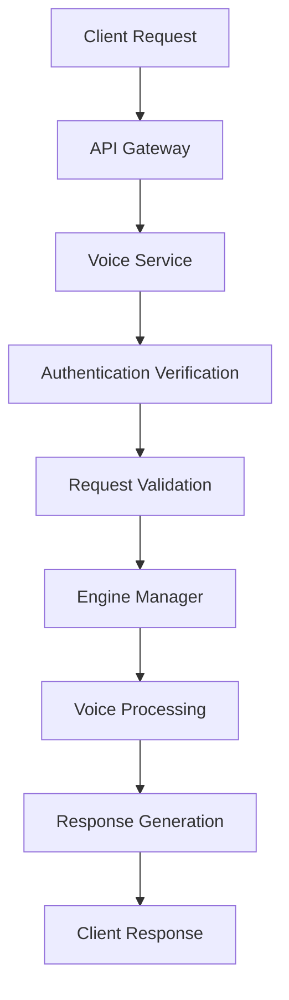
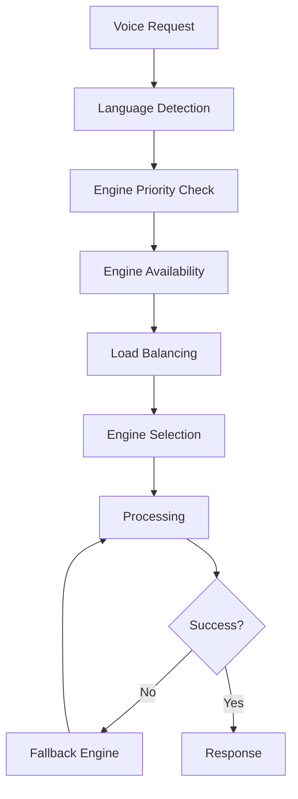

# Voice Service Architecture

## Overview

The MantraPath Voice Service follows a modular, enterprise-grade architecture designed for scalability, maintainability, and high performance. Built using FastAPI with async/await patterns, the service integrates multiple voice processing engines while providing a unified API interface.

## 🏗️ Architectural Patterns

### Microservices Architecture
- **Independent Service**: Fully autonomous with own database and business logic
- **Service Discovery**: Automatic registration with API Gateway
- **Health Monitoring**: Built-in health checks and status reporting
- **Horizontal Scaling**: Container-based deployment for easy scaling

### Layered Architecture
```
┌─────────────────────────────────────────┐
│           API Layer (FastAPI)           │
├─────────────────────────────────────────┤
│         Service Layer (Business)        │
├─────────────────────────────────────────┤
│        Engine Layer (Voice Engines)     │
├─────────────────────────────────────────┤
│        Core Layer (Models/Utils)        │
└─────────────────────────────────────────┘
```

## 📁 Directory Structure

```
voice_service/
├── main.py                     # FastAPI application entry point
├── config/                     # Configuration management
│   ├── __init__.py
│   ├── settings.py            # Environment settings
│   └── language_config.py     # Language support configuration
├── core/                      # Core models and utilities
│   ├── __init__.py
│   ├── models.py             # Pydantic data models
│   ├── exceptions.py         # Custom exception classes
│   └── base_engine.py        # Abstract base classes
├── engines/                   # Voice processing engines
│   ├── __init__.py
│   ├── engine_manager.py     # Engine orchestration
│   ├── whisper_engine.py     # Whisper STT implementation
│   └── elevenlabs_tts_engine.py # ElevenLabs TTS implementation
├── services/                  # Business logic services
│   ├── __init__.py
│   ├── voice_service.py      # Core voice processing
│   ├── command_processor.py  # Voice command handling
│   ├── profile_service.py    # Voice profile management
│   └── integration_service.py # External service integration
├── tests/                    # Comprehensive test suite
│   ├── __init__.py
│   ├── test_main.py
│   ├── test_engines.py
│   ├── test_services.py
│   └── fixtures.py
└── doc/                      # Documentation
    └── *.md
```

## 🔧 Component Architecture

### 1. API Layer (`main.py`)
**Responsibilities:**
- FastAPI application setup and configuration
- Route definition and request handling
- Authentication and authorization
- Request/response validation
- Error handling and logging

**Key Components:**
- Application lifespan management
- CORS and middleware configuration
- JWT token verification
- Health check endpoints

### 2. Engine Manager (`engines/engine_manager.py`)
**Responsibilities:**
- Voice engine lifecycle management
- Engine selection and load balancing
- Fallback engine configuration
- Performance monitoring

**Supported Engines:**
- **STT Engines**: Whisper, Google Speech-to-Text, Azure Speech
- **TTS Engines**: ElevenLabs, Azure Speech, Google Text-to-Speech
- **Engine Selection**: Priority-based with language-specific preferences

### 3. Voice Processing Service (`services/voice_service.py`)
**Responsibilities:**
- Audio processing pipeline orchestration
- Format conversion and validation
- Session management
- Cache integration

**Processing Pipeline:**
```
Audio Input → Validation → Format Conversion → Engine Selection → Processing → Response Formatting
```

### 4. Command Processor (`services/command_processor.py`)
**Responsibilities:**
- Natural language command parsing
- Intent recognition and classification
- Action execution and response generation
- Context-aware processing

### 5. Profile Service (`services/profile_service.py`)
**Responsibilities:**
- Voice profile creation and management
- Voice cloning pipeline
- Training data management
- Profile optimization

### 6. Integration Service (`services/integration_service.py`)
**Responsibilities:**
- External service communication
- API Gateway registration
- Authentication verification
- Event publishing

## 🔄 Data Flow Architecture

### Request Processing Flow


### Engine Selection Flow


## 🏛️ Design Patterns

### 1. Factory Pattern
- Engine creation based on configuration
- Dynamic engine selection
- Extensible engine registration

### 2. Strategy Pattern
- Pluggable voice processing algorithms
- Engine-specific implementations
- Runtime strategy selection

### 3. Observer Pattern
- Event-driven architecture
- Real-time status updates
- Notification system

### 4. Adapter Pattern
- Unified interface for different engines
- Engine-specific configuration abstraction
- Consistent response format

## 🚀 Scalability Design

### Horizontal Scaling
- Stateless service design
- Container-based deployment
- Load balancing support
- Database connection pooling

### Vertical Scaling
- Async/await pattern throughout
- Non-blocking I/O operations
- Memory-efficient processing
- CPU optimization

### Caching Strategy
- Engine response caching
- Profile data caching
- Session state management
- Distributed cache support

## 🔒 Security Architecture

### Authentication & Authorization
- JWT token validation
- Role-based access control
- API key management
- Rate limiting

### Data Protection
- Audio data encryption
- Secure profile storage
- PII data handling
- GDPR compliance

## 🔧 Configuration Management

### Environment-Based Configuration
```python
class VoiceConfig:
    ENVIRONMENT: str = "development"
    DEBUG: bool = True
    LOG_LEVEL: str = "INFO"
    
    # Service Configuration
    HOST: str = "0.0.0.0"
    PORT: int = 8007
    
    # Engine Configuration
    WHISPER_MODEL: str = "base"
    ELEVENLABS_API_KEY: str = ""
    
    # Integration
    API_GATEWAY_URL: str = ""
    AUTH_SERVICE_URL: str = ""
```

### Language Configuration
- Tiered language support
- Engine preferences per language
- Cultural adaptation settings
- Meditation-specific optimizations

## 📊 Monitoring & Observability

### Health Checks
- Service status monitoring
- Engine availability checks
- Database connectivity
- External service dependencies

### Metrics Collection
- Processing latency
- Engine performance
- Error rates
- Resource utilization

### Logging Strategy
- Structured logging
- Request/response tracing
- Error tracking
- Performance profiling

## 🔄 Integration Points

### API Gateway Integration
- Service registration
- Route configuration
- Load balancing
- Health monitoring

### Auth Service Integration
- Token verification
- User authentication
- Permission validation
- Session management

### Other Service Communication
- Profile service integration
- Notification service events
- Content service interaction
- Analytics data collection

## 🎯 Future Architecture Enhancements

### Planned Improvements
- **Real-time Streaming**: WebSocket-based audio streaming
- **ML Model Training**: Custom model training pipeline
- **Edge Computing**: Offline processing capabilities
- **Multi-tenant**: Tenant-specific configurations
- **Advanced Analytics**: ML-driven insights and recommendations

### Technology Roadmap
- **Neural TTS**: Advanced neural voice synthesis
- **Voice Biometrics**: Speaker identification and verification
- **Emotion AI**: Advanced emotion recognition
- **Conversation AI**: Context-aware voice interactions

---

This architecture provides a solid foundation for the Voice Service while maintaining flexibility for future enhancements and scaling requirements.
