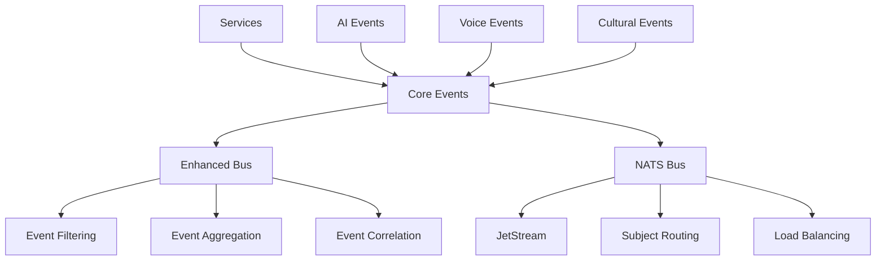

# MantraPath Event System

The MantraPath event system provides robust, scalable, and real-time communication between microservices. It supports multiple event bus implementations, specialized event types, and advanced features like event correlation, replay, and cultural intelligence.

## 🏗️ Architecture Overview



## 📋 Event Bus Components

| Component | Purpose | Protocol | Persistence |
|-----------|---------|----------|-------------|
| `enhanced_bus.py` | Advanced event processing | In-memory/Redis | Optional |
| `nats_bus.py` | High-performance messaging | NATS/JetStream | Yes |
| `ai_events.py` | AI/ML specific events | Both | Yes |
| `voice_events.py` | Voice processing events | Both | Yes |
| `cultural_events.py` | Cultural intelligence | Both | Yes |

## 🚀 Enhanced Event Bus (`enhanced_bus.py`)

The enhanced event bus provides advanced event processing capabilities with filtering, aggregation, and correlation.

### Key Features

- **Event Filtering**: Route events based on content and metadata
- **Event Aggregation**: Combine related events for batch processing
- **Event Correlation**: Link related events across services
- **Circuit Breaker**: Prevent cascading failures
- **Retry Logic**: Automatic retry with exponential backoff
- **Dead Letter Queue**: Handle failed events gracefully

### Usage Example

```python
from shared.events.enhanced_bus import EnhancedEventBus
from shared.core_events import MoodEvent

# Initialize event bus
bus = EnhancedEventBus()

# Publish event
await bus.publish(MoodEvent(
    user_id=123,
    mood_score=7,
    energy_level=6,
    event_type="mood_update"
))

# Subscribe to events
@bus.subscribe("mood_update")
async def handle_mood_update(event: MoodEvent):
    print(f"User {event.user_id} mood: {event.mood_score}")
```

### Event Filtering

```python
# Filter events by user
bus.add_filter("user_filter", lambda event: event.user_id == target_user_id)

# Filter by event severity
bus.add_filter("critical_only", lambda event: event.severity == "critical")
```

### Event Aggregation

```python
# Aggregate mood events over 5-minute windows
aggregator = bus.create_aggregator(
    event_type="mood_update",
    window_size=300,  # 5 minutes
    aggregation_func=lambda events: {
        "avg_mood": sum(e.mood_score for e in events) / len(events),
        "count": len(events)
    }
)
```

## 🚄 NATS Event Bus (`nats_bus.py`)

High-performance event bus using NATS JetStream for persistent, scalable messaging.

### Key Features

- **JetStream Persistence**: Durable event storage with replay
- **Subject-based Routing**: Hierarchical event routing
- **Load Balancing**: Distribute events across multiple consumers
- **Stream Management**: Automatic stream creation and management
- **Consumer Groups**: Shared processing across service instances

### Usage Example

```python
from shared.events.nats_bus import NATSEventBus

# Initialize NATS bus
bus = NATSEventBus("nats://nats:4222")

# Publish to specific subject
await bus.publish("mood.updates", MoodEvent(...))

# Subscribe to subject pattern
@bus.subscribe("mood.*")
async def handle_all_mood_events(subject: str, event: dict):
    print(f"Received mood event on {subject}: {event}")
```

### Stream Configuration

```python
# Create persistent stream
await bus.create_stream(
    name="mood-events",
    subjects=["mood.updates", "mood.analysis"],
    retention_policy="workqueue",
    max_age=86400  # 24 hours
)
```

### Consumer Groups

```python
# Create consumer group for load balancing
await bus.create_consumer(
    stream="mood-events",
    name="mood-processors",
    deliver_subject="mood.process",
    queue_group="mood-workers"
)
```

## 🤖 AI Events (`ai_events.py`)

Specialized events for AI and machine learning operations.

### Event Types

- **ModelTrainingEvent**: ML model training status
- **PredictionEvent**: AI prediction results
- **AnomalyDetectionEvent**: Anomaly alerts
- **ModelUpdateEvent**: Model version updates
- **CrossServiceIntelligenceEvent**: Multi-service AI coordination

### Usage Example

```python
from shared.events.ai_events import ModelTrainingEvent, PredictionEvent

# Model training completion
training_event = ModelTrainingEvent(
    model_id="crisis_predictor_v2",
    status="completed",
    accuracy=0.873,
    training_duration=3600,
    metadata={
        "features_used": ["mood_patterns", "journal_sentiment"],
        "training_samples": 10000
    }
)

await bus.publish(training_event)

# Prediction result
prediction_event = PredictionEvent(
    model_id="crisis_predictor_v2",
    user_id=123,
    prediction_type="crisis_risk",
    result={"risk_score": 0.75, "confidence": 0.89},
    features_used=["recent_mood", "journal_sentiment"]
)

await bus.publish(prediction_event)
```

## 🎤 Voice Events (`voice_events.py`)

Events for voice processing and speech-to-text/text-to-speech operations.

### Event Types

- **SpeechToTextEvent**: STT processing results
- **TextToSpeechEvent**: TTS generation requests
- **VoiceCommandEvent**: Voice command processing
- **LanguageDetectionEvent**: Spoken language detection
- **VoiceAnalysisEvent**: Voice pattern analysis

### Usage Example

```python
from shared.events.voice_events import SpeechToTextEvent, VoiceCommandEvent

# Speech-to-text result
stt_event = SpeechToTextEvent(
    user_id=123,
    audio_id="audio_123",
    transcript="How am I feeling today?",
    confidence=0.95,
    language="en-US",
    processing_time_ms=450
)

# Voice command processing
command_event = VoiceCommandEvent(
    user_id=123,
    command="log_mood",
    parameters={"mood_score": 7, "energy": 6},
    intent_confidence=0.92,
    language="en-US"
)
```

## 🌍 Cultural Events (`cultural_events.py`)

Events for cultural intelligence and adaptation features.

### Event Types

- **CulturalContextEvent**: Cultural context updates
- **LanguagePreferenceEvent**: User language changes
- **TranslationQualityEvent**: Translation feedback
- **CulturalAdaptationEvent**: Cultural adaptation triggers
- **LocalizationEvent**: Content localization updates

### Usage Example

```python
from shared.events.cultural_events import CulturalContextEvent, LanguagePreferenceEvent

# Cultural context update
cultural_event = CulturalContextEvent(
    user_id=123,
    cultural_context={
        "primary_language": "hi",
        "cultural_background": "indian",
        "communication_style": "high_context",
        "time_zone": "Asia/Kolkata"
    },
    trigger="profile_update"
)

# Language preference change
language_event = LanguagePreferenceEvent(
    user_id=123,
    previous_language="en",
    new_language="hi",
    context="voice_command",
    confidence=0.88
)
```

## 🔧 Configuration

### Environment Variables

```bash
# NATS Configuration
NATS_URL=nats://nats:4222
NATS_STREAM_PREFIX=mantrapath
NATS_MAX_RECONNECT_ATTEMPTS=10

# Enhanced Bus Configuration
EVENT_BUS_TYPE=enhanced  # or 'nats'
EVENT_AGGREGATION_ENABLED=true
EVENT_CORRELATION_ENABLED=true

# Event Persistence
EVENT_PERSISTENCE_ENABLED=true
EVENT_RETENTION_DAYS=30
```

### Stream Configuration

```yaml
# Stream configuration for different event types
streams:
  mood-events:
    subjects: ["mood.*"]
    retention: "workqueue"
    max_age: 86400
    
  ai-events:
    subjects: ["ai.*", "ml.*"]
    retention: "interest"
    max_age: 604800  # 7 days
    
  voice-events:
    subjects: ["voice.*", "speech.*"]
    retention: "workqueue"
    max_age: 43200  # 12 hours
```

## 🧪 Testing

### Unit Tests

```bash
# Test event system components
python -m pytest shared/events/tests/ -v

# Test specific event bus
python -m pytest shared/events/tests/test_enhanced_bus.py -v
```

### Integration Tests

```bash
# Test cross-service event communication
python -m pytest tests/integration/test_event_system.py -v
```

### Load Testing

```bash
# Test event bus performance
python -m pytest shared/events/tests/test_performance.py -v
```

## 📊 Monitoring and Observability

### Event Metrics

- **Event throughput**: Events per second by type
- **Processing latency**: Time from publish to consumption
- **Error rates**: Failed events and retry attempts
- **Queue depths**: Pending events in each stream
- **Consumer lag**: Delay in event processing

### Health Checks

```python
# Check event bus health
health = await bus.get_health_status()
print(f"Status: {health.status}")
print(f"Connected: {health.connected}")
print(f"Pending events: {health.pending_events}")
```

### Observability Integration

```python
# OpenTelemetry tracing
from opentelemetry import trace

tracer = trace.get_tracer(__name__)

with tracer.start_as_current_span("event_processing"):
    await bus.publish(event)
```

## 🚀 Performance Optimization

### Best Practices

1. **Batch Events**: Group related events for efficiency
2. **Use Appropriate TTL**: Set reasonable event expiration
3. **Monitor Queue Depth**: Prevent event accumulation
4. **Scale Consumers**: Add consumers for high-load subjects
5. **Optimize Serialization**: Use efficient event serialization

### Performance Tuning

```python
# Configure bus for high throughput
bus_config = {
    "max_batch_size": 100,
    "batch_timeout_ms": 50,
    "connection_pool_size": 10,
    "max_reconnect_attempts": 5
}

bus = EnhancedEventBus(**bus_config)
```

## 🔐 Security

### Event Security Features

- **Event Validation**: Schema validation for all events
- **Access Control**: Subject-based permissions
- **Encryption**: Optional event payload encryption
- **Authentication**: NATS authentication integration
- **Audit Logging**: Event processing audit trails

### Security Configuration

```python
# Secure event bus configuration
secure_config = {
    "enable_tls": True,
    "validate_schemas": True,
    "encrypt_payloads": True,
    "audit_enabled": True
}
```

## 🔄 Event Replay and Recovery

### Event Replay

```python
# Replay events from specific time
replay_config = {
    "stream": "mood-events",
    "start_time": "2024-01-01T00:00:00Z",
    "end_time": "2024-01-02T00:00:00Z"
}

await bus.replay_events(**replay_config)
```

### Disaster Recovery

```python
# Backup event streams
await bus.backup_stream("mood-events", "backup_location")

# Restore from backup
await bus.restore_stream("mood-events", "backup_location")
```

---

For more detailed information about specific event types and advanced usage patterns, refer to the individual component files and their inline documentation.
