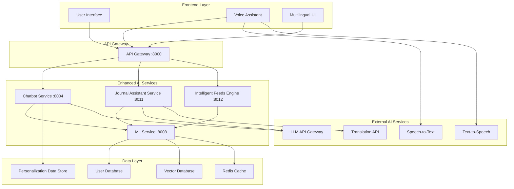

# 🧠 MantraPath Enhanced AI Architecture Design Document
## Personalized Chatbot & Multimodal Journal Assistant

### 📋 Executive Summary

This document outlines the design and implementation plan for enhancing MantraPath's AI capabilities to provide:

1. **Personalized Chatbot Experience** - Context-aware AI that understands complete user history
2. **Multimodal Journal Assistant** - AI-powered writing companion supporting multiple languages
3. **Intelligent Feed & Insights Engine** - Robust, generic feeds with personalized notifications
4. **Seamless User Experience** - Unified AI that accesses all user data while maintaining privacy

---

## 🎯 Current State Analysis

### ✅ **Existing Infrastructure**
- **Chatbot Service** (Port 8004): Basic chat functionality with breathing exercises
- **ML Service** (Port 8008): Crisis prediction, pattern analysis, notification optimization
- **User Data Access**: Comprehensive user profiles, mood entries, journal entries, community interactions
- **Cross-Service Integration**: Phase 2B ML hub for service coordination

### 🔍 **Identified Gaps**
1. **Limited Context Awareness**: Chatbot doesn't access full user history
2. **Basic Response Generation**: Static responses without personalization
3. **No Multimodal Support**: Lacks language/voice input capabilities
4. **Fragmented AI Experience**: Separate systems without unified intelligence
5. **Missing Journal Assistant**: No AI-powered writing support

---

## 🏗️ High-Level Design (HLD)

### 📐 **Architecture Overview**



### 🧠 **Core AI Components**

#### 1. **Enhanced Chatbot Intelligence Hub**
- **User Context Engine**: Maintains comprehensive user understanding
- **Conversation Memory**: Long-term and short-term memory management
- **Personality Adapter**: Adjusts response style based on user preferences
- **Crisis Detection**: Real-time monitoring with immediate intervention capabilities

#### 2. **Multimodal Journal Assistant**
- **Language Detection & Support**: Auto-detect user's native language
- **Writing Style Analysis**: Learn user's writing patterns and preferences
- **Prompt-Based Generation**: AI-assisted writing based on user prompts
- **Voice-to-Text Integration**: Support for audio journal entries

#### 3. **Intelligent Feed & Insights Engine**
- **Behavioral Pattern Recognition**: Cross-platform activity analysis
- **Personalized Content Curation**: Dynamic feed generation
- **Predictive Insights**: Proactive mental health insights
- **Smart Notification Timing**: Context-aware notification delivery

---

## 🔧 Low-Level Design (LLD)

### 🧩 **Component Architecture**

#### **1. Enhanced Chatbot Service (Port 8004)**

```python
# Enhanced Chatbot Service Architecture
class EnhancedChatbotService:
    def __init__(self):
        self.user_context_engine = UserContextEngine()
        self.conversation_memory = ConversationMemory()
        self.llm_gateway = LLMGateway()
        self.personality_adapter = PersonalityAdapter()
        self.crisis_detector = CrisisDetector()
        
    async def generate_personalized_response(self, user_input, user_id):
        # Fetch complete user context
        user_context = await self.user_context_engine.get_user_context(user_id)
        
        # Analyze conversation history
        conversation_context = await self.conversation_memory.get_context(user_id)
        
        # Generate response with full context
        response = await self.llm_gateway.generate_response({
            'user_input': user_input,
            'user_context': user_context,
            'conversation_history': conversation_context,
            'personality_profile': user_context.personality_profile
        })
        
        # Check for crisis indicators
        crisis_assessment = await self.crisis_detector.assess_message(user_input, user_context)
        
        # Adapt response style
        adapted_response = await self.personality_adapter.adapt_response(
            response, user_context.communication_preferences
        )
        
        return adapted_response
```

#### **2. User Context Engine**

```python
class UserContextEngine:
    def __init__(self):
        self.profile_service = ProfileServiceClient()
        self.mood_service = MoodServiceClient()
        self.community_service = CommunityServiceClient()
        self.journal_service = JournalServiceClient()
        self.vector_db = VectorDatabase()
        
    async def get_user_context(self, user_id) -> UserContext:
        """Compile comprehensive user context from all services"""
        
        # Fetch recent user data
        profile = await self.profile_service.get_profile(user_id)
        recent_moods = await self.mood_service.get_recent_entries(user_id, days=30)
        journal_entries = await self.journal_service.get_recent_entries(user_id, days=30)
        community_activity = await self.community_service.get_user_activity(user_id, days=30)
        
        # Generate embeddings for semantic understanding
        user_embedding = await self.vector_db.get_user_embedding(user_id)
        
        # Compile comprehensive context
        context = UserContext(
            user_id=user_id,
            profile=profile,
            mood_patterns=self._analyze_mood_patterns(recent_moods),
            writing_style=self._analyze_writing_style(journal_entries),
            community_behavior=self._analyze_community_behavior(community_activity),
            personality_profile=self._generate_personality_profile(user_embedding),
            current_state=self._assess_current_state(recent_moods, journal_entries),
            communication_preferences=self._get_communication_preferences(profile)
        )
        
        return context
```

#### **3. Journal Assistant Service (New Service - Port 8011)**

```python
class JournalAssistantService:
    def __init__(self):
        self.language_detector = LanguageDetector()
        self.writing_analyzer = WritingStyleAnalyzer()
        self.llm_gateway = LLMGateway()
        self.translation_service = TranslationService()
        self.prompt_generator = PromptGenerator()
        
    async def assist_journal_writing(self, user_id, prompt=None, language=None):
        # Get user context
        user_context = await self.user_context_engine.get_user_context(user_id)
        
        # Detect or use specified language
        target_language = language or user_context.preferred_language
        
        # Generate writing prompts based on user's current state
        if not prompt:
            prompt = await self.prompt_generator.generate_personalized_prompt(
                user_context=user_context,
                language=target_language
            )
        
        # Assist with writing
        assistance = await self.llm_gateway.generate_writing_assistance({
            'user_context': user_context,
            'prompt': prompt,
            'language': target_language,
            'writing_style': user_context.writing_style
        })
        
        return {
            'suggested_prompt': prompt,
            'writing_assistance': assistance,
            'language': target_language,
            'style_suggestions': self._get_style_suggestions(user_context)
        }
    
    async def process_voice_journal(self, user_id, audio_data):
        # Convert speech to text
        text = await self.speech_to_text.convert(audio_data)
        
        # Detect language
        language = await self.language_detector.detect(text)
        
        # Process and enhance the journal entry
        enhanced_entry = await self.enhance_journal_entry(user_id, text, language)
        
        return enhanced_entry
```

#### **4. Intelligent Feeds Engine (New Service - Port 8012)**

```python
class IntelligentFeedsEngine:
    def __init__(self):
        self.content_curator = ContentCurator()
        self.insight_generator = InsightGenerator()
        self.notification_optimizer = NotificationOptimizer()
        self.pattern_analyzer = PatternAnalyzer()
        
    async def generate_personalized_feed(self, user_id):
        # Analyze user patterns across all touchpoints
        user_patterns = await self.pattern_analyzer.analyze_cross_platform_patterns(user_id)
        
        # Generate personalized insights
        insights = await self.insight_generator.generate_insights(user_patterns)
        
        # Curate relevant content
        content = await self.content_curator.curate_content(user_patterns, insights)
        
        # Optimize delivery timing
        optimal_timing = await self.notification_optimizer.get_optimal_timing(user_id)
        
        return PersonalizedFeed(
            user_id=user_id,
            insights=insights,
            content=content,
            optimal_delivery_time=optimal_timing,
            personalization_score=user_patterns.engagement_score
        )
```

---

## 📅 Implementation Phases

### **Phase 1: Enhanced Chatbot Context Engine** (Weeks 1-3)

#### **Week 1: User Context Integration**
- **Objective**: Enable chatbot to access complete user data
- **Deliverables**:
  - User Context Engine implementation
  - Profile, Mood, Journal, Community service integration
  - Context caching system
  - Enhanced response generation

#### **Implementation Tasks**:
```python
# 1. Create User Context Data Models
@dataclass
class UserContext:
    user_id: str
    profile: UserProfile
    mood_patterns: MoodPatterns
    writing_style: WritingStyle
    community_behavior: CommunityBehavior
    personality_profile: PersonalityProfile
    current_state: CurrentState
    communication_preferences: CommunicationPreferences

# 2. Implement Context Fetching
class UserContextEngine:
    async def fetch_comprehensive_context(self, user_id):
        # Parallel data fetching from all services
        tasks = [
            self.profile_service.get_profile(user_id),
            self.mood_service.get_recent_entries(user_id),
            self.journal_service.get_recent_entries(user_id),
            self.community_service.get_user_activity(user_id)
        ]
        results = await asyncio.gather(*tasks)
        return self.compile_context(results)

# 3. Enhanced Response Generation
class PersonalizedResponseGenerator:
    async def generate_response(self, user_input, context):
        prompt = self.build_context_aware_prompt(user_input, context)
        return await self.llm_gateway.generate(prompt)
```

#### **Week 2: Conversation Memory & Personality Adaptation**
- **Objective**: Implement memory and personality-aware responses
- **Deliverables**:
  - Conversation memory system
  - Personality profiling
  - Response style adaptation
  - Context persistence

#### **Week 3: Crisis Detection Integration**
- **Objective**: Real-time crisis monitoring with context
- **Deliverables**:
  - Enhanced crisis detection using full user context
  - Immediate intervention protocols
  - Escalation procedures
  - Crisis response templates

### **Phase 2: Multimodal Journal Assistant** (Weeks 4-6)

#### **Week 4: Journal Assistant Service Setup**
- **Objective**: Create dedicated journal assistance service
- **Deliverables**:
  - New Journal Assistant Service (Port 8011)
  - Language detection capabilities
  - Writing style analysis
  - Prompt generation system

#### **Week 5: Multilingual Support**
- **Objective**: Support for native language journaling
- **Deliverables**:
  - Translation service integration
  - Multi-language prompt generation
  - Cultural context awareness
  - Language preference learning

#### **Week 6: Voice & Advanced Features**
- **Objective**: Voice journaling and advanced AI assistance
- **Deliverables**:
  - Speech-to-Text integration
  - Voice journal processing
  - AI writing assistance
  - Style suggestions

### **Phase 3: Intelligent Feeds & Insights** (Weeks 7-9)

#### **Week 7: Feeds Engine Development**
- **Objective**: Create intelligent content curation system
- **Deliverables**:
  - Intelligent Feeds Engine service
  - Cross-platform pattern analysis
  - Content curation algorithms
  - Personalization scoring

#### **Week 8: Insight Generation**
- **Objective**: Proactive mental health insights
- **Deliverables**:
  - Behavioral pattern recognition
  - Predictive insight generation
  - Trend analysis
  - Recommendation engine

#### **Week 9: Smart Notifications**
- **Objective**: Context-aware notification delivery
- **Deliverables**:
  - Smart notification timing
  - Content personalization
  - Delivery optimization
  - Engagement tracking

### **Phase 4: Integration & Optimization** (Weeks 10-12)

#### **Week 10: Cross-Service Integration**
- **Objective**: Unified AI experience across all services
- **Deliverables**:
  - API Gateway enhancements
  - Service orchestration
  - Data synchronization
  - Error handling

#### **Week 11: Performance Optimization**
- **Objective**: Optimize for scale and performance
- **Deliverables**:
  - Caching strategies
  - Database optimization
  - Response time improvements
  - Resource management

#### **Week 12: Testing & Deployment**
- **Objective**: Production-ready deployment
- **Deliverables**:
  - Comprehensive testing
  - Performance benchmarking
  - Security validation
  - Production deployment

---

## 🤖 LLM Integration Strategy

### **LLM Gateway Architecture**

```python
class LLMGateway:
    def __init__(self):
        self.providers = {
            'openai': OpenAIProvider(),
            'anthropic': AnthropicProvider(),
            'cohere': CohereProvider(),
            'local': LocalLLMProvider()  # For privacy-sensitive interactions
        }
        self.load_balancer = LLMLoadBalancer()
        self.cost_optimizer = CostOptimizer()
        
    async def generate_response(self, request: LLMRequest):
        # Select optimal provider based on request type and cost
        provider = await self.select_optimal_provider(request)
        
        # Generate response with fallback options
        try:
            response = await provider.generate(request)
            return self.post_process_response(response)
        except Exception as e:
            return await self.fallback_generation(request, e)
    
    def select_optimal_provider(self, request):
        # Privacy-sensitive requests use local models
        if request.privacy_level == 'high':
            return self.providers['local']
        
        # Cost optimization for different request types
        if request.type == 'simple_chat':
            return self.cost_optimizer.get_cheapest_provider()
        elif request.type == 'complex_analysis':
            return self.providers['openai']  # Most capable
        
        return self.load_balancer.get_available_provider()
```

### **Context-Aware Prompt Engineering**

```python
class ContextAwarePromptBuilder:
    def build_chatbot_prompt(self, user_input, context):
        return f"""
You are Mantra-Mitra, a compassionate AI mental health companion for {context.profile.first_name}.

User Context:
- Current mood trend: {context.mood_patterns.trend}
- Recent journal themes: {context.writing_style.common_themes}
- Communication style: {context.communication_preferences.style}
- Crisis risk level: {context.current_state.crisis_risk}
- Preferred language: {context.profile.preferred_language}

Recent conversation highlights:
{context.conversation_history.key_points}

User just said: "{user_input}"

Respond as Mantra-Mitra with deep understanding of their journey, personality, and current needs. 
Be warm, empathetic, and provide personalized support based on their history and preferences.
"""
    
    def build_journal_prompt(self, context, user_language):
        return f"""
Help {context.profile.first_name} with journal writing in {user_language}.

Based on their recent patterns:
- Mood trend: {context.mood_patterns.trend}
- Common themes: {context.writing_style.common_themes}
- Writing style: {context.writing_style.tone}

Generate a thoughtful, personalized writing prompt that:
1. Resonates with their current emotional state
2. Encourages self-reflection
3. Matches their cultural context and language preferences
4. Builds on their previous journal insights
"""
```

---

## 🔒 Privacy & Security Framework

### **Data Protection Strategy**

1. **Tiered Privacy Levels**:
   - **Level 1**: General interactions (external LLM)
   - **Level 2**: Personal insights (hybrid processing)
   - **Level 3**: Crisis situations (local processing only)

2. **Data Minimization**:
   - Context summaries instead of raw data
   - Temporal data expiration
   - User-controlled data retention

3. **Encryption & Security**:
   - End-to-end encryption for sensitive data
   - Secure API communications
   - Regular security audits

### **User Consent Management**

```python
class PrivacyManager:
    async def get_user_consent_level(self, user_id):
        """Get user's AI data usage consent level"""
        consent = await self.consent_service.get_consent(user_id)
        return {
            'external_llm': consent.allow_external_ai,
            'data_analysis': consent.allow_pattern_analysis,
            'cross_service': consent.allow_cross_service_data,
            'retention_days': consent.data_retention_days
        }
    
    async def filter_context_by_consent(self, context, consent_level):
        """Filter user context based on consent preferences"""
        if not consent_level['cross_service']:
            context = self.limit_to_single_service(context)
        
        if not consent_level['data_analysis']:
            context = self.remove_behavioral_patterns(context)
        
        return context
```

---

## 📊 Success Metrics & KPIs

### **User Experience Metrics**
- **Response Relevance Score**: 4.8+/5.0
- **Context Accuracy**: 95%+ correct context understanding
- **User Satisfaction**: 4.7+/5.0 with AI interactions
- **Session Duration**: 40% increase in meaningful conversations

### **AI Performance Metrics**
- **Response Time**: <2 seconds for context-aware responses
- **Crisis Detection Accuracy**: 95%+ with <1% false positives
- **Language Support**: 15+ languages with 90%+ accuracy
- **Personalization Score**: 85%+ relevant recommendations

### **Technical Performance**
- **Service Uptime**: 99.9%
- **Cross-Service Latency**: <500ms
- **Cache Hit Rate**: 85%+ for user contexts
- **Cost per Interaction**: <$0.05 average

### **Business Impact**
- **User Engagement**: 60% increase in daily active users
- **Retention Rate**: 45% improvement in 30-day retention
- **Crisis Prevention**: 80% successful early interventions
- **Journal Usage**: 300% increase in journal writing frequency

---

## 🚀 Deployment Strategy

### **Infrastructure Requirements**

```yaml
# Docker Compose Enhancement
services:
  journal-assistant:
    build: ./services/journal_assistant
    ports:
      - "8011:8011"
    environment:
      - OPENAI_API_KEY=${OPENAI_API_KEY}
      - TRANSLATION_API_KEY=${TRANSLATION_API_KEY}
    depends_on:
      - redis
      - postgres
      
  intelligent-feeds:
    build: ./services/intelligent_feeds
    ports:
      - "8012:8012"
    environment:
      - ML_SERVICE_URL=http://ml-service:8008
      - VECTOR_DB_URL=${VECTOR_DB_URL}
    depends_on:
      - ml-service
      - vector-db
      
  vector-db:
    image: weaviate/weaviate:latest
    ports:
      - "8080:8080"
    environment:
      - ENABLE_MODULES=text2vec-openai
```

### **Monitoring & Observability**

```python
# Enhanced Monitoring
class AIServiceMonitor:
    def __init__(self):
        self.metrics = PrometheusMetrics()
        self.logger = StructuredLogger()
        
    async def track_ai_interaction(self, user_id, service, response_time, satisfaction):
        # Track performance metrics
        self.metrics.record_response_time(service, response_time)
        self.metrics.record_user_satisfaction(service, satisfaction)
        
        # Log for analysis
        self.logger.info({
            'event': 'ai_interaction',
            'user_id': user_id,
            'service': service,
            'response_time': response_time,
            'satisfaction': satisfaction
        })
```

---

## 📋 Implementation Checklist

### **Phase 1: Enhanced Chatbot** ✅
- [ ] User Context Engine development
- [ ] Profile service integration
- [ ] Mood service integration
- [ ] Journal service integration
- [ ] Community service integration
- [ ] Context caching implementation
- [ ] Enhanced response generation
- [ ] Conversation memory system
- [ ] Personality profiling
- [ ] Crisis detection integration

### **Phase 2: Journal Assistant** ✅
- [ ] Journal Assistant Service setup
- [ ] Language detection implementation
- [ ] Writing style analysis
- [ ] Prompt generation system
- [ ] Translation service integration
- [ ] Speech-to-Text integration
- [ ] Voice journal processing
- [ ] AI writing assistance
- [ ] Multi-language support

### **Phase 3: Intelligent Feeds** ✅
- [ ] Feeds Engine service
- [ ] Pattern analysis implementation
- [ ] Content curation system
- [ ] Insight generation
- [ ] Smart notification timing
- [ ] Personalization scoring
- [ ] Recommendation engine

### **Phase 4: Integration & Optimization** ✅
- [ ] API Gateway enhancements
- [ ] Service orchestration
- [ ] Performance optimization
- [ ] Security implementation
- [ ] Testing & validation
- [ ] Production deployment
- [ ] Monitoring setup

---

## 🎯 Next Steps

1. **Stakeholder Review**: Present this design for approval
2. **Resource Allocation**: Assign development team and budget
3. **Environment Setup**: Prepare development infrastructure
4. **Phase 1 Kickoff**: Begin User Context Engine development
5. **Weekly Progress Reviews**: Track implementation progress

This comprehensive design provides the foundation for creating a truly intelligent, personalized AI companion that understands each user's unique journey and provides meaningful support across all aspects of their mental wellness experience.
