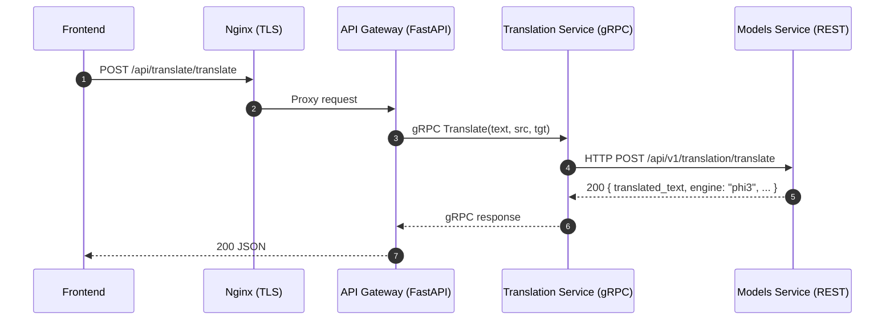
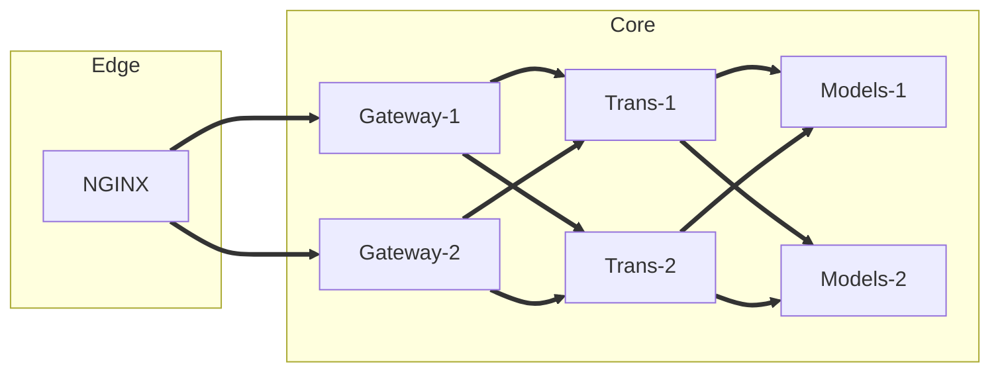

# MantraPath Technical Design: Architecture, Persistence, and Resilience

Date: 2025-09-20
Owner: Platform Engineering
Status: Draft (implementation-ready)

## Overview

This document captures the current system architecture and proposes a strategy to strengthen data persistence and overall resilience. It covers:
- API communication and service architecture (current state + proposed improvements)
- Containerization and deployment
- Data persistence and management strategy (root-cause and redesign)
- Roadmap and implementation plan

Where applicable, Mermaid diagrams illustrate flows and dependencies.

---

## 1) API Communication and Service Architecture

### 1.1 Current State

Services (from docker-compose and code inspection):
- Nginx TLS reverse proxy (production) – terminates HTTPS, proxies /api/* to API Gateway, WebSocket support.
- API Gateway (FastAPI) – public REST endpoints, internal clients; provides REST shims while calling downstream services.
- Translation Service – exposes HTTP and gRPC; API Gateway uses gRPC for internal calls.
- Models Service – centralized AI models (STT, TTS, NLP), FastAPI REST under `/api/v1/*`.
- Redis (cache, ephemeral state) – primary cache, also separate agent Redis.
- Postgres – relational data store.
- NATS – messaging and future WS clustering via JetStream.
- Frontend – Vite app consuming `/api/*` via Nginx → API Gateway.

Protocols in use:
- External → API Gateway: HTTP/REST, WebSocket.
- API Gateway → Internal services: HTTP/REST (legacy) and gRPC (Translation Service), with JSON payloads for REST and protobuf for gRPC.
- Internal service → Models Service: HTTP/REST JSON (e.g., Translation Coordinator uses Models Service `/api/v1/translation/*`).

Key APIs and data formats (representative):
- Translation (REST shim at gateway):
  - POST `/api/translate/translate` → { text, source_language, target_language } → { translated_text, engine, confidence }
  - POST `/api/translate/detect-language` → { text } → { detected_language, confidence }
  - GET `/api/translate/languages` → [{ code, name }]
- Models Service (REST):
  - POST `/api/v1/translation/translate` → { text, source_language, target_language } → { success, translated_text, source_language, target_language, confidence_score, engine }
  - POST `/api/v1/translation/detect-language` → { text } → { language, confidence }

Sequence: external request to translation



Architecture (current):

```mermaid
flowchart LR
  subgraph Edge
    CFE[Frontend]
    NGINX[Nginx TLS/HTTP2]
  end
  subgraph Core
    GW[API Gateway]
    TS[Translation Service]
    MS[Models Service]
    NATS[NATS + JetStream]
  end
  subgraph Data
    PG[(Postgres)]
    R1[(Redis 0)]
    AR[(Agent Redis)]
    Vol[Docker Volumes]
  end

  CFE--HTTPS/WebSocket-->NGINX
  NGINX--/api/*-->GW
  GW--gRPC-->TS
  TS--REST-->MS
  GW--REST-->Other Services
  GW--NATS-->NATS
  GW--Redis-->R1
  OtherServices-->PG
  OtherServices-->R1
  MS--models/cache-->Vol
```

Observations:
- Public REST surface consolidated in API Gateway; internalizing gRPC incrementally.
- Nginx configured with Docker DNS resolver and `resolve` to avoid stale DNS 502s.
- Models Service runs “minimal mode”; lazy-initializes NLP engine on first use to avoid heavy cold starts.

### 1.2 Resilience Analysis

Critical points of failure:
- Single API Gateway instance – outage blocks all external traffic.
- Single Models Service – translation and NLP dependent on it.
- Redis single instance without AOF/RDB persistence – cache loss risks session/state loss.
- Postgres single instance – primary data store; no replica/backup configured in compose.
- Nginx upstream DNS previously caused 502s; now mitigated via `resolver`/`resolve`.
- Lazy model initialization path – first-hit latency; if init fails, translation falls back.

Recommended improvements:
- API Gateway HA: run 2+ replicas behind Nginx with health-based upstreams, sticky where needed.
- Models Service HA: 2 replicas with shared model store (read-only) and a write-once model cache strategy.
- Service discovery: prefer internal DNS names, plus active health checks; consider Consul/eureka only if compose→k8s migration later.
- Timeouts/retries/circuit breakers: standardized client policies (httpx/grpc) with exponential backoff; gateway should degrade gracefully and return cached or fallback responses.
- Backpressure: rate limiting at Nginx and Gateway; queue heavy requests via NATS/JetStream when needed.
- Health and readiness:
  - Liveness: /health
  - Readiness: /status and model-ready checks; exclude not-ready pods from rotation.
- Observability: structured logs, Prometheus metrics, and tracing via OpenTelemetry for GW→TS→MS spans.

Mermaid: load-balanced core



Configuration enablers:
- Nginx upstreams with multiple backends and health checks (or passive health via fail_timeout/max_fails).
- Docker Compose: scale services (`--scale`), or migrate to Nomad/Kubernetes for production-grade orchestration.

---

## 2) Containerization and Deployment

### 2.1 Docker Build Process (current)

- Base images: python:3.11-slim (for Models Service and others), redis:7-alpine, postgres:15, nats:2.10-alpine.
- Install system deps (ffmpeg, sox, etc.) where needed.
- Copy `requirements.txt` then `pip install` to leverage layer caching.
- Copy service code and startup scripts (e.g., `start_simple.sh`).
- Expose ports via compose environment variables.
- Run as root by default in several services (can be improved).

Improvements:
- Multi-stage builds for heavy dependencies; wheel caching.
- Explicit non-root user and file permissions.
- Pin dependencies and enable pip download cache mount.
- Leverage buildx cache-from/to to speed CI.

### 2.2 Deployment Strategy (current)

- Docker Compose orchestrates services in a single host environment.
- Nginx fronts HTTPS and proxies to API Gateway.
- Health checks configured for key services; gateway depends on Redis health.
- Environment variables drive service-to-service URLs via internal DNS (`service-name:port`).

Path to higher resilience:
- Short term: Compose scaling + Nginx upstream pools.
- Mid term: Move to Kubernetes (or Nomad) with:
  - Deployments + HPA, PodDisruptionBudgets
  - Services with ClusterIP and Liveness/Readiness probes
  - ConfigMaps/Secrets, StatefulSets for DBs
  - Ingress with mTLS and canary/blue-green rollouts

---

## 3) Data Persistence and Management Strategy

### 3.1 Problem Analysis (current issue)

Symptoms reported: data not persisting correctly with Docker attached volumes. Likely contributing factors:
- Relative host bind mounts pointing to transient or incorrect paths; containers writing to different directories than expected.
- Named volumes used but container paths don’t match application write paths (e.g., models saved under `/app/models` while volume mounted to `/models`).
- Startup scripts recreating directories and overwriting content, or clearing caches on container restart.
- Models downloaded into container layer instead of mounted volume → lost on rebuild.
- Redis running without AOF/RDB persistence → data loss on restart.

Verification checklist:
- Identify all write paths across services (models, cache, logs, uploads, DB data dirs).
- Ensure a named volume or host bind is mounted exactly at those paths.
- Confirm startup scripts do not delete or reinitialize mounted paths.

### 3.2 Proposed Persistence Design

Goals:
- Durable and location-agnostic storage for:
  1) ML models and caches
  2) User-generated content and interaction logs
  3) Relational data and analytical logs
- Support future ML training using historical data (auditable, queryable, secure).

Key choices:
- Object Storage for models and artifacts: S3-compatible (MinIO on-prem) or cloud S3; store model files, tokenizer, checkpoints, and large artifacts.
- Local Read-Through Cache: each Models Service mounts a writable cache volume for hot artifacts.
- Database for metadata and user data: Postgres with nightly backups and WAL archiving.
- Event/Log pipeline: Ship application logs and interaction events to OpenSearch/ELK or ClickHouse for analytics; keep raw JSON in object storage for reprocessing.
- Redis persistence: enable AOF (appendonly yes) and periodic RDB snapshots for resilience.

Storage layout:
- Models Service:
  - MODELS_DIR = /data/models (named volume) – hot cache
  - CACHE_DIR = /data/cache (named volume)
  - LOG_DIR = /var/log/models-service (bind or volume)
  - Remote backing store: s3://mantrapath-models-bucket/{model_name}/
- Postgres:
  - Named volume for /var/lib/postgresql/data
  - WAL archiving to object storage for point-in-time restore
- Redis:
  - Named volume for /data
  - redis.conf enabling AOF + RDB
- User uploads/logs:
  - Object storage bucket s3://mantrapath-uploads/ and s3://mantrapath-interactions/

MinIO option (on the same host):
- Run MinIO with a dedicated volume; provide S3 credentials via env to services.

### 3.3 Concrete Compose Snippets

Models Service volumes and env:

```yaml
services:
  models-service:
    volumes:
      - models_store:/data/models
      - models_cache:/data/cache
      - models_logs:/var/log/models-service
    environment:
      - MODELS_DIR=/data/models
      - MODELS_CACHE_DIR=/data/cache
      - MODELS_LOG_DIR=/var/log/models-service
      - MODELS_REMOTE_STORE=s3
      - S3_ENDPOINT=http://minio:9000
      - S3_BUCKET=models
      - S3_ACCESS_KEY=${MINIO_ACCESS_KEY}
      - S3_SECRET_KEY=${MINIO_SECRET_KEY}
```

Redis with AOF:

```yaml
services:
  redis:
    image: redis:7-alpine
    command: ["redis-server", "/usr/local/etc/redis/redis.conf"]
    volumes:
      - redis_data:/data
      - ./config/redis.conf:/usr/local/etc/redis/redis.conf:ro
```

Example `config/redis.conf`:

```conf
appendonly yes
appendfsync everysec
save 900 1
save 300 10
save 60 10000
```

Postgres backups (lightweight):

- Add a `pgbackups` sidecar that runs `pg_dump` nightly to object storage, or enable WAL archiving:

```yaml
services:
  pgbackups:
    image: ghcr.io/prodrigestivill/postgres-backup-local:latest
    environment:
      - POSTGRES_HOST=postgres
      - POSTGRES_DB=${POSTGRES_DB}
      - POSTGRES_USER=${POSTGRES_USER}
      - POSTGRES_PASSWORD=${POSTGRES_PASSWORD}
      - SCHEDULE=@daily
      - BACKUP_DIR=/backups
    volumes:
      - pg_backups:/backups
    depends_on:
      postgres:
        condition: service_healthy
```

MinIO server (optional on-prem object storage):

```yaml
services:
  minio:
    image: quay.io/minio/minio:RELEASE.2025-01-05T00-00-00Z
    command: server /data --console-address ":9001"
    ports:
      - "9000:9000"
      - "9001:9001"
    environment:
      - MINIO_ROOT_USER=${MINIO_ACCESS_KEY}
      - MINIO_ROOT_PASSWORD=${MINIO_SECRET_KEY}
    volumes:
      - minio_data:/data
    healthcheck:
      test: ["CMD", "mc", "ready", "local"]
      interval: 30s
      timeout: 10s
      retries: 5
```

Log shipping (optional):
- Use fluent-bit sidecar to ship JSON logs to S3/OpenSearch/ClickHouse for analytics.

### 3.4 Application Changes

- Ensure Models Service writes models and caches exclusively under MODELS_DIR/CACHE_DIR from env.
- Replace any hard-coded `/app/models` or `./models` paths with env-driven paths.
- Add a simple S3 client in `ModelManager` to fetch model artifacts when missing; maintain checksums and a manifest.
- Avoid deleting mounted directories in startup scripts; create if missing with correct permissions.
- Introduce retention policies for logs and interactions.

Security considerations:
- Store S3 credentials as secrets; restrict bucket policies to needed prefixes.
- Encrypt backups at rest; enable TLS for MinIO if exposed beyond localhost.

---

## 4) Roadmap for Improvements

### Phase 0: Immediate (0–2 weeks)
- Fix persistence:
  - Mount named volumes to exact write paths for models/cache/logs/redis/postgres.
  - Enable Redis AOF and Postgres backups sidecar.
  - Audit startup scripts to avoid wiping mounted paths.
- Resilience quick wins:
  - Add client-side timeouts/retries in Gateway, TS, and MS.
  - Add readiness endpoints and have Nginx exclude not-ready backends.
  - Improve logging and add baseline Prometheus metrics.

### Phase 1: Short Term (2–6 weeks)
- Scale out critical services with Nginx upstream pools (2 replicas each for Gateway, TS, MS).
- Introduce object storage (MinIO/S3) for models and uploads; wire ModelManager to read-through cache.
- Add log shipping pipeline and interaction events store.
- Start canary deployments for Gateway with staged rollouts.

### Phase 2: Mid Term (6–12 weeks)
- Adopt Kubernetes or Nomad:
  - Deployments with HPA, PDBs, and proper probes.
  - StatefulSets for Postgres/Redis with operators (e.g., CrunchyData, Redis operator) or managed services.
  - Ingress, cert-manager, and service mesh (mTLS, retries, circuit breaking).
- Full OpenTelemetry tracing across GW→TS→MS.
- Blue/Green releases and automated rollback.

### Acceptance Criteria
- Data remains intact across container rebuilds/restarts; model cache survives upgrades.
- Translation and NLP remain functional during a single instance failure (degraded capacity only).
- Backups restorable to a new environment within RTO/RPO targets (define in SRE policy).
- Observability provides end-to-end request traces and error budgets.

---

## Appendices

### A) Health/Readiness Patterns
- Liveness: `/health` returns 200 when process alive.
- Readiness: `/status` includes model readiness. Nginx/K8s should only route when ready.

### B) Example Nginx Upstream (multi-backend)

```nginx
upstream api_gateway_upstream {
    server api-gateway:8000 max_fails=3 fail_timeout=10s;
    # server api-gateway-2:8000 max_fails=3 fail_timeout=10s;
    keepalive 64;
}

map $http_upgrade $connection_upgrade { default upgrade; '' close; }

server {
    listen 443 ssl http2;
    server_name mantrapath.example.com;
    resolver 127.0.0.11 ipv6=off valid=30s;

    location /api/ {
        proxy_pass http://api_gateway_upstream;
        proxy_http_version 1.1;
        proxy_set_header Connection $connection_upgrade;
        proxy_set_header Upgrade $http_upgrade;
    }
}
```

### E) Environments and DNS (low-cost)
- Domains via GoDaddy: configure A/AAAA records to the host IP; use subdomains:
  - prod: api.mantrapath.example.com, app.mantrapath.example.com
  - staging: api.staging.mantrapath.example.com, app.staging.mantrapath.example.com
  - beta (preprod): api.mantrapath-beta.example.com, app.mantrapath-beta.example.com
- Use separate compose projects and networks for isolation:
  - Production: `docker compose -p mantrapath-prod -f docker-compose.yml up -d`
  - Beta: `docker compose -p mantrapath-beta -f docker-compose.yml -f docker-compose.preprod.yml up -d`
- Point Nginx to the appropriate internal gateway (prod or beta) via distinct upstreams or ports.
- Keep databases and caches separate for each env; use different volume names and ports (see preprod override).

### C) Models Service Env Contract
- MODELS_DIR, MODELS_CACHE_DIR, MODELS_LOG_DIR
- MODELS_REMOTE_STORE: none|s3
- S3_ENDPOINT, S3_BUCKET, S3_ACCESS_KEY, S3_SECRET_KEY

### D) Risk Register
- First-request latency during lazy initialization – mitigate by warming model on deploy.
- Disk pressure from large models – enforce cache quotas and eviction (
least-recently-used).
- Consistency between replicas – immutable model artifact versions; avoid partial writes with temp files + rename on commit.

---

End of document.
