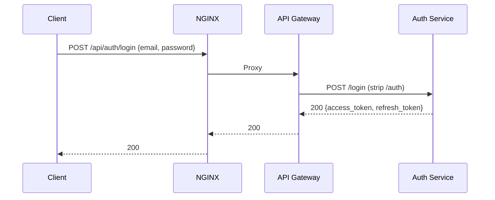
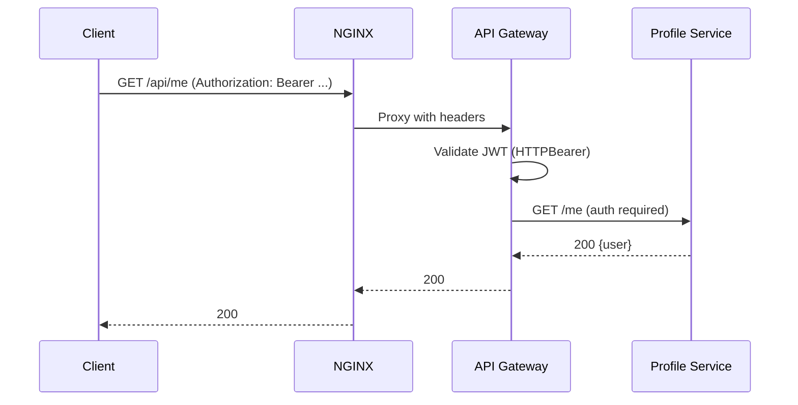
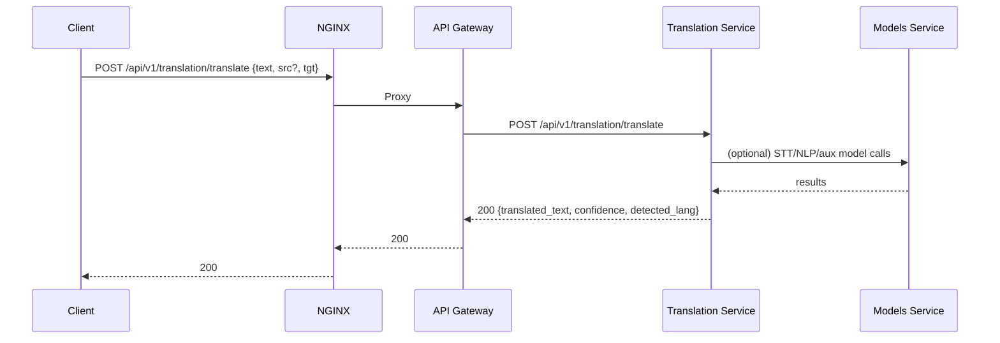
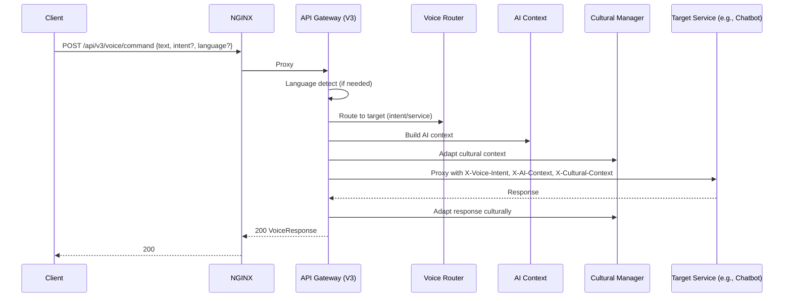

# API Gateway + NGINX Integration: End-to-End Flow

This document explains how NGINX fronts the MantraPath API Gateway and how the gateway routes requests to backend services. It includes the functional responsibilities, request flow diagrams, routing rules, ports, and health/rate-limiting behavior.

Last updated: 2025-09-20

## Overview

- Edge: NGINX reverse proxy (HTTP + WebSocket, rate limits, security headers)
- Core: API Gateway (FastAPI, service registry, routing, auth, rate limiting, circuit breaker, WebSocket proxy, voice/AI/cultural context pipeline)
- Backend: Microservices (auth, profile, mood, chatbot, content, community, notification, ML, media, translation, voice, action-orchestrator, models, ai-context, ai-events, etc.)

High-level flow:

```
Clients (Web, Mobile, Voice) → NGINX → API Gateway → Target Service(s)
                                    ↘           ↘
                                     WebSocket    Cross-service integrations
```

Related docs for deeper dives:
- docs/services/04-api-gateway-analysis.md
- backend/services/api_gateway/README.md and docs/ under the same folder
- docs/services/08-translation-service-analysis.md

## NGINX configuration (entry point)

Primary configs:
- `nginx/mantrapath.conf` (production VM config)
- `backend/nginx/nginx.conf` (container/compose config)

Key behaviors from `nginx/mantrapath.conf`:

- Upstreams
  - `api_gateway`: localhost:8000
  - `frontend`: localhost:3000
  - `websocket`: localhost:8080 (separate WS port if needed)
- Rate limits
  - `limit_req_zone` for `/api/` (10 r/s) and general (30 r/s)
- Routing
  - `/api/` → API Gateway (proxies headers incl. X-Forwarded-*; adds CORS headers; handles OPTIONS)
  - `/api/notifications/ws/` → API Gateway (WebSocket upgrade and long timeouts)
  - `/ws/` → a WS upstream directly (optional, separate path)
  - `/` → frontend app (with long-term caching for assets)
- Docs proxy (note): configured to `/docs`, `/redoc`, `/openapi.json`.
  - Gateway defaults to `/api/v3/docs`, `/api/v3/redoc`, `/api/v3/openapi.json` (see below).
  - If using `/docs` at the edge, ensure the gateway exposes `/docs` or update NGINX to point to `/api/v3/docs`.

Key behaviors from `backend/nginx/nginx.conf` (compose):

- `/api/` → `api-gateway:8000`
- `/api/notifications/ws/` and `/api/assistance/ws/` → API Gateway (WS upgraded)
- `/ws/` → `notification-service:8007` (WS direct)
- `/` → `frontend:${FRONTEND_PORT}`

## API Gateway responsibilities

Gateway app: `backend/services/api_gateway/src/main.py`

- Core middleware: CORS, TrustedHost, GZip
- Custom middleware: Performance, CulturalContext, AIContext, VoiceRouting
- Security: HTTP Bearer (JWT expected by protected routes)
- Service registry: `src/registry/service_registry.py` (tracks services, periodic health checks)
- Routing: `src/routing/router.py` (regex-based path routing to service names)
- Load balancing: `src/routing/load_balancer.py` (strategy from config)
- Proxy: `src/routing/proxy.py` (forwards HTTP; WS proxy endpoints implemented in `main.py`)
- Resilience: RateLimiter, CircuitBreaker
- Voice/AI/Culture features: VoiceCommandRouter, AIContextManager, CulturalContextManager, WebSocketManager

OpenAPI and docs (as configured in `main.py`):
- Swagger UI: `/api/v3/docs`
- ReDoc: `/api/v3/redoc`
- OpenAPI JSON: `/api/v3/openapi.json`

Health endpoints:
- Basic: `/health`, `/api/health`
- Liveness: `/health/live`
- Readiness: `/health/ready`
- Enhanced: `/api/v3/health/enhanced`
- Feature-specific: `/api/v3/health/{voice|ai-context|cultural}`

WebSockets via gateway:
- Real-time voice streaming: `GET ws://<host>/api/v3/voice/stream`
- Proxy to notifications: `GET ws://<host>/api/notifications/ws/{user_id}`

## Service registry and ports

Configured in `src/core/config.py` with env-var defaults. Health path is `/health` unless stated.

- auth: `AUTH_SERVICE_PORT` default 8001
- profile: `PROFILE_SERVICE_PORT` default 8002
- mood: `MOOD_SERVICE_PORT` default 8003
- chatbot: `CHATBOT_SERVICE_PORT` default 8004
- content: `CONTENT_SERVICE_PORT` default 8005
- community: `COMMUNITY_SERVICE_PORT` default 8006
- notification: `NOTIFICATION_SERVICE_PORT` default 8007
- ml: `ML_SERVICE_PORT` default 8008
- media: `MEDIA_SERVICE_PORT` default 8009
- translation: `TRANSLATION_SERVICE_PORT` default 8010
- voice: `VOICE_SERVICE_PORT` default 8011
- action-orchestrator: `ACTION_ORCHESTRATOR_PORT` default 8012
- ai-context: `AI_CONTEXT_STORE_PORT` default 8013
- ai-events: `AI_EVENT_PROCESSOR_PORT` default 8014
- models: `MODELS_SERVICE_INTERNAL_PORT` default 8080

The registry performs periodic health checks to `<service_url>/<health_path>` and maintains status for load balancing and circuit breaking.

## Gateway routing rules (selected)

Defined in `src/routing/router.py` as ordered regex rules. Highlights:

- Auth
  - `^/auth/.*` → auth (strip `/auth`)
  - `^/(register|login|logout|refresh-token|verify-email|resend-verification)/?$` → auth
  - `^/me/?$` → auth (auth required)
- Profile
  - `^/profile/.*` → profile (strip `/profile`)
  - `^/users/.*`, `^/api/profiles/.*`, `^/user/stats/?$` → profile
- Notifications
  - `^/notify/.*` and `^/notifications/.*` → notification
- Action Orchestrator
  - `^/api/v1/(orchestrate.*|workflow/.*|intents.*|cultural-contexts.*)` → action-orchestrator
- Mood and Analytics (also under API v1)
  - `^/(mood/.*|api/v1/mood/.*|api/v1/analytics/.*|api/v1/journal/.*)` → mood
- Chatbot
  - `^/chat/.*` and `^/api/chatbot/.*` → chatbot
  - `^/voice/chatbot/.*` → chatbot (strip `/voice`)
- Content and Journal
  - `^/content/.*` (strip `/content`) and `^/journal/.*` → content
- Community
  - `^/community/.*` (strip `/community`) → community
- ML
  - `^/ml/.*` → ml (strip `/ml`, long timeout)
- Media
  - `^/media/.*` → media (strip `/media`)
- Translation
  - `^/api/v1/translation/.*` → translation (keep full path)
  - `^/translate/languages/?$` → translation (public)
  - `^/translate/.*` → translation (strip `/translate`)
- Voice
  - `^/voice/.*` → voice (strip `/voice`)
- Models (AI models/STT/TTS/NLP)
  - `^/api/v1/models/.*` → models
  - `^/api/v1/(stt|tts|nlp)/.*` → models
- AI integrations
  - `^/ai-events/.*` → ai-events (strip `/ai-events`)
  - `^/ai-context/.*` → ai-context (strip `/ai-context`)

Auth is required for most routes except selected public endpoints (e.g., translation languages, auth endpoints).

## Request flows (end-to-end)

### 1) Auth login (public)

Sequence:


Notes:
- Gateway rule strips `/auth` for `^/auth/.*` and forwards to auth service.
- Rate limiting applies at NGINX and Gateway (per-IP/user depending on config).

### 2) Profile: get current user

Sequence:


### 3) Translation: text → translated

Typical paths: `/api/v1/translation/translate` or `/translate` family.



### 4) Voice command: enhanced pipeline



WebSocket streaming (real-time): `ws /api/v3/voice/stream`

### 5) Notifications WebSocket proxy

```mermaid
sequenceDiagram
  participant C as Client (WS)
  participant N as NGINX
  participant G as API Gateway
  participant NS as Notification Service
  C->>N: WS /api/notifications/ws/{userId}
  N->>G: Proxy (Upgrade, Connection: upgrade)
  G<->>NS: WS ws://notification-service:8007/ws/{userId}
  G<->>C: Bidirectional relay
```

### 6) Models: STT/TTS/NLP

Paths:
- `/api/v1/models/*` (admin/management)
- `/api/v1/stt/*` (speech-to-text)
- `/api/v1/tts/*` (text-to-speech)
- `/api/v1/nlp/*` (NLP tasks)

Gateway routes directly to `models-service:${MODELS_SERVICE_INTERNAL_PORT}`.

## Health, resilience, and performance

- NGINX
  - `/health` returns 200 healthy (edge-only check)
  - `limit_req` for `/api/` and WS paths; compression; security headers

- API Gateway
  - Health endpoints: `/health`, `/health/live`, `/health/ready`, `/api/v3/health/enhanced`
  - ServiceRegistry checks all services periodically (interval = `GATEWAY_HEALTH_CHECK_INTERVAL`, default 30s)
  - RateLimiter: per-user/IP (configurable), headers exposed for rate-limit metadata
  - CircuitBreaker: failure thresholds + recovery timeout
  - PerformanceMiddleware + PerformanceMonitor metrics

## Endpoints quick map

Edge to gateway:
- `/api/*` → API Gateway
- `/api/notifications/ws/*` → API Gateway (WS)
- `/` → Frontend
- Docs mismatch note:
  - Gateway docs live under `/api/v3/docs|redoc|openapi.json`.
  - If NGINX proxies `/docs`/`/redoc`/`/openapi.json`, either expose those paths in the gateway or update NGINX to `/api/v3/...`.

Gateway to services (examples):
- `/auth/*` → auth (prefix stripped)
- `/me`, `/users/*`, `/api/profiles/*` → profile
- `/notify/*`, `/notifications/*` → notification
- `/chat/*`, `/api/chatbot/*`, `/voice/chatbot/*` → chatbot
- `/content/*`, `/journal/*` → content
- `/community/*` → community
- `/mood/*`, `/api/v1/mood/*`, `/api/v1/analytics/*`, `/api/v1/journal/*` → mood
- `/ml/*` → ml (prefix stripped)
- `/media/*` → media (prefix stripped)
- `/api/v1/translation/*`, `/translate/*` → translation
- `/voice/*` → voice (prefix stripped)
- `/api/v1/{models,stt,tts,nlp}/*` → models
- `/ai-events/*` → ai-events (prefix stripped)
- `/ai-context/*` → ai-context (prefix stripped)

## Functional responsibilities by layer

- NGINX
  - TLS termination (when enabled), HTTP/WS proxy, rate limits, security headers, static/SPA routing

- API Gateway
  - AuthN/AuthZ enforcement (for protected routes)
  - Routing and load balancing
  - Circuit breaker, retries, timeouts per route
  - Cross-cutting: language detection, AI context, cultural adaptation
  - WebSocket proxying/management
  - Health, metrics, logging

- Services
  - Implement domain APIs and `/health`
  - Optional cross-service calls (e.g., translation → models)

## Configuration reference

Selected envs (see `src/core/config.py` and docker-compose for full list):

- Gateway
  - `GATEWAY_PORT` (default 8000), `GATEWAY_ENVIRONMENT`, `GATEWAY_DEBUG`
  - Feature toggles: `VOICE_ROUTING_ENABLED`, `AI_CONTEXT_ENABLED`, `CULTURAL_ADAPTATION_ENABLED`
  - Redis: `REDIS_URL`
  - Strategy: `GATEWAY_LOAD_BALANCING_STRATEGY`

- Services URLs (consumed by gateway)
  - `SERVICE_*_URL` for each service (e.g., `SERVICE_TRANSLATION_SERVICE_URL`)
  - Defaults point to service names and the ports above within the compose network

## Troubleshooting notes

- If Swagger UI at `/docs` returns 404, use `/api/v3/docs` or update NGINX to proxy `/docs` → `/api/v3/docs` on the gateway.
- 429 Too Many Requests can be caused by NGINX rate-limit or gateway rate limit; check both.
- 503/504 usually indicate target service unhealthy (see `/health/ready` on gateway and service health endpoints).
- WebSocket issues: confirm `Upgrade` and `Connection` headers pass through NGINX; verify `proxy_read_timeout` is long enough.

## Appendix: Compose ports (non-exhaustive)

From `backend/docker-compose*.yml`:

- API Gateway: `${API_GATEWAY_PORT}:8000` (HTTP), `${API_GATEWAY_WEBSOCKET_PORT}:8080` (WS), `${API_GATEWAY_METRICS_PORT}:9090`
- Translation: `${TRANSLATION_SERVICE_PORT}:${TRANSLATION_SERVICE_PORT}` (default 8010)
- Models: `${MODELS_SERVICE_EXTERNAL_PORT}:${MODELS_SERVICE_INTERNAL_PORT}` (default 8081→8080)
- Voice: `${VOICE_SERVICE_PORT}:${VOICE_SERVICE_PORT}` (default 8011)
- Notification: `${NOTIFICATION_SERVICE_PORT}:${NOTIFICATION_SERVICE_PORT}` (default 8007)
- Others similarly mapped per service

---

This doc reflects the current code and configs. For additions, update routing rules in `src/routing/router.py`, service URLs in `src/core/config.py`, and NGINX locations in `nginx/mantrapath.conf` (or `backend/nginx/nginx.conf`).
